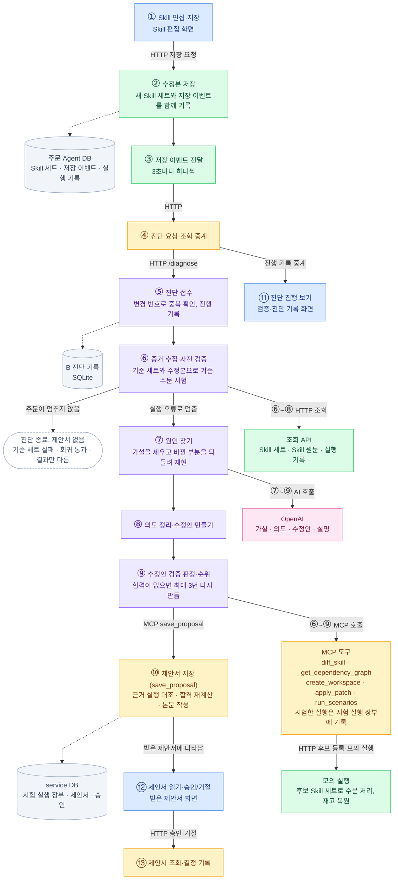

# SkillOps Agent — Capstone 4조

업무 담당자가 SKILL.md 를 고쳐 깨진 에이전트 서비스를, 실행 증거로 진단하고 **검증된 수정안**을 제안하는 에이전트.
설계도: `docs/skillops-design.md` · 계약: `docs/contracts/` · **역할별 작업 가이드: `docs/roles/`** (각자 자기 파일 하나만 읽으면 된다)

## 전체 흐름

담당자가 Skill을 고쳐 저장하면, 주문 Agent가 저장 이벤트를 service로 넘기고, B 진단 Agent가 원인을 찾아 수정안을 검증한 뒤 제안서를 저장합니다. 운영자는 받은 제안서 화면에서 후보를 골라 승인하거나 거절합니다. 노드 색은 실행 단위입니다: 파랑은 화면(`frontend/`), 초록은 주문 Agent(`order-agent/`), 노랑은 SkillOps service(`service/`), 보라는 B 진단 Agent(`skillops-agent/`), 분홍은 OpenAI, 회색은 저장소입니다. 단계별 설명과 코드 위치는 `docs/architecture/skill-change-to-proposal.md`에 있습니다.



## 구성

| 폴더 | 역할 | 스택 | 포트 |
|---|---|---|---|
| `service/` | 주문 처리 서비스 + Spring AI harness + MCP Server (A · C-1 · C-2 · D) | Java 21 · Spring Boot 4.1.0 · Spring AI 2.0.0 · Gradle 9.7.1 | 8080 (`/api`, `/mcp`) |
| `skillops-agent/` | SkillOps Agent (B) | Python 3.11 · uv · Anthropic SDK · mcp · FastAPI | 8000 |
| `frontend/` | 편집기 · 트레이스 · 수정안 화면 (A) | Vue 3.5 · Vite 8 · Pinia · Vue Router | 5173 |
| `skills/` | live SKILL.md 6개 (D) | — | — |
| `scenarios/` | 골든 g-01~06 · 장애 F1~F3 (D) | — | — |
| `docker-compose.yml` | PostgreSQL 17 | Docker Compose | 5432 |

## 처음 한 번

```bash
cp .env.example .env            # OPENAI_API_KEY 채우기 (없어도 빌드·부팅·MCP ping 은 된다)
docker compose up -d --wait     # postgres 17
```

## 기동

```bash
# 1) service
cd service && ./gradlew bootRun
#    확인: curl localhost:8080/api/health  → {"status":"ok",...}
#    Swagger: http://localhost:8080/swagger-ui.html

# 2) skillops-agent
cd skillops-agent && uv sync && uv run uvicorn skillops_agent.main:app --reload --port 8000
#    MCP 배선 확인(service 가 떠 있을 때): uv run scripts/mcp_smoke.py

# 3) frontend
cd order-agent && docker compose up --build -d --wait   # 주문 Agent(:8081) — 운영 화면의 데이터 원천
cd frontend && npm install && npm run dev    # http://localhost:5173 · /api → order-agent 8081, /service → service 8080(로그인·승인)
#    서버 없이 화면만: npm run dev:mock    (order-agent 와 같은 형식의 메모리 mock: 정상·결함·수정본, 개선안 예시)
#    패키지를 바꾼 뒤 화면이 멈추면: npm run dev:mock -- --force
```

## 로그인 · 승인 (service)

운영 화면 로그인과 수정안 승인만 service(8080)가 JWT(HS256, 2시간)로 보호한다. **그 밖의 API 와 MCP(`/mcp`)는 지금처럼 인증 없이 열려 있다.**

| 로컬 데모 계정 | 비밀번호 | 역할 | 할 수 있는 것 |
|---|---|---|---|
| `owner` | `owner1234` | OWNER · 업무 담당자 | 화면 조회, Skill 초안 |
| `operator` | `operator1234` | OPERATOR · 운영자 | 위 + 수정안 승인·거절 |

| API | 인증 | 설명 |
|---|---|---|
| `POST /api/auth/login` | 없음 | `{username, password}` → `{access_token, token_type, expires_in, user}` |
| `GET /api/auth/me` | 로그인 | 토큰의 사용자 |
| `GET /api/proposals` · `GET /api/proposals/{id}` | 로그인 | 저장된 제안서 목록, 본문(`document`)·제안서·결정까지 담은 상세 |
| `POST /api/proposals/{id}/approve` | OPERATOR | `{candidate_no, intent_confirmed}` → 승인 기록과 `approval_token`. 합격 후보만, 의도 확인이 있어야 하며, 같은 제안서는 한 번만 결정한다 |
| `POST /api/proposals/{id}/reject` | OPERATOR | 거절 기록. 쓸 수 있는 안이 없는 제안서를 닫을 때도 쓴다 |
| `GET /api/approvals` | 로그인 | 승인 기록(최근 50건) |
| 그 밖의 `/api/**`, `/mcp`, Swagger | 없음 | 다른 담당자의 API·MCP 는 인증 때문에 막히지 않는다 |

- 승인·거절은 저장된 제안서(`proposals`)의 상태를 바꾸고 `approvals` 테이블(계약 5 저장 공간, 담당 A)에 승인자·후보 번호·의도 확인·`approval_token` 을 남긴다. skillops-agent 로는 보내지 않는다. `used_at` 은 운영 반영(promote_workspace, 아직 없음)이 채운다.
- `@WebMvcTest` 에도 같은 보안 규칙이 자동 적용된다(`service/src/test/resources/META-INF/spring/…AutoConfigureWebMvc.imports`). 새 API 에 로그인이 필요하면 `auth/SecurityConfig` 에 한 줄 추가한다.
- 키·비밀번호 해시·서비스 토큰은 `.env.example` 참고. `SKILLOPS_JWT_SECRET` 을 비우면 기동마다 임시 키를 만든다(재시작하면 다시 로그인).

## 검증

```bash
cd service && ./gradlew build            # 컴파일 + 테스트
cd skillops-agent && uv run pytest && uv run ruff check .
cd frontend && npm run lint && npm run build
```

## 필요한 로컬 도구 (팀 공통)

Temurin JDK 21 · Node ≥ 22.18 (npm) · Python 3.11 + uv · Docker Desktop. Gradle 은 wrapper 가 받는다.
