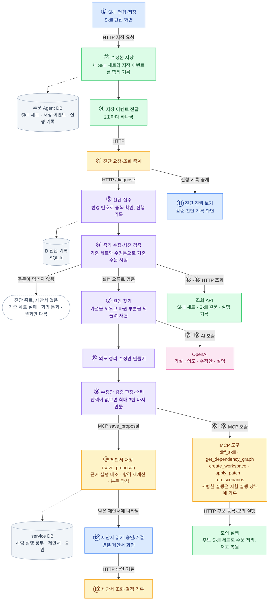

# Skill 변경에서 제안서까지: 상위 흐름

기준: `feat/#60_skillops-pipeline-integration` (`ec1539b`), 2026-10-21. 지금 실제로 동작하는 흐름만 그렸습니다. 노드는 흐름의 단계이고, 노드 색은 그 단계를 실행하는 프로그램·컨테이너입니다.

## 실행 단위와 색

| 색 | 실행 단위 | 무엇인가 | 기본 주소 |
|---|---|---|---|
| 파랑 | 화면 | `frontend/` Vue 개발 서버 | 5173 |
| 초록 | 주문 Agent | `order-agent/` backend 컨테이너 | 8081 |
| 노랑 | SkillOps service | `service/` Spring Boot (REST와 MCP `/mcp`) | 8080 |
| 보라 | B 진단 Agent | `skillops-agent/` FastAPI + LangGraph | 8000 |
| 분홍 | OpenAI | 외부 AI 모델 | — |
| 회색 | 저장소 | 주문 Agent DB(PostgreSQL), service DB(PostgreSQL), B 진단 기록(SQLite) | — |

## 흐름도

실선은 호출과 데이터가 넘어가는 방향이고, 점선은 저장소에 기록하는 관계입니다. 가운데 세로줄은 ①에서 ⑬까지 이어지는 주 흐름입니다. 왼쪽에는 저장소와 진단 종료를 두고, 오른쪽에는 B가 부르는 도구와 진행 화면을 두었습니다. 모든 선이 바로 다음 줄의 노드로만 이어지므로, 주 흐름은 곧은 세로선이 되고 옆으로 가는 선은 라벨에서 한 번만 꺾입니다. 그래서 B의 여러 단계가 함께 쓰는 도구(MCP 도구, OpenAI, 조회 API)는 선 하나로 묶고, 그 도구를 쓰는 단계 번호를 라벨에 적었습니다(예: ⑥~⑨ MCP 호출). 저장소도 대표 기록 하나만 선으로 잇고, 나머지 기록 위치는 아래 표에 적었습니다.

## 단계별 설명

| 단계 | 실행 단위 | 하는 일 | 코드 |
|---|---|---|---|
| ① | 화면 | 담당자가 기준 세트를 고르고 SKILL.md를 고쳐 저장합니다. | `frontend/src/views/SkillDraftView.vue`, `api/orderAgent.js` `saveSkillEdits` |
| ② | 주문 Agent | 수정본을 새 Skill 세트로 저장하고, 같은 트랜잭션에 저장 이벤트를 남깁니다. | `controller/EvidenceController.java` `POST /api/snapshots/edits`, `workspace/SnapshotService.java` |
| ③ | 주문 Agent | 아직 전달하지 않은 저장 이벤트를 3초마다 하나씩 service로 보냅니다. 실패하면 다시 보냅니다. | `workspace/SkillChangeDispatcher.java` |
| ④ | service | 저장 이벤트를 B로 넘기고, 화면의 진단 기록 조회를 B로 중계합니다. | `diagnosis/DiagnosisController.java` `POST /internal/skill-changes`, `GET /api/diagnoses` |
| ⑤ | B | 진단을 접수하고 진행 상황을 SQLite에 남깁니다. 같은 변경 번호는 한 번만 받습니다. | `skillops_agent/main.py` `/diagnose`, `run_store.py` |
| ⑥ | B | 두 Skill 세트와 바뀐 부분을 읽고, 기준 세트와 수정본으로 기준 주문을 시험합니다. 주문이 멈추지 않으면 여기서 끝납니다. | `nodes.py` `fetch_evidence` |
| ⑦ | B | AI가 원인 가설을 세우면, 바뀐 부분을 되돌린 연습 공간에서 실패한 주문을 다시 돌려 원인을 확정합니다. | `nodes.py` `hypothesize`, `ablate`, `check_ablation` |
| ⑧ | B | AI가 담당자의 의도와 확인 조건을 정리하고 수정안을 만듭니다. 읽을 수 없는 조건은 버립니다. | `nodes.py` `extract_intent`, `generate_candidates` |
| ⑨ | B | 수정안마다 연습 공간에 적용해 기준 주문, 실패 재현, 의도 조건을 시험하고 순위를 매깁니다. | `nodes.py` `verify_candidates`, `check_valid`, `rank_and_explain` |
| MCP 도구 | service | 바뀐 부분 비교, 의존 관계, 연습 공간, 수정 적용, 시험 주문을 맡습니다. 시험한 실행은 장부에 남깁니다. | `mcp/SkillDiffTools.java`, `DependencyGraphTools.java`, `WorkspaceTools.java`, `scenario/HarnessFlowRunner.java`, `JpaRunLedger.java` |
| 모의 실행 | 주문 Agent | 후보 Skill 세트로 주문을 처리하고 실행 기록을 남깁니다. 재고는 끝난 뒤 되돌립니다. | `POST /api/snapshots/candidates`, `controller/DryRunController.java` `POST /api/dry-runs` |
| ⑩ | service | 근거 실행이 장부에 있는지 확인하고, 합격 후보를 다시 계산한 뒤, 본문을 만들어 제안서를 저장합니다. | `mcp/ProposalTools.java`, `proposal/ProposalService.java`, `ProposalDocumentWriter.java` |
| ⑪ | 화면 | 진단 진행 로그와 결과를 보여 주고, 제안서가 있으면 링크를 띄웁니다. | `frontend/src/views/DiagnosisView.vue` |
| ⑫ | 화면 | 제안서 본문을 목차대로 보여 주고, 운영자가 후보를 골라 승인하거나 거절합니다. | `views/ProposalListView.vue`, `ProposalView.vue`, `components/ProposalDocument.vue` |
| ⑬ | service | 제안서 목록·본문을 내주고, 결정을 제안서와 승인 기록에 남깁니다. | `api/ProposalController.java`, `ApprovalController.java`, `approval/ApprovalService.java` |

## 제안서가 생기지 않고 끝나는 경우

- ⑥에서 기준 세트로 돌린 주문도 실패하면 `기준 주문 검증 불가`로 끝납니다.
- ⑥에서 수정본으로도 주문이 모두 통과하면 `기본 회귀 검증 통과`로 끝납니다.
- ⑥에서 오류 없이 결과만 기대와 다르면 `기대 결과 불일치`로 끝납니다.
- 어느 단계에서든 통신·AI·검증 오류가 나면 `오류`로 끝납니다.

⑦에서 원인을 확정하지 못하거나 ⑨에서 합격한 수정안이 없어도 제안서는 저장됩니다. 이때 상태는 `쓸 수 있는 안 없음`입니다.
