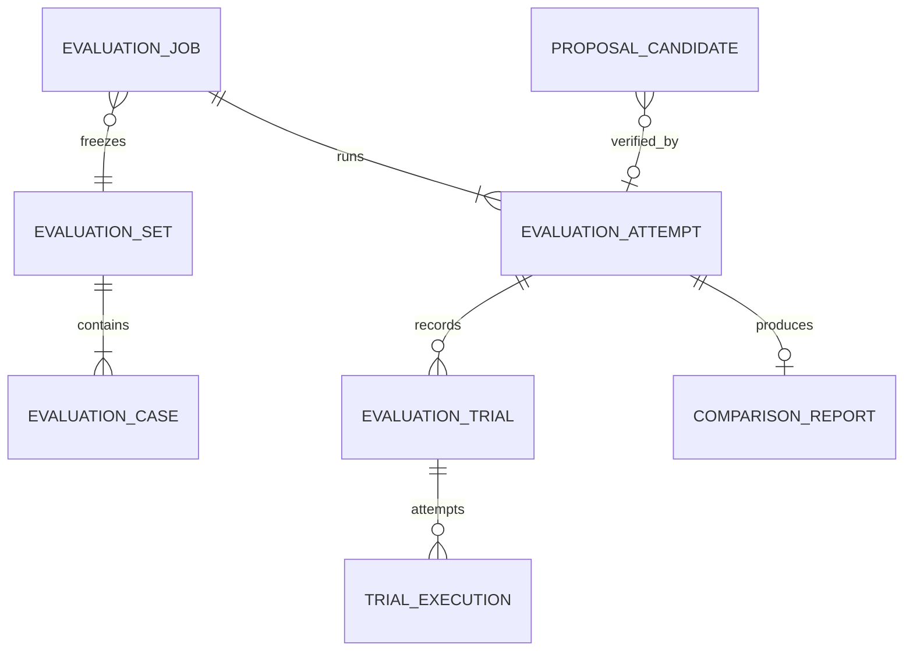

# #88 Skill 변경 전후 평가·비교 백엔드 계약 설계

작성: 2026-10-26 · 설계 버전: draft 0.1 · 기준 코드: `653fcac`

상태는 **백엔드 설계 초안, 담당자 합의 전**이다. 아래 API·MCP·테이블은 제안이며 현재 서버에 구현되거나 배포된 명세가 아니다. 현행 [MCP 계약](contracts/mcp-tools-input-output.md), `apply_patch` v1.3, REST 계약을 대체하지 않는다.

2026-10-26 구현 갱신: 이 초안을 바탕으로 AI 코드를 제외한 백엔드 fixed 기능 검증 경로를 구현했다. 실제 지원 범위·이름·제약·새 계약은 [평가 계약 v1.0](contracts/evaluation-backend.md)을 우선한다. 실모델·신규 Skill 호출 품질 승인·안전성 측정은 지원 완료로 표시하지 않는다.

근거: [#88](https://github.com/SKALA-2026-10-team4/ai-agent-capstone/issues/88), `SKILLOPS_기획안.pdf` v0.1의 실제 실행·전후 비교·근거 있는 승인 요청, [현재 코드 검토와 재현 결과](reports/2026-10-26-backend-contract-review.md).

## 1. 목표와 담당 범위

동일한 입력 조건에서 기준본과 후보본을 실행하고, 서버가 보관한 결과로 개선·회귀를 판단한다. 실행 ID의 존재 확인만으로 제출자가 주장한 성공을 인정하지 않는다.

- 백엔드: 입력 고정, 평가 작업 접수·상태·저장, 러너 연결, 결과 집계, 근거 검증, 조회·오류 계약.
- AI 담당자와 합의: 기대 Skill 라벨, 업무 성공·의도 조건, 모델·프롬프트 식별, 선택 결과 추출, 분석 입력.
- 이번 설계 제외: 프롬프트 개선, LLM 원인 분석·자동 수정 생성 구현, 자동 patch 적용, 운영 반영·배포, 기존 코드 수정.
- 사람의 의도 최종 확인은 기존 승인 API의 역할이다. 자동 평가의 의도 조건 통과와 사람이 확인했다는 사실을 합치지 않는다.

## 2. 기존 구현 재사용과 분리

| 기존 구성 | 재사용할 부분 | 추가 설계가 필요한 부분 |
|---|---|---|
| `WorkspaceService` | snapshot 기반 복사, patch·정적 검사 | 평가 시작 시 파일·검사 결과를 불변 revision으로 고정 |
| `ScenarioRunner`, `ScenarioGrader` | 시나리오 계획·기대 조건 채점 | 작업 단위 반복 실행, 결과별 영속화, 구조화된 실패 사유 |
| `HarnessFlowRunner`, `OrderAgentRunClient` | 후보 snapshot 발행·dry-run·trace 조회 | 고정 snapshot 실행 어댑터, 실행 중단·재시도 안전성 |
| `OrderAgentTraceConverter`, `RunOutcome` | 업무 단계 입출력·최종 상태 변환 | 현재 버리는 선택 이벤트·사용량·시간을 별도 관측 결과로 보존 |
| `scenario_runs`, `JpaRunLedger` | 실제 실행 ID와 workspace 이력 | 사례·회차·역할·revision·판정·실패 사유의 관계 |
| 주문 Agent snapshot·trace 저장소 | 원문·파일 해시·실제 실행 이벤트 | 평가 결과에서 출처·해시 참조, 보존 기간 연계 |
| Python `RunStore`·기존 graph | 진단 접수·진행·설명 기록 | 평가 작업 저장소와 별도 유지. `thread_id`는 선택적 연결 |
| `trigger_graph`, `trigger_metrics` | description 선택 실험·분석 결과 | 별도 평가 유형으로 연결. 집계는 서버 원자료 기준으로 검증 |
| `qa/check`, `qa/eval` | 정답표 및 SkillOps 진단 검증 | 대상 Agent 평가와 구분하여 회귀 검증에 사용 |
| 제안서·승인 저장 | 제안 조회·사람의 결정·동시 결정 방어 | 서버 평가 근거를 연결하는 새 저장 계약 |

기존 `run_scenarios`를 장시간 평가용 비동기 도구로 바꾸지 않는다. 새 Application Service가 공통 실행·채점 기능을 재사용하고 REST/MCP 어댑터가 같은 메서드를 호출한다. 평가 저장소는 service PostgreSQL에 두고 Python SQLite를 중복 장부로 사용하지 않는다.

## 3. 평가 종류와 비교 가능 조건

입력의 `runner_kind`와 `model_mode`를 각각 기록하고 서버의 실제 실행 설정과 대조한다.

| runner_kind | model_mode | 확인할 수 있는 내용 |
|---|---|---|
| `CONTRACT_ONLY` | `NONE` | 정적 계약·고정 모의 결과. 실제 모델·업무 실행 증거로 승인 불가 |
| `ORDER_HARNESS` | `FIXED` | 실제 주문 harness와 규칙 기반 동작·회귀. description 호출 품질 개선의 증거는 아님 |
| `ORDER_HARNESS` | `OPENAI` | 실제 주문 Agent의 선택·업무·도구 실행과 사용량 |
| `DESCRIPTION_SELECTOR` | `OPENAI` | 별도 선택 LLM의 name/description 반응. 주문 업무 성공을 입증하지 않음 |

서로 다른 runner·모델·평가셋·판정 기준·단계 관측 단위를 섞어 개선율을 만들지 않는다. 주문 Agent의 entry Skill 선택과 flow 내부 단계 실행은 별개다. 실제 선택 이벤트가 없으면 단순히 실행된 단계를 선택으로 추정하지 않는다.

비교에는 snapshot 두 개, 평가셋 버전·해시, 모델 설정, 반복 수·회차 대응, 판정기·정책 버전, 환경 fixture 버전이 같아야 한다. snapshot 내용과 평가 목적상 선언된 기대 동작 차이만 허용한다. seed를 지원하지 않는 공급자는 `seed=null`과 지원 여부를 기록하며 동일 응답 재현을 보장한다고 표시하지 않는다.

## 4. 고정 입력과 평가셋

접수 후에는 입력을 수정하지 않는다. workspace ID는 출처일 뿐 실행 대상을 뜻하지 않는다. 작업자가 최신 workspace를 매번 다시 읽는 방식은 사용하지 않는다.

1. 후보를 workspace에서 만들었다면 revision·파일 manifest와 원본 바이트의 해시를 일관된 읽기 시점으로 확보한다. 고정할 수 없거나 중간 변경이 감지되면 접수를 거부한다.
2. 기존 snapshot 발행 경로를 재사용해 불변 후보 snapshot을 얻고 그 ID·bundle hash를 기록한다. 이미 발행된 snapshot 요청도 해시를 검증한다.
3. 평가셋은 cases의 ID·입력·기대 라벨·조건·분류·정렬 순서를 포함한 불변 payload로 등록한다. SHA-256 대상 바이트와 원본을 함께 보관하고, 구현 시 canonical JSON 규칙을 fixture로 고정한다.
4. 서버가 모델 설정과 프롬프트·판정기 버전, 각 역할의 필수 suite를 해석해 실행 계획을 만든다. 생산자가 유리한 사례만 고르거나 필수 회귀 세트를 생략할 수 없다.
5. 평가 시 사용하는 재고·정책 등 외부 상태는 격리 fixture로 고정한다. dry-run 뒤 재고 복원만으로 동일 환경을 보장하지 않으며, 운영 재고와 동시에 실행하지 않는다.

평가셋 등록 필드: `schema_version`, `name`, `cases`, `label_review_status`, `label_source`, `reviewer_ref`, `generator_version`. 서버 응답은 `evaluation_set_id`, `version`, `sha256`이며 새 내용은 새 버전이다. 승인 근거용 라벨은 `REVIEWED`가 필수다. 실제 검토 권한·상태 변경은 서버가 관리하고 생산자의 문자열만으로 승인하지 않는다.

case 필드: `case_id`, `suite`(`REGRESSION`/`REPRODUCTION`/`INTENT`/`NEW_SKILL`), `input`, `selection_expectation`, `task_expectation`, `intent_checks`. 기대 선택은 `EXACT` 또는 `FORBID`, Skill 목록과 `ENTRY`/`STEP` 관측 단위를 가진다. EXACT의 `none`은 관측된 미선택을 뜻한다. FORBID는 금지 대상을 피했는지만 판단하며 전체 업무 성공을 뜻하지 않는다. 등록되지 않은 Skill 문자열은 두 방식 모두 실패다.

현재 `TriggerCase.expected_skill/should_trigger`는 이 기대 선택으로 변환할 어댑터가 필요하다. 원본 라벨도 보존한다. LLM이 생성한 질의와 라벨은 검토 전 탐색용이며 승인 근거로 사용하지 않는다. RAG·프롬프트에 노출된 학습·진단 사례와 독립 평가셋을 구분하고, 제외 ID·평가셋 해시를 실행 설정에 기록한다.

## 5. 식별자·저장 관계

새 내부 ID는 UUID를 사용한다. 기존 주문 `run_id=r_...`, `execution_id`, snapshot UUID, workspace·proposal·thread ID 형식은 바꾸지 않고 참조한다.



| 저장 단위 | 주요 필드와 불변 조건 |
|---|---|
| `evaluation_jobs` | `evaluation_id`, `purpose`, 기준·후보 snapshot/hash, 평가셋 ID/version/hash, runner/model 설정, repeat, 정책·판정기 버전, 예산, input fingerprint, idempotency key, 생성자·시각 |
| `evaluation_attempts` | `attempt_id`, evaluation_id, 부모 attempt_id, 상태·진행 수·종료 사유, worker lease·fencing token, 시작·종료 시각. 재실행은 새 attempt |
| `evaluation_trials` | `trial_id`, attempt_id, `BASELINE/CANDIDATE`, case_id, repeat_index, 역할, 실행 상태·판정, 실패 코드·조건별 결과, 선택 원문/해석값, 업무 결과, trace/hash, 시간·토큰·비용·관측 상태 |
| `trial_executions` | trial_id별 실행 시도 번호, 실제 run_id/execution_id, 요청 fingerprint, 호출·응답 시각, 오류, 사용량. 실패한 재시도도 보존 |
| `comparison_reports` | attempt_id 유일, schema/policy/grader version, paired coverage, 각 지표의 분자·분모·값·상태, 회귀 case ID, 판정·이유, evidence 참조, report hash |
| `proposal_evaluation_links` | proposal/candidate_no, 검증 attempt_id, 후보 snapshot/hash, 원인 분석 attempt 참조, 서버가 산출한 합격 결과 |

계획된 trial은 `(attempt_id, arm, case_id, repeat_index)`로 유일하다. 같은 실행을 다른 trial의 증거로 중복 귀속시키지 않는다. 여러 실제 요청 재시도는 trial 하위에 남기고 비용에는 모두 합산하되 업무 점수 표본을 늘리는 데 사용하지 않는다.

`purpose`는 `CHANGE_COMPARISON`, `CAUSE_ANALYSIS`, `CANDIDATE_VERIFICATION`이다. 원인 분석과 후보 검증 결과를 같은 합격 분모로 합치지 않는다. trial 판정은 서버가 고정 입력과 trace로 산출한다. 클라이언트가 `passed`, `valid`, 토큰 수를 제출해서 확정할 수 없다.

## 6. 작업 상태·재시작·취소

`QUEUED → RUNNING → SUCCEEDED | BLOCKED | FAILED | STOPPED | CANCELLED | INTERRUPTED`

- `SUCCEEDED`: 필요한 평가·집계가 완료됐다는 작업 상태다. 후보 합격을 뜻하지 않는다. 결과 판정 `PASS/FAIL/INCONCLUSIVE`는 별도 필드다.
- `BLOCKED`: 실행 전 문서·입력·러너 기능 문제가 확인되어 실행하지 않았다. 차단 사유와 원문 증거를 보존한다.
- `FAILED`: 저장·외부 호출 등 시스템 실패. 정상 실행 결과가 업무상 실패인 것은 trial의 FAIL이며 작업 전체 FAILED와 구분한다.
- `STOPPED`: 시간·토큰·비용 한도 초과. 부분 결과는 남기고 비교 판정은 INCONCLUSIVE다.
- `CANCEL_REQUESTED`는 RUNNING에서 거치는 중간 상태다. 새 실행을 막고 진행 중 실행의 종료·중단 여부를 확인한 뒤 CANCELLED로 전환한다.
- `INTERRUPTED`: 작업자 소실 후 외부 실행의 완료 여부를 안전하게 확정하지 못했다. 자동 성공·재호출하지 않는다.

접수 트랜잭션에서 job·첫 attempt·실행 계획을 저장하고 202를 반환한다. service의 DB 기반 작업자가 lease를 얻어 처리한다. 단순 프로세스 메모리 BackgroundTasks나 MemorySaver를 작업 보존 수단으로 사용하지 않는다.

worker lease 갱신·만료와 fencing token으로 중복 작업자의 상태 덮어쓰기를 막는다. 다만 이것만으로 외부 주문 중복 실행이 방지되지는 않는다. 주문 Agent가 요청 키로 실행 ID를 멱등 조회하는 기능이 없으면, 요청 전달 후 응답을 잃은 실행은 INTERRUPTED로 남기고 자동 재전송하지 않는다. 해당 상위 API의 확장은 담당자 협의가 필요하다.

재실행은 동일 고정 입력의 새 attempt와 부모 참조를 만든다. 기준·후보를 함께 다시 평가하고 서로 다른 attempt의 표본을 합치지 않는다. 자동으로 새 attempt를 생성하지 않으며 기존 결과는 불변이다. 재시작 후 아직 전송하지 않은 QUEUED 작업은 이어갈 수 있지만, 외부 실행 여부가 모호한 작업은 먼저 조회·대조한다.

## 7. LLM 오류 재시도와 예산

서버 정책으로 repeat 1~5(기존 범위 재사용), 최대 case 수·동시 실행 수·총 실행 시간·총 토큰·총 비용·개별 요청 timeout·재시도 상한을 제한한다. 실제 수치·허용 모델·가격표 버전은 운영 설정으로 필수 지정하고, 미지정·미지원 한도로 승인용 실모델 평가를 시작하지 않는다. 클라이언트 요청은 서버 한도를 낮출 수만 있다.

- timeout·연결 오류·429·5xx는 실행 효과가 없거나 동일 요청의 멱등성이 보장된 경우에만 재시도한다. 인증·잘못된 형식·미등록 Skill·업무 FAIL은 시스템 오류 재시도로 점수를 바꾸지 않는다.
- SDK 재시도와 애플리케이션 재시도는 총 시도 수·비용을 함께 계산한다. provider가 실제 사용량을 주지 않은 실패 시도는 0으로 계산하지 않는다.
- 각 호출 전 입력 토큰·최대 출력 토큰 기반의 보수적 예산을 원자적으로 예약하고, 응답 후 관측 사용량으로 정산한다. 두 arm과 모든 재시도가 동일 작업 예산을 공유한다.
- 상위 주문 Agent 내부의 모델 호출에도 남은 토큰·비용·deadline을 전달하고 강제할 수 있어야 전체 예산을 보장한다. 사후 trace 조회만으로는 이미 쓴 비용을 막을 수 없다.
- 현재 dry-run API가 이 제어를 지원하는지는 별도 구현·검증이 필요하다. 미지원이면 `BUDGET_ENFORCEMENT_UNSUPPORTED`로 승인용 실모델 작업을 차단한다. 탐색용 사후 측정 모드를 허용할 경우 `OBSERVED_ONLY`로 표시하고 엄격한 예산 보장으로 안내하지 않는다.
- 취소·timeout 후 늦은 응답도 감사·사용량에는 기록한다. 다음 도구 실행을 차단할 상위 제어 기능과 상태 확인 없이는 즉시 중단됐다고 표시하지 않는다.

토큰·비용 한도는 동일 evaluation_id의 모든 attempt에 누적 적용한다. 재실행으로 예산을 초기화하지 않는다. wall_time_ms는 각 attempt의 실행 시작부터 적용하며 큐 대기·전체 보관 기한은 별도 서버 정책이다. 서버 정책에 최대 attempt 수도 둔다. 사용량이 불명확한 요청은 보수적으로 예약액을 유지하고 남은 예산이 부족하면 재실행 접수를 거부한다. 새 예산이 필요한 평가는 새 접수로 명시적으로 시작하고 이전 평가 참조를 남긴다.

## 8. 사례 판정과 지표

실행 상태(`NOT_RUN/RUNNING/COMPLETED/EXECUTION_UNKNOWN`)와 판정(`PASS/FAIL/NOT_APPLICABLE/UNMEASURABLE`)을 분리한다. 오류 코드는 최소 `DOCUMENT_INVALID`, `INVALID_SELECTION`, `TASK_FAILED`, `MODEL_ERROR`, `UPSTREAM_ERROR`, `TIMEOUT`, `BUDGET_EXCEEDED`, `TRACE_MISSING`을 구분한다. 원인 문자열·원문 trace는 보존한다.

- 관측된 `none`은 실제 미선택이다. 이벤트·trace 부재는 `null + UNMEASURABLE`이며 none으로 치환하지 않는다.
- 업무 성공은 고정된 task expectation으로 채점한다. 실행이 FAILED가 아니었다는 사실만으로 새 평가의 업무 성공을 선언하지 않는다. 기존 replay 채점 정책을 재사용하면 그 정책 버전과 한계를 표시한다.
- 정적 문서·연결·flow 검사와 실제 업무·선택·의도 검사를 각각 기록한다. LLM 심사를 쓰는 조건도 심사기 버전·입력·점수·근거를 보관하고 객관적 실행 사실과 분리한다.
- `keeps_intent`를 빈 실행 목록의 `all=true`로 만들지 않는다. 의도 조건이 없으면 NOT_APPLICABLE로 기록하고 승인 시 사람의 확인은 계속 요구한다.

| 지표 | 계산·집계 규칙 |
|---|---|
| 업무 성공률 | 측정 가능한 완료 trial의 업무 PASS 수 / 업무 판정 가능한 완료 trial 수. `planned/completed/measured/failed/unknown` 수를 함께 제공 |
| 대상 Skill recall | 해당 Skill이 요구된 선택 기회 중 실제 선택한 TP / 요구된 기회 수(TP+FN). 미등록 선택은 정답이 아니며 양성에서는 FN |
| 대상 Skill precision | 실제 대상 Skill 선택 중 올바른 TP / 실제 대상 Skill 선택 수(TP+FP). 한 번도 선택하지 않으면 null |
| 선택 정확도 | 유효한 선택으로 고정 기대를 만족한 수 / 관측된 선택 판정 수. 미등록 Skill은 FAIL. FORBID 통과는 전체 업무 성공과 별개 |
| 회귀 건수 | 같은 case·회차·판정 기준의 baseline PASS → candidate FAIL 쌍 수 및 case ID의 중복 제거 수를 함께 제공 |
| 반복 편차 | 회차별 성공률·recall 등 값과 표본분산(n−1 분모), 최소·최대. 유효 회차 2개 미만이면 분산 null |
| 지연 | trial의 실제 시작~종료 wall time. 큐 대기 시간 별도. 쌍이 모두 완료된 경우만 차이 계산 |
| 토큰·비용 | 실패·재시도 포함 실제 사용량 합계. 미관측이 있으면 `known_total`, `coverage`, `complete=false`; 전체 합계를 0이나 확정값으로 제시하지 않음 |
| 안전성 | 정책에 정의한 금지 도구·승인 없는 효과·민감 정보 노출 등의 관측 결과. 검사 미지원은 UNMEASURABLE이며 자동 PASS 아님 |

모든 비율은 `numerator`, `denominator`, `value`, `measurement_status`를 반환한다. 분모 0이면 value=null이다. 반올림은 표시 단계에만 적용하고 원시 카운트로 비교한다. 평가 대상 Agent 비용과 SkillOps 진단·제안 LLM 비용은 구분한다. 통화·가격표·사용량 출처 버전이 다르면 비용 차이를 단정하지 않는다.

누락·차단 표본은 성공 분모에서 제외되더라도 planned 대비 coverage에 남긴다. 완료된 동일 쌍만 전후 차이에 사용하고 누락 쌍 수를 함께 반환한다. 승인용 정책은 필수 suite·회차의 측정 coverage 100%, 필수 항목 FAIL 0개를 요구한다. 사례 수가 달라지면 개선이 아니라 비교 불가다.

평가셋이 `REGRESSION`인 사례는 양쪽에 같은 기대 조건을 적용한다. `NEW_SKILL`은 기준본에 해당 Skill이 없으므로 arm별 기대 동작을 명시하고 신규 호출 품질을 따로 보고한다. 이 차이를 기존 기능 회귀나 동일 기대 성공률 차이에 섞지 않는다. 신규 기능 성공과 기존 회귀 없음이 모두 확인되어야 신규 Skill 합격이다.

## 9. 제안서 검증과 승인 근거

원인 분석에서는 실패 실행도 유효한 증거다. 후보 합격에서는 필수 사례·의도 조건·정적 검증의 통과가 필요하다. 둘을 한 개의 `passed` 값으로 묶지 않는다.

새 `save_proposal_v2` 설계:

- 입력은 기존 제안 내용과 `schema_version=2`, 후보별 `verification_attempt_id`, 원인 설명의 `cause_evaluation_attempt_ids`를 받는다. 후보 snapshot/hash는 해당 서버 평가에서 가져오고 patch·workspace 내용과 일치하는지 대조한다.
- verification은 purpose=CANDIDATE_VERIFICATION, 완료 상태, 동일 후보 snapshot, 서버 정책이 요구한 REGRESSION/REPRODUCTION/INTENT/NEW_SKILL suite와 회차를 충족해야 한다. 변경 유형상 불필요한 suite는 서버 정책이 명시적으로 N/A로 지정한다.
- 기준본이 이미 실패한 기존 기능도 확인 대상이면 절대 통과 기준으로 검증한다. 회귀 0건만으로 합격시키지 않는다.
- `fixes_failure`, `keeps_old_orders`, 자동 의도 검사·정적 검사·최종 valid는 서버가 저장된 조건별 결과에서 산출한다. 생산자의 results·valid가 함께 오면 참고 주장으로 보존하고 서버 결과와 다를 경우 저장을 거부한다.
- 원인 근거는 실패/성공 조합과 source snapshot·실험 목적이 확인되면 허용한다. 원인 설명의 의미적 타당성까지 실행 ID만으로 자동 확정했다고 표시하지 않는다.
- 반환은 `{proposal_id, status, valid_candidate_nos, verification_status, evaluation_attempt_ids}`다. `verification_status=SERVER_VERIFIED`인 후보만 새 검증 경로의 승인 대상이다.

`no_valid_fix` 제안은 실패·차단·미측정 사유를 보존할 수 있다. 실행 전 차단된 후보에 가짜 run ID를 만들도록 요구하지 않는다. 추천·승인은 허용하지 않는다.

제안서 저장과 평가 링크·서버 판정 저장은 한 트랜잭션으로 처리한다. 승인 시에도 연결된 검증 완료·후보 hash·정책 버전을 확인하고 기존 낙관적 잠금으로 중복 결정을 방어한다. 사람이 승인한 것은 기록이며 운영 배포는 실행하지 않는다.

## 10. REST/MCP 변경안

아래 이름·경로는 **구현 전 제안**이다. REST는 기존 인증·권한을 재사용하며 평가 접수·취소·재실행은 OPERATOR, 평가셋 검토·승인 권한은 담당 정책에 맞춰 별도 명시한다. MCP도 같은 Application Service의 입력 검증을 통과해야 한다.

| REST | 입력 또는 출력 |
|---|---|
| `POST /api/evaluation-sets` | 불변 평가셋 등록 → ID/version/hash. 라벨 검토 상태 변경 권한·감사 이력은 별도 서비스 정책 |
| `POST /api/evaluations` | `Idempotency-Key`와 아래 고정 입력 → 202 `{evaluation_id, attempt_id, status, status_url}` |
| `GET /api/evaluations?cursor=...&limit=...` | 원문·trace 제외 요약 목록, 안정적 정렬·서버 상한·next_cursor |
| `GET /api/evaluations/{id}` | 입력 참조·실제 실행 설정·최신 attempt 상태·진행·종료 사유·이력 링크 |
| `GET /api/evaluations/{id}/attempts/{attempt_id}/cases?cursor=...` | 사례·arm·회차별 결과와 trace 참조. 평가 소속 확인 |
| `GET /api/evaluations/{id}/attempts/{attempt_id}/report` | 저장한 비교 보고서. 미완료는 partial과 INCONCLUSIVE 표시 |
| `POST /api/evaluations/{id}/attempts/{attempt_id}/cancel` | 취소 접수 202. 이미 종료된 동일 요청은 기존 상태 반환 |
| `POST /api/evaluations/{id}/attempts/{attempt_id}/retries` | 실패·중단·취소 attempt의 동일 입력 재평가. 요청 키 필수, 새 attempt 202 |

MCP 신설 제안: `submit_evaluation`(접수), `get_evaluation`(진행), `get_evaluation_report`(attempt별 보고서·페이지화된 사례 참조), `save_proposal_v2`(서버 검증 기반 저장). REST와 같은 DTO·서비스를 사용한다. 기존 `run_scenarios`, `save_proposal`의 모양·동기 의미는 유지한다. 새 도구 수를 현행 도구 수에 미리 반영하지 않는다.

접수 입력 예시(실제 ID는 등록·조회 응답에서 받는다):

```json
{
  "schema_version": "evaluation-draft-0.1",
  "purpose": "CANDIDATE_VERIFICATION",
  "baseline_snapshot_id": "11111111-1111-4111-8111-111111111111",
  "candidate_snapshot_id": "22222222-2222-4222-8222-222222222222",
  "evaluation_set": {"id": "33333333-3333-4333-8333-333333333333", "version": 1},
  "runner_kind": "ORDER_HARNESS",
  "model_mode": "FIXED",
  "model_config_ref": "order-fixed-v1",
  "repeat": 2,
  "policy_ref": "order-candidate-verification-v1",
  "environment_ref": "isolated-order-fixture-v1",
  "limits": {"wall_time_ms": 120000, "max_total_tokens": 20000, "max_cost_usd": "0.50"},
  "diagnosis_thread_id": null
}
```

숫자는 입력 형식의 예시이며 확정된 운영 한도가 아니다. fixed의 토큰 관측은 현행처럼 null로 두고, 모델 호출 0회가 확인된 사실과 토큰 미관측을 구분한다.

같은 권한 범위·idempotency key·fingerprint이면 기존 job/attempt를 반환한다. 내용이 다르면 409다. 모델 설정·평가셋·policy 참조는 서버가 해석한 구체적인 내용을 고정한 뒤 fingerprint를 계산한다. 재실행 API에도 동일한 규칙을 적용한다.

REST 오류 예시: `{code, message, retryable, evaluation_id, attempt_id, details}`. 접수 전 오류에서 아직 발급되지 않은 ID는 null이다. MCP는 `isError=true`와 동일 오류 본문을 반환한다. 작업이 이미 접수된 뒤의 업무 실패는 도구 오류가 아니라 저장된 결과다.

| 오류 | REST 상태 | 의미 |
|---|---|---|
| `EVALUATION_NOT_FOUND`, `EVALUATION_SET_NOT_FOUND` | 404 | 해당 리소스 없음 |
| `INVALID_EVALUATION_INPUT` | 400 | 잘못된 타입·repeat·예산·라벨·미지원 조합 |
| `IDEMPOTENCY_CONFLICT`, `INVALID_EVALUATION_STATE` | 409 | 같은 키에 다른 내용, 상태 전이 불가 |
| `EVALUATION_INPUT_CHANGED`, `EVIDENCE_MISMATCH` | 409 | 고정할 revision 또는 제안 근거 불일치 |
| `EVALUATION_CAPABILITY_UNSUPPORTED`, `BUDGET_ENFORCEMENT_UNSUPPORTED` | 422 | 필요한 선택 관측·실행 제어·예산 강제 불가 |
| `EVALUATION_CAPACITY_EXCEEDED` | 429 | 접수 한도 초과, retryable=true |
| `EVALUATION_UPSTREAM_UNAVAILABLE` | 503 | 접수 전 상위 조회 불가. 실행 전송 여부가 불명확하면 자동 재시도 금지 |

문서가 읽히지만 실행 불가능하면 작업 결과 BLOCKED로 남긴다. 접수 JSON 자체가 잘못된 400과 구분한다. 토큰·비용 한도 초과는 접수 후 STOPPED와 `BUDGET_EXCEEDED`이며 HTTP 오류로 이전 결과를 버리지 않는다.

## 11. 호환성과 전환

1. 현재 API/MCP와 기존 저장 제안서를 그대로 읽을 수 있게 유지한다. 이번 초안으로 기존 생산자 필드·승인 동작을 몰래 변경하지 않는다.
2. 새 테이블·조회 서비스·새 도구를 먼저 추가하고 소비자에게 지원 capability·계약 버전을 제공한다. 현재 자동 생성 중인 Python 제안서는 아직 새 검증 방식이 아니다.
3. 새 경로는 `SERVER_VERIFIED`, 기존 경로는 `LEGACY_UNVERIFIED`로 구분할 추가 조회 필드를 설계한다. 기존 제안서를 새 검증 완료로 소급 표시하지 않는다.
4. Python 생산자가 verification attempt를 연결하도록 전환한 후 shadow 판정으로 차이를 점검한다. 실제 승인 차단 전환 시점과 legacy 취급은 사용자·담당자 합의 후 별도 계약 변경으로 적용한다.
5. 전환 전에는 기존 근거 검증의 한계가 남는다. 새 경로 추가만으로 전체 제안서의 문제가 해결됐다고 공지하지 않는다. 긴급한 기존 경로 강화는 호환 영향과 별도 승인·검증이 필요한 후속 수정이다.

## 12. 구현 순서와 검증 계획

| 단계 | 백엔드 구현 단위 | 완료 판단 |
|---|---|---|
| 1 | 실행 장부의 판정·시나리오 조회, 실행 batch·역할·검사 조건·revision 저장 | 실패 증거의 원인용/후보용 구분, 저장된 결과와 제출 주장 불일치 탐지 |
| 2 | 불변 평가셋·snapshot 기반 실행 계획, typed DTO·repository | 평가 중 workspace 변경에도 입력 고정, 누락 suite 거부 |
| 3 | DB 작업자·lease·상태·예산·부분 결과 저장 | 재시작·중복 접수·중단·모호한 외부 실행 안전 처리 |
| 4 | 기존 harness 어댑터·정적/업무/선택 관측·전후 집계 | fixed/실모델 차이·coverage·미측정·회귀 결과 재현 |
| 5 | 새 REST/MCP·보고서·제안서 v2 연결 | 서버 기록 기준 합격, 실패·미완료 후보 승인 불가 |
| 6 | Python 소비자 전환·호환 검증·격리 실서버 수용 테스트 | 기존 계약 유지 확인 후 승인 정책 전환 여부 결정 |

1단계의 실행 장부 조회만으로 전체 문제 해결을 선언하지 않는다. 현재 `scenario_runs.passed` 하나만으로는 재현·회귀·의도 검사 구분과 정적 검사까지 재구성할 수 없기 때문에 batch·역할·고정 조건 저장이 함께 필요하다.

공통 fixture로 확인할 사례:

- 실제 실패 실행에 성공 results를 주장하면 거부. 실패 원인 실험 증거는 목적에 맞으면 보존.
- 다른 workspace·다른 후보 snapshot·다른 검사 조건·서로 다른 attempt의 근거 혼합 거부.
- 필수 사례·반복 누락, 중복 run ID, 완료되지 않은 작업을 합격으로 처리하지 않음.
- `steps:null`, 중복 키·alias·구분선·크기 경계는 기존 Java 정상 fixture와 Python 품질 검사의 정책 차이를 명시하고 비교.
- 미등록 Skill·관측된 none·trace 없음·분모 0·부분 사용량을 각각 다른 결과로 반환.
- 기준본 성공→후보 실패, 신규 Skill의 arm별 기대, 기준본부터 실패, 목표 Skill만 정상이고 다른 사례가 실패한 경우.
- fixed/selector 결과로 실제 주문 모델의 개선을 주장하지 않음. seed 미지원·가격표 차이·RAG 누출 조건 표시.
- 429/5xx 재시도, 응답 손실·worker 중복·재시작, 예산 예약 경합·한도 초과·늦은 응답·취소 중 실행.
- 새 제안 저장·승인 동시 요청, 동일 키 재접수, 다른 payload 충돌, 기존 소비자의 응답 파싱 회귀.

실서버 수용 검증은 별도 DB·주문 fixture·Python RunStore로 격리한다. 먼저 fixed harness로 흐름·저장·승인을 검증하고, 합의된 소규모 예산으로 실제 모델을 검증한다. 평가에서는 dry-run trace·주문 이력이 생성되므로 이를 예상 변화로 기록하고 live 주문·실패 목록과 구분한다. 검증 전후 재고 복원·외부 효과·로그 사용량을 확인한다.

## 13. 합의 필요 항목과 #88 종료 조건

| 상대 | 합의할 사항 | 미합의 시 처리 |
|---|---|---|
| AI 담당자 | 기대 라벨·선택 관측 단위·의도 조건·심사기·프롬프트 버전·RAG 제외 | 해당 평가를 승인 근거로 연결하지 않음 |
| 주문 Agent 담당자 | snapshot 실행 고정·멱등 요청 조회·중단·예산 전달·trace 사용량 | 가능한 fixed 경로부터 구현, 미지원 실모델 기능은 명시적으로 차단 |
| 백엔드·사용자 | 필수 suite 정책·운영 한도·권한·legacy 승인 전환 | 설정과 정책 확정 전 운영 수용 완료로 표시하지 않음 |

#88에서 백엔드 설계 초안과 구현 영향 정리는 이 문서로 작성했다. **담당자 합의와 수용 검증 계획의 확정 전 이슈 전체 완료로 체크하지 않는다.** API/MCP JSON Schema·마이그레이션·코드는 합의된 계약을 구현하는 후속 작업에서 추가하고, 변경 함수에는 짧은 기능 주석을 남긴다.
