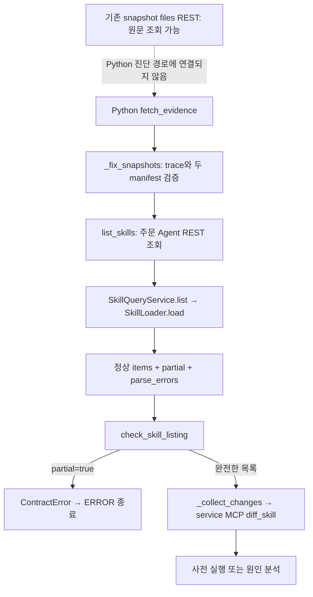

# #72 · partial Skill 목록의 진단 증거 보존 설계

작성일: 2026-10-23 · 상태: **증거 수집·저장 구현 완료, 자동 수정은 범위 제외**

적용 계약: [진단 증거 조회 v1](contracts/diagnosis-evidence.md). 원문 조회 → 목록 검증 → partial 전용 수집 노드 → RunStore 저장 순으로 구현했다. 아래 분석·초기 재현 결과는 변경 전 기록이며, 실제 변경·검증 결과는 별도 [변경 기록](changes/2026-10-23-partial-skill-evidence.md)을 따른다.

## 1. 이번에 해결할 문제

깨진 SKILL.md를 조사하려는데, 그 파일의 메타데이터가 잘못됐다는 이유로 조사 자체가 중단된다. 주문 Agent는 정상 파일의 목록과 오류 파일의 경로를 함께 반환하지만, Python 진단기는 이를 받고 diff를 읽기도 전에 종료한다.

먼저 **실행 가능한 문서인지와 원문을 조사할 수 있는지를 분리**한다. 메타데이터를 읽지 못해도 고정 snapshot의 원문·파일 해시·오류·diff를 실행 기록에 남긴다. 자동 수정·검증을 계속하는 기능은 그다음 단계다.

아래는 최초 설계와 근거다. evidence 필드는 이제 진단 상세 REST에 반영했으며 새 계약 문서를 우선한다. 기존 MCP v1.3, 실행 로더, workspace 생성 정책은 변경하지 않았다.

## 2. 현재 호출 관계와 데이터



| 함수·경로 | 입력 | 출력·동작 | 현재 막히는 부분 |
|---|---|---|---|
| Python `_fix_snapshots` | 실패 execution 또는 candidate/baseline snapshot 참조 | trace, before/after manifest, 고정 snapshot ID | snapshot·해시 불일치 시 중단하는 규칙은 유지해야 함 |
| Python `MCPTools.list_skills` → `order_agent.list_skills` | `snapshot_id` | 아래 목록 REST 응답을 그대로 반환 | 이름은 MCPTools지만 이 조회는 주문 Agent REST 호출 |
| 주문 Agent `SkillQueryService.list` | snapshot UUID | 정상 `items`, `partial`, `parse_errors` | 깨진 파일은 items에서 빠짐; 목록 제공 자체는 성공 |
| Python `check_skill_listing` | 목록, 예상 snapshot ID/hash | 정상일 때 `{skill_id: version}` | partial 또는 parse_errors가 있으면 즉시 예외 |
| Python `_collect_changes` | 두 manifest, 선택적 changed_paths | 검증한 diff 응답과 번호가 붙은 hunks | 앞선 목록 검사에 막혀 호출되지 않음 |
| service `SkillDiffService.diffSkill` | skill_id, before/after snapshot ID | 파일 해시, hunks, frontmatter 변경·해석 오류 | YAML이 깨져도 UTF-8 텍스트의 diff를 만들 수 있음 |
| Python `_repair_inputs` | snapshot_id, skill_versions, entry_skill_id | 의존성 그래프와 `{skill: {content, version}}` | 목록에서 빠진 Skill은 읽지 않음; 개별 조회도 엄격함 |
| 주문 Agent `SkillQueryService.get` | snapshot UUID, skill ID | 해석 성공 시 메타데이터와 원문 | 메타데이터 오류면 `SKILL_METADATA_INVALID`; 원문 반환 안 함 |
| 주문 Agent `EvidenceController.file` | snapshot UUID, 파일 경로 | 원본 파일의 해시·크기·encoding·content | 이미 사용할 수 있지만 Python 운영 도구에 조회 함수가 없음 |
| service `WorkspaceService.createFromSnapshot` → `versionOf` → `SkillHeader.parse` | snapshot_id, 각 SKILL 원문 | workspace_id, skill_versions | YAML·name/version·목록을 읽지 못하면 생성 실패 |
| Python `graph.guarded` → `RunStore.update` | 노드가 반환한 상태 | SQLite 실행 기록 | 예외가 난 노드의 지역 변수는 저장하지 않음 |

### 목록 응답 예시: owner가 빠진 inventory-check

```json
{
  "snapshot_id": "22222222-2222-4222-8222-222222222222",
  "snapshot_hash": "<고정 snapshot 해시>",
  "items": [
    {"skill_id": "order-flow", "version": 1},
    {"skill_id": "payment", "version": 1}
  ],
  "partial": true,
  "parse_errors": [{
    "path": "skills/inventory-check/SKILL.md",
    "code": "INVALID_SKILL_FORMAT",
    "message": "Skill 메타데이터를 해석할 수 없습니다: INVALID_SKILL_FORMAT"
  }]
}
```

items는 설명에 필요한 일부 필드만 표시했다. 실제 정상 항목에는 name, description, owner, path, hash, inputs, outputs, depends_on, steps도 있다. 현재 오류 응답은 상세 필드명 대신 코드 중심의 문구를 반환한다. Python이 여기서 owner 오류라고 추측해 확정해서는 안 된다.

### 이미 존재하는 원문 조회 응답

`GET /api/snapshots/{snapshot_id}/files?path=skills/inventory-check/SKILL.md`

```json
{
  "snapshot_id": "22222222-2222-4222-8222-222222222222",
  "path": "skills/inventory-check/SKILL.md",
  "hash": "<원본 바이트의 SHA-256>",
  "size": 123,
  "encoding": "utf-8",
  "content": "<원본 SKILL.md>"
}
```

size는 예시다. 이 응답에는 `snapshot_hash`가 없다. snapshot ID, 경로, 파일 해시·크기를 먼저 고정한 manifest와 대조하고, content에서 복원한 실제 바이트의 SHA-256과 크기도 확인해야 한다. UTF-8로 읽을 수 없는 파일은 encoding이 base64다. 원본 바이트는 보존할 수 있지만 일반 텍스트 patch 대상으로 보내면 안 된다.

## 3. 변경 전 재현 결과와 한계

초기 재현 테스트는 구현 후 [증거 보존 회귀 테스트](../skillops-agent/tests/test_partial_evidence_reproduction.py)로 전환했다. 아래 8개 결과와 518개 전체 테스트 수는 변경 전 관찰 기록이다.

| 재현 | 확인 결과 |
|---|---|
| owner 누락·깨진 YAML·version 누락 × failure/skill_saved 요청 | 6개 모두 목록 검사에서 `ERROR` 종료 |
| 위 6개에서 downstream 호출 확인 | diff, 개별 원문, workspace, 시나리오 실행, 제안 저장, LLM 호출 모두 없음 |
| 반환 상태와 SQLite RunStore 확인 | 이미 읽은 snapshot 참조·trace도 기본값; diff와 changes 없음; parse_errors 상세 미보존 |
| partial 검사를 생략했다고 가정하고 `_repair_inputs` 호출 | items에서 빠진 오류 Skill은 후보 생성 원문에서도 누락 |
| 오류 Skill의 버전만 확보했다고 가정하고 `_repair_inputs` 호출 | 엄격한 get_skill 실패가 전파되어 다시 중단 |

**8개는 현재 문제 동작을 확인하는 관찰 테스트**다. 통과했다는 사실은 문제가 해결됐다는 뜻이 아니다. 실제 서버나 LLM에 접속하지 않았으며, 주문 Agent와 같은 형태의 응답을 주입해 Python 그래프와 실제 임시 SQLite 저장을 검증했다. get_skill 실패도 조회 예외를 주입한 테스트다. Java 서버의 응답 생성이나 DB 연동을 새로 검증한 결과로 해석하면 안 된다.

로컬 검증 결과:

- 신규 재현 테스트: 8개 통과.
- Python 전체 테스트: 기존 510개와 신규 8개를 포함해 **518개 통과**.
- 신규 테스트 파일 Ruff 검사와 포맷 검사 통과.
- Java 운영 코드·테스트는 이번에 변경하지 않았으며 Java 전체 검증을 다시 실행하지 않았다.

service의 기존 `SkillDiffServiceTest.brokenYamlIsReportedNotThrown`에는 깨진 YAML에서도 hunks와 파싱 오류를 반환하는 검사가 있다. 주문 Agent의 기존 `DiagnosisReadApiIntegrationTest`에는 partial 목록·개별 조회 거부·원문 조회 사례가 있으나 DB 통합 실행 조건이 있으므로 이번 검증에 실행했다고 기록하지 않는다.

## 4. 목록 검사만 지우면 해결되지 않는 이유

1. 오류 Skill은 items에 없으므로 skill_versions에도 없다. `_repair_inputs`는 그 키만 순회해 정작 고칠 파일의 원문을 놓친다.
2. 버전을 다른 경로로 알아도 `get_skill`은 해석 실패 문서의 원문을 반환하지 않는다. 원문 파일 API가 필요하다.
3. 깨진 YAML·version 누락 등은 `create_workspace`도 막는다. 원문을 확보하는 것과 현재 MCP patch를 적용할 기반을 만드는 것은 별개다.
4. snapshot·파일 해시가 맞지 않는 응답까지 허용하면 서로 다른 변경을 근거로 진단할 수 있다. partial 허용과 증거 신뢰 검증 완화는 구분해야 한다.

owner/description 누락처럼 YAML·name/version·목록을 읽을 수 있는 경우는 workspace 복사가 가능할 수 있다. workspace는 실행 로더의 모든 필수 정보까지 검사하지 않기 때문이다. 반면 YAML 자체가 깨졌거나 version이 없으면 생성이 막힌다. **partial이라는 값 하나로 실행 가능 여부를 결정하지 않는다.**

## 5. 권장 구현: 1단계는 증거 보존까지

### 5.1 메타데이터 목록 검사와 실행용 버전 사용을 분리한다

기존 `check_skill_listing`의 완전한 목록을 요구하는 용도는 보존한다. 증거 수집에는 별도의 검사 함수를 두어 다음을 확인한 뒤 정상 항목과 오류 항목을 구분해서 반환한다.

- snapshot ID/hash가 고정한 manifest와 일치하는지.
- items/parse_errors가 목록인지, partial이 Boolean인지, 각 항목의 필수 값과 타입이 맞는지.
- 항목과 오류 경로가 manifest에 실제로 존재하는지; 정상 항목의 hash가 파일 해시와 일치하는지.
- 정상 항목·오류 항목의 중복이나 충돌이 없는지, manifest의 모든 SKILL.md가 빠짐없이 설명되는지.
- 오류가 있는데 partial=false이거나, partial=true인데 오류가 없는 모순 응답인지.

정상 목록에서 읽은 버전만 신뢰한다. 오류 파일의 버전을 1, 기준 버전, 기준 버전+1로 채우지 않는다. 새로운 Python YAML 파서를 만들어 버전을 다시 해석하지 않는다.

### 5.2 원문 조회 기능을 연결한다

`order_agent.py`에 원문 파일 조회 함수를 추가하고 `MCPTools`가 기존 HTTP client를 전달한다. URL query는 문자열 이어 붙이기 대신 HTTP client의 params로 보낸다. 기존 조회 재시도·timeout·오류 처리 규칙을 재사용하고, StubMCPTools에도 같은 함수와 인자를 추가한다.

원문 검증은 별도 계약 함수로 분리한다. 경로는 고정 manifest에서 고르며 parse_errors의 문자열만 믿고 조회하지 않는다. 정상 파일과 오류 파일 모두 출처와 해시를 유지한다. 변경되지 않은 파일이라도 parse_errors에 있으면 오류 증거를 보존한다.

base64는 엄격하게 복원해 바이트 해시를 확인한다. 잘못된 UTF-8을 대체 문자로 바꾸거나 줄바꿈을 정규화하지 않는다. 현재 service diff는 UTF-8 텍스트를 요구하므로 비텍스트 파일은 원본·오류를 남기고 diff 불가 사유를 기록한다.

### 5.3 수집한 증거가 나중 오류로 사라지지 않게 한다

`fetch_evidence`를 작은 수집 함수와 상태 조립 함수로 나눈다. 알려진 partial/파일 형식 오류는 증거를 포함한 반환값으로 처리한다. 사전 실행이나 의존성 분석에 실패해도 이미 수집한 결과가 유지되어야 한다.

완료된 수집 단계마다 상태가 저장되도록 그래프의 증거 수집 단계 분리도 함께 검토한다. 단순히 기존 함수에서 예외만 잡으면 함수가 끝나기 전 프로세스 중단 때 수집분이 사라진다는 한계가 남는다. 노드를 분리한다면 FLOW, 진행 이벤트, 단계 제한 계산, 기존 흐름 테스트를 함께 갱신한다. 저장 책임은 기존 guarded/RunStore 경로에 두고 각 수집 함수가 DB를 직접 수정하지 않게 한다.

diff 수집은 정상 메타데이터 목록이 아니라 manifest의 실제 파일 차이를 기준으로 한다. snapshot·파일 해시 검사는 그대로 유지한다. 현재 지원하지 않는 추가/삭제·리소스 변경·잘못된 Skill ID는 원문 증거와 제한 사유를 저장하고 자동 되돌리기 대상으로 만들지 않는다.

### 5.4 실행을 이어갈 수 없으면 증거를 남기고 종료한다

1단계에서 partial 응답을 받으면 증거 수집까지만 수행한다. 기존 `ERROR` 상태와 `diagnosis.explanation`으로 자동 분석을 진행하지 못한 이유를 설명한다. 새 종료 상태를 바로 추가하지 않는다.

- snapshot 참조·manifest·원문·해시·목록 오류·수집 가능한 diff는 저장한다.
- 메타데이터가 불완전하다는 사실을 그대로 남긴다.
- LLM, workspace 생성, 실행 실험, 후보 생성·승인 가능한 제안 저장은 진행하지 않는다.
- snapshot 해시 불일치나 내용 변조는 계속 계약 오류다. 검증하지 못한 원문을 정상 증거에 섞지 않는다.
- 인증·접속 오류나 5xx를 메타데이터 오류로 바꾸지 않는다. 수집 실패 종류를 구분해 남긴다.

이 단계로 이슈의 **partial 목록에서도 원문·해시·파싱 오류 수집** 항목을 완료할 수 있다. 자동 복구까지 완료했다고 표시하지 않는다.

## 6. 저장 구조 제안과 명세 영향

기존 snapshot_id, baseline_snapshot_id, trace, diff, changes는 그대로 활용한다. 새 증거는 `AgentState.evidence` 아래에 모으는 안을 권장한다.

| 제안 필드 | 내용 |
|---|---|
| `evidence.snapshots` | 고정한 before/after manifest와 snapshot 해시 |
| `evidence.metadata` | 원본 listing의 items, partial, parse_errors; 완전성 검사 결과 |
| `evidence.sources` | snapshot_id/path/hash/size/encoding/content가 검증된 파일 증거 |
| `evidence.collection_errors` | 단계·snapshot·경로·실패 코드·문구; 원문 미수집과 해석 실패를 구분 |
| `evidence.limitations` | 자동 실행·diff 등을 이어갈 수 없는 구조화된 사유 |

이는 필드명과 의미를 정하기 위한 설계안이다. 실제 JSON schema, 중복 데이터 저장 범위, 파일별·실행별 저장 용량 제한은 구현할 때 확정하고 계약 테스트로 고정한다. 전체 원문을 진행 이벤트마다 복제하거나 LLM에 무제한 전달하지 않는다. 한도에 걸리면 조용히 잘라 정상 원문처럼 저장하지 않고 미수집 사유를 남긴다.

| 대상 | 1단계 변경 필요 여부 |
|---|---|
| 주문 Agent 목록·개별 Skill REST | 기존 계약 유지 |
| 주문 Agent files REST | 기존 계약 재사용; 새 endpoint 불필요 |
| service MCP diff_skill/create_workspace/apply_patch | 필드·입력·버전 변경 불필요 |
| Python 내부 도구 함수 | 원문 파일 조회 함수 추가; 이름에 관계없이 실제 호출은 REST |
| Python 진단 실행 조회 REST 및 service 중계 | 새 evidence가 응답에 노출되므로 추가 필드·저장·오류 의미 문서화 필요 |
| 프런트엔드 | 기존 상태명 유지; 새 증거 화면 표시는 별도 담당 범위 |
| Python 후보 판정·제안 schema | 1단계에서 변경 불필요; partial 경로는 후보 생성 전 종료 |

구현 시 [주문 Agent 조회 명세](../order-agent/docs/diagnosis-read-api.md), [진단 접수·기록 조회 문서](skill-save-auto-diagnosis.md), [MCP·REST 계약](contracts/mcp-tools-and-rest.md)의 관련 절과 Python 상태 설명을 함께 확인·갱신한다. MCP 명세에는 기존 원문 REST를 재사용한다는 연동 설명만 필요하며, MCP v1.3에 새 필드가 추가됐다고 적지 않는다.

## 7. 참고: 자동 수정은 이번 범위에서 제외

사용자 요청에 따라 자동 수정은 구현하지 않는다. 아래는 향후 별도 요청이 있을 때 검토할 기술적 제약이며 다음 작업으로 예약한 내용이 아니다.

| 문서 상태 | 후속 설계 |
|---|---|
| owner/description 등 오류, workspace 생성 가능 | create_workspace의 skill_versions와 정상 목록을 대조해 버전 확보; 검증한 원문 파일 증거를 후보 입력으로 사용; 그래프 분석 가능 여부도 별도 확인 |
| YAML·version 등 오류로 workspace 생성 불가 | 현재 base_version 기반 patch 계약으로 바로 진행 불가; 불변 파일 해시/revision을 기준으로 원문 workspace를 만드는 별도 계약부터 설계 |
| entry flow 해석 불가 | 정상 의존성 그래프를 가정하지 않음; 원문·오류만으로 가능한 분석과 실행 실험을 분리 |
| base64 원문·잘못된 Skill ID·추가/삭제 | 현재 텍스트 patch/되돌리기 정책 밖; 각각 별도 처리 계약 필요 |

기준 snapshot에 patch를 적용하고 후보 검증이라고 부르면 안 된다. 후보 snapshot의 다른 변경이 빠져 실험 결과가 달라질 수 있다. workspace 생성에 성공하더라도 메타데이터·flow·의존성 검증이 통과한 것으로 간주하지 않는다. 기존 MCP v1.3 검증 배열과 실제 실행 검증을 계속 사용한다.

Java 서비스와 주문 Agent 변경은 백엔드 범위다. Python 도구·상태·그래프 변경도 필요하므로 Python 진단기를 AI 담당자가 관리한다면 착수 전에 이 설계의 범위와 조회 응답을 공유한다. 프롬프트만 바꾸어 해결할 문제는 아니다. 다른 담당자가 관리하는 운영 코드는 수정 전에 사용자에게 변경 대상을 알리고 확인받는다.

## 8. 구현 순서와 완료 기준

1. 원문 파일 조회·계약 검증·대역 도구와 정상/변조 응답 테스트 추가.
2. partial 목록의 증거용 검사 추가. 기존 엄격한 실행용 검사와 분리.
3. 수집 결과의 상태·RunStore 저장 연결 및 partial 경로의 증거 수집 후 종료 구현.
4. 아래 회귀 검증과 관련 REST 설명을 함께 갱신.
5. 실제 구현과 검증 결과를 변경 기록에 남긴 뒤 해당 이슈 항목 체크.

| 검증 | 1단계 기대 결과 |
|---|---|
| 정상 문서와 완전한 목록 | 기존 진단·사전 검증·후보 판정 동작 유지 |
| owner 누락·깨진 YAML·version 누락 | 실패 사유와 원문·해시·가능한 diff 저장; LLM/실행/제안 저장 없음 |
| 정상/오류 파일이 함께 있는 목록 | 정상 항목·오류 항목 모두 보존; 오류 파일을 누락하지 않음 |
| 변경되지 않은 오류 파일 | 원문·해시·목록 오류 보존; 없는 diff를 만들지 않음 |
| UTF-8 LF/CRLF | 원문 바이트 해시 유지 |
| 잘못된 UTF-8 | base64 증거 보존, 텍스트 실행·patch 차단 |
| 잘못된 snapshot/hash/path/size, 중복·누락 목록 | 계약 오류로 중단; 검증된 증거와 오류 사유만 저장 |
| 파일 일부 조회 실패·지원 밖 변경 | 먼저 확보한 증거 보존; 실패를 빈 정상 결과로 바꾸지 않음 |
| 사전 검증 실패 또는 후속 예외 | 먼저 수집한 증거가 실행 조회에 남음 |
| 수집 단계 완료 후 재시작 | SQLite에 저장한 증거 유지; 중단을 성공으로 바꾸지 않음 |
| 기존 API/MCP 계약 검사 | 입력·기존 필드 의미 유지; 새 진단 evidence만 명세 반영 |

partial 증거 수집·저장은 구현했으며 자동 수정은 포함하지 않았다. 외부 이슈 체크박스와 커밋·배포는 이번 구현 요청에서 변경하지 않았다.

## 9. 확인한 구현 위치

- Python 수집·수정 입력: [nodes.py](../skillops-agent/skillops_agent/nodes.py), [contracts.py](../skillops-agent/skillops_agent/contracts.py).
- Python 도구·조회: [tools.py](../skillops-agent/skillops_agent/tools.py), [order_agent.py](../skillops-agent/skillops_agent/order_agent.py).
- Python 상태·실행 기록: [state.py](../skillops-agent/skillops_agent/state.py), [graph.py](../skillops-agent/skillops_agent/graph.py), [run_store.py](../skillops-agent/skillops_agent/run_store.py).
- 주문 Agent 메타데이터·원문: [SkillQueryService.java](../order-agent/backend/src/main/java/com/capstone4/orderagent/workspace/SkillQueryService.java), [EvidenceController.java](../order-agent/backend/src/main/java/com/capstone4/orderagent/controller/EvidenceController.java).
- service diff·workspace: [SkillDiffService.java](../service/src/main/java/com/capstone4/skillops/snapshot/SkillDiffService.java), [WorkspaceService.java](../service/src/main/java/com/capstone4/skillops/workspace/WorkspaceService.java), [SkillHeader.java](../service/src/main/java/com/capstone4/skillops/workspace/SkillHeader.java).
