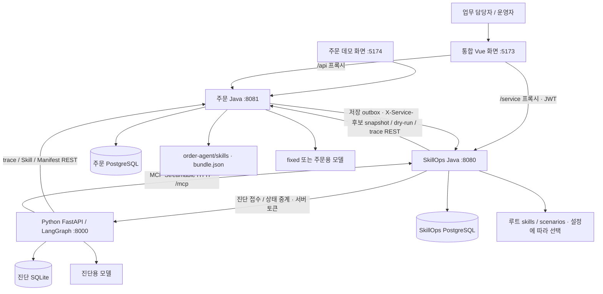
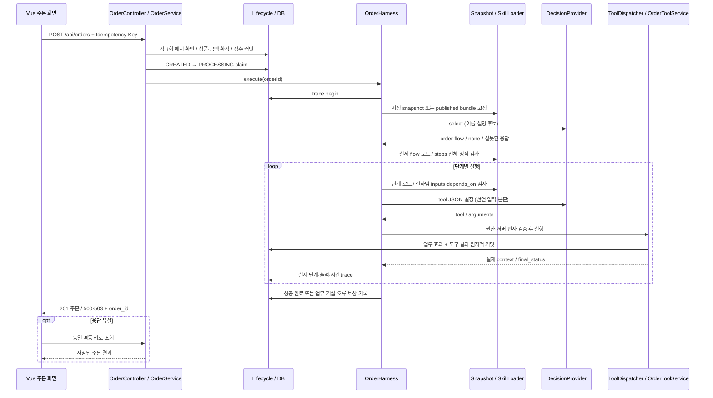
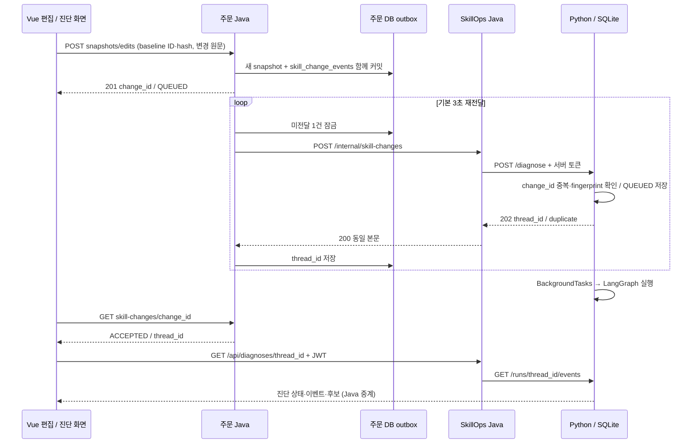
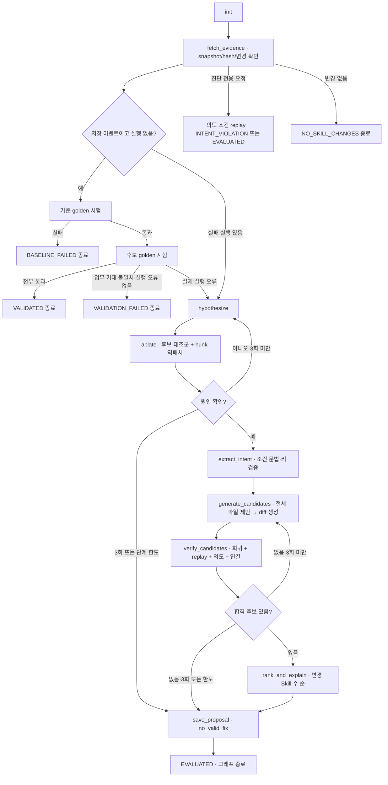
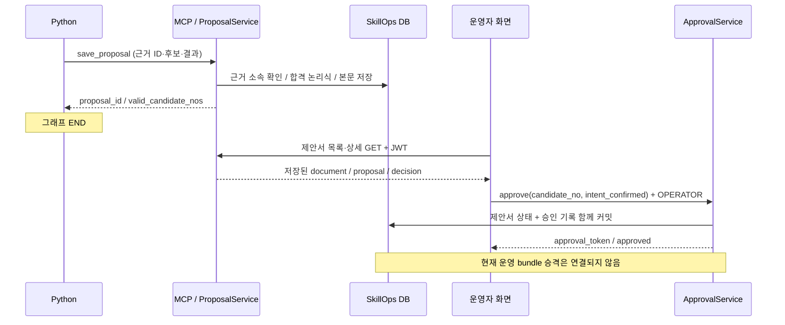

# 구조·실행 흐름·개선사항 리뷰

> **과거 검토 기록 — 기준 `ec39713`.** 이 문서의 “현재”, 미완료 항목, 테스트 수와 줄 번호는 작성 당시 기준입니다. 최신 구현·계약·#72 완료 상태는 [리뷰 문서 안내](../README.md)를 우선합니다. 아래 제안을 현재 API나 새 작업 승인으로 간주하지 않습니다.

기준: 2026-10-22 (Asia/Seoul), `ec39713`. [전체 안내](README.md) · [API](backend-api.md) · [MCP](mcp-spec.md) · [함수 안내](function-reference.md).

현재 코드는 **고정된 실행 증거를 바탕으로 Skill 변경을 진단하고, 후보를 시험하여 사람이 검토할 제안서로 저장하는 구조**까지 연결되어 있습니다. 주문 실행 경계에서 실제 파일 hash와 도구 결과를 남기는 점, 모델이 계산한 금액을 신뢰하지 않는 점, 승인과 제안서 결정을 함께 저장하는 점이 좋은 기반입니다. 다만 ‘시험을 통과한 후보’라는 결론의 신뢰성을 높이려면 평가 기준·증거 원장·시험 격리·revision 고정을 우선 보강하시는 것이 좋겠습니다.

여기서 ‘확인’은 코드와 테스트로 확인한 사실이며, 장애를 실제 발생시키지 않은 항목은 ‘정적 검토에 따른 위험’으로 명시했습니다. 새로운 기능 구현은 수행하지 않고 현재 동작과 필요한 수정을 문서화했습니다.

## 1. 현재 작업 트리와 최근 변경

작업 시작 시 `git status --short` 결과는 다음 한 줄이었습니다.

```text
?? order-agent/docs/runner-integration-design.md
```

추적 파일의 미커밋 수정은 없었습니다. 위 미추적 설계 문서는 기존 작업으로 보존했습니다. 해당 문서는 Runner/workspace가 없다는 과거 상태와 `/internal/...` API 제안을 포함하므로 **현재 구현 명세로 사용하면 안 됩니다**. 현재는 WorkspaceService, ScenarioRunner, HarnessFlowRunner, 후보 snapshot과 `/api/dry-runs`가 구현되어 있습니다.

최근 이력에는 파이프라인 연동, 제안서 저장·담당자 승인, no_valid_fix 제안서 노출, 의도 확인 조건 사전 검증이 포함됩니다. 이는 커밋 제목과 현재 코드에 근거한 설명이며, 각 PR의 전체 변경 이력을 재심사했다는 뜻은 아닙니다.

이번 문서 작업은 `docs/review/2026-10-22/`에만 추가했습니다. 애플리케이션·공용 계약·사용자 설계 초안은 수정하지 않았습니다.

## 2. 구성과 책임



| 경계 | 소유하는 사실 | 소유하지 않는 것 |
|---|---|---|
| 주문 Java | 주문·가격·재고·업무 효과·실행 snapshot·trace 원본 | 개선안 승인 여부, 진단 단계 상태 |
| SkillOps Java | workspace·정적 분석·시나리오 판정·실행 원장·제안서·승인 | 원본 주문 실행 로직, Python의 모델 사고 과정 |
| Python | 진단 접수·중복 방지·증거 조합·가설·원인 실험·후보 생성·검증 조율 | 운영 주문의 실제 금액 결정, 운영 파일 반영 |
| 통합 Vue | 초안·선택 snapshot·API 결과 표시·사용자 결정 입력 | 서버 권한 부여, 검증 합격의 최종 근거 |
| 주문 Vue | 주문 입력·동일 키 복구·독립 데모 증거 조회 | SkillOps 자동 진단·운영 승인 |

두 Java 모듈은 하나의 Spring 애플리케이션이 아닙니다. service README의 ‘주문 처리 서비스’ 표현, 빈 harness/domain/registry/trace 등 package-info는 초기 설계 경계입니다. 실제 주문 Harness는 order-agent/backend에 있습니다. Python의 상태·증거 DB와 Java의 제안서 DB도 분리되어 있습니다.

## 3. 처음 보실 때 필요한 용어

| 용어 | 의미 | 혼동하면 생기는 문제 |
|---|---|---|
| SKILL.md | YAML 선언 + 자연어 업무 안내 | 선언 outputs와 실제 tool outputs를 같다고 오해 |
| snapshot | 실행 파일 바이트와 metadata를 고정한 묶음 | 현재 운영 파일을 읽어 과거 장애를 분석 |
| workspace | 후보를 수정하는 DB 복사본 | 운영 파일까지 바뀌었다고 오해 |
| execution_id | 주문 Harness 실행 UUID | Python 진단 thread와 혼용 |
| run_id | execution_id의 r_32hex 별칭 | 다른 실행이라고 중복 집계 |
| thread_id | Python 진단 UUID | 주문 trace 조회에 사용 |
| change_id | 저장 변경·접수 멱등 키 | 동일 변경 재전송으로 진단 중복 생성 |
| version | 파일 선언 또는 workspace 표시 번호 | 같은 번호면 같은 바이트라고 오해 |
| completion | 실행기가 끝났는지·오류인지 | 업무 거절 REJECTED를 실행 장애로 오해 |
| final_status | 주문 업무 결과 | FAILED가 아니면 원래 업무가 복구됐다고 오해 |
| approval_token | 승인 기록의 참조 | 이미 운영 반영이 끝났다고 오해 |

특히 workspace 표시 version과 SKILL.md의 version 줄은 자동으로 동기화되지 않습니다. 후보 식별에는 UUID·revision·hash를 사용하셔야 합니다.

## 4. 일반 주문 실행 흐름



정상 순서는 order-intake → inventory-check → payment → shipping-reserve → notify입니다. Skill이 실행할 수 있는 도구는 서버 binding으로 제한합니다. order.total은 시작 선택 문맥에서 제거하고 order.inspect로 서버 확정 금액을 읽게 합니다. 모델의 금액·주문 ID·도구 선택이 현재 서버 주문과 맞지 않으면 거부합니다.

재고 부족과 결제 거절은 COMPLETED + REJECTED/HOLD이며 뒤 단계를 실행하지 않습니다. 선언 공급 단절은 도구 실행 전 CONTRACT_VIOLATION, 실제 출력 누락은 MISSING_SKILL_OUTPUT입니다. 아직 결제하지 않은 예약은 보상하고, 이미 확정된 Mock 결제는 일반 실패에서 임의로 지우지 않습니다.

트랜잭션은 접수·claim·개별 도구·완료·보상으로 나눕니다. 외부 모델 응답을 기다리는 동안 DB 트랜잭션을 장시간 열지 않는 방향은 유지하시는 것이 좋겠습니다.

## 5. Skill 편집 저장 → 자동 진단 흐름



브라우저 초안(localStorage)을 바꾸는 것과 서버 snapshot 저장은 다릅니다. 서버 저장도 운영 bundle 교체는 아닙니다. 저장된 수정본은 snapshot을 지정한 시험·주문에만 쓰입니다. 독립 주문 화면의 기본 주문은 published bundle을 계속 읽습니다.

outbox와 수신 중복 제거가 있으므로 ‘저장됐지만 전달 도중 응답을 잃은 경우’를 같은 change_id로 복구하는 기반이 있습니다. 반면 Python 작업 큐는 BackgroundTasks이므로 영속 worker 실행 보장은 없습니다. 전달 ACCEPTED와 진단 성공은 반드시 나누어 표시하셔야 합니다.

## 6. 진단 그래프의 실제 분기



그림의 분기는 이해를 위해 펼친 것입니다. 실제 fetch_evidence 안에서 diagnosis_only·변경 없음·사전 시험을 처리하고 evidence_route가 종료 여부를 결정합니다. 각 guarded node는 예외를 ERROR로 바꾸고 SQLite에 부분 상태를 기록합니다.

원인 실험은 ‘같은 실패본 그대로도 오류가 재현되는지’를 대조군으로 먼저 확인하고, 변경 hunk 하나를 되돌린 새 workspace에서 실행합니다. 성공하면 그 hunk를 원인 근거로 기록합니다. 실제 확정 강도는 replay Judge의 기준에 제한되며 복수 변경 상호작용까지 증명하지는 않습니다.

후보는 모델이 전체 SKILL.md 원문을 제안하면 Python이 고정 원문과 비교하여 diff를 생성합니다. 모델이 만든 줄 번호를 직접 신뢰하지 않는 방식입니다. 후보별 독립 workspace에서 golden/replay를 각각 2회, 의도 조건이 있으면 replay를 추가 2회 시험합니다. 기본 golden 3개일 때 시험되는 후보 하나는 6+2+선택 2회입니다. 한 node 안에서 후보 수만큼 반복하므로 step_count 40이 모델 호출·총 실행 비용 40회를 뜻하지 않습니다.

## 7. 제안서 → 승인 흐름과 종료 경계



Python에는 wait_for_approval와 /approve가 남아 있지만 현행 graph에는 승인 대기 node가 등록되지 않습니다. Java 승인도 Python을 호출하지 않습니다. UI·제안서 본문도 운영 반영이 아직 없다고 안내합니다. 현재 완료 범위는 **검토·결정 기록**입니다.

## 8. 데이터 저장과 복구

| 저장소 | 테이블·파일 | 의미와 복구 |
|---|---|---|
| 주문 PostgreSQL | products,orders,order_items,order_processing_steps | 실제 업무 상태·가격 snapshot·재고; 주문 멱등 키 유일 제약, row lock·claim |
| 주문 PostgreSQL | skill_snapshots,snapshot_files | metadata와 파일 바이트 고정, 읽을 때 파일·묶음 hash 검증 |
| 주문 PostgreSQL | agent_executions,execution_events,agent_tool_operations | 관찰 원본, 순번, 업무 결과 멱등 캐시 |
| 주문 PostgreSQL | skill_change_events | 저장과 함께 커밋한 전달 outbox |
| SkillOps PostgreSQL | workspaces | 원문·resource·baseVersion/revision; OPEN 이후 승격 수명주기는 없음 |
| SkillOps PostgreSQL | scenario_runs | trial ID/workspace/scenario/passed/시각의 최소 원장 |
| SkillOps PostgreSQL | proposals,approvals | 고정 제안서 본문·결정·승인 토큰; 결정 트랜잭션·Proposal @Version |
| SQLite | diagnosis_runs | change_id 유일 키, trigger fingerprint, 전체 state JSON; 재시작 미완료를 ERROR 처리 |
| 프로세스 메모리 | LangGraph MemorySaver, _pending_approvals, 후보 snapshot 캐시 | 재시작 시 소실; 현재 승인 재개는 현행 흐름 밖 |
| 브라우저 | sessionStorage auth, localStorage workspace | 토큰·초안·선택 snapshot. 서버 판정 원본은 아님 |

주문 시작 복구는 CREATED/PROCESSING 주문을 FAILED로 바꾸고 미결제 예약을 해제합니다. 자동으로 결제·배송을 재실행하지 않는 방향은 중복 효과 방지에 도움이 됩니다. 다만 다중 인스턴스의 실행 소유권·lease 없이 전체 처리 중 주문을 정리하는 구조이므로 한 인스턴스 재시작이 다른 인스턴스의 진행 주문을 중단 처리할 위험이 있습니다. 현재 단일 프로세스 데모 전제를 벗어나실 때 별도 소유권이 필요합니다.

## 9. 구체적인 개선사항

우선순위 P0는 운영 신뢰성·검증 결론에 직접 영향을 주는 항목, P1은 연동·복구·동시성, P2는 유지보수·효율입니다. 일부는 데모 의도에 따른 제한이며 실제 운영 배포 전에는 해결이 필요합니다.

### P0-1. 제안서 합격 결과를 제출값이 아닌 실제 원장에서 계산해 주세요

근거: [ProposalService.checkEvidence/checkRootCause](../../../service/src/main/java/com/capstone4/skillops/proposal/ProposalService.java), [ProposalRules.passes](../../../service/src/main/java/com/capstone4/skillops/proposal/ProposalRules.java), [JpaRunLedger](../../../service/src/main/java/com/capstone4/skillops/scenario/JpaRunLedger.java).

현재는 evidence ID가 workspace에 존재하는지 확인하고, 클라이언트가 보낸 fixes_failure/keeps_old_orders/keeps_intent/no_broken_links의 논리식만 재계산합니다. ledger에 저장한 passed는 승인 가능 후보 재계산에 사용하지 않습니다. 정적 검토상, 실패했던 trial ID에 성공 results를 붙이거나 일부 통과 ID만 제출해도 이를 완전히 배제하지 못합니다. root proof도 해당 진단의 대조군·복원군인지 확인하지 않습니다.

개선: evaluation ID, trial 목적(regression/repro/intent/control/restore), 기대값 hash, snapshot ID/hash, workspace revision, 판정과 이유를 서버가 저장하고 save_proposal은 해당 evaluation을 참조하도록 해 주세요. valid와 회귀 집계는 서버 원장에서 재계산해야 합니다. 검증: 다른 workspace/다른 revision/일부 trial/실패 trial/다른 진단 proof를 섞은 제안서를 모두 거부하는 테스트가 필요합니다.

### P0-2. replay 통과를 원래 업무 복구와 연결해 주세요

근거: [Expectation.replay](../../../service/src/main/java/com/capstone4/skillops/scenario/Expectation.java), [ScenarioGrader.grade](../../../service/src/main/java/com/capstone4/skillops/scenario/ScenarioGrader.java), [replayPassesUnlessFailed 테스트](../../../service/src/test/java/com/capstone4/skillops/scenario/ScenarioGraderTest.java).

현재 replay는 final_status != FAILED면 통과합니다. 정상 배송해야 할 주문을 재고 거절 REJECTED로 바꿔도 fixes_failure=true나 ablation confirmed가 될 수 있습니다. 기존 테스트도 REJECTED 통과를 명시합니다. 원인 복원 실험은 1회씩이므로 환경 변화·우연 성공에도 민감합니다.

개선: 원본 입력과 함께 서버가 관리하는 재현 expectation을 고정하고 completion=COMPLETED, 기대 업무 결과·필수 tool 결과·필요한 인자를 확인해 주세요. 업무 거절이 올바른 시나리오는 별도 기대값으로 허용하면 됩니다. 검증: 원래 성공 주문이 REJECTED/HOLD/NO_SELECTION이 된 경우 복구 합격이 되지 않아야 합니다. 재현 조건과 원인 실험도 같은 fixture·Clock으로 고정하시는 것이 좋겠습니다.

### P0-3. dry-run을 운영 재고에서 분리하고 중단 복구를 보강해 주세요

근거: [DryRunService.run/cleanup](../../../order-agent/backend/src/main/java/com/capstone4/orderagent/service/DryRunService.java), [InventoryRecovery.releaseUnpaid](../../../order-agent/backend/src/main/java/com/capstone4/orderagent/service/InventoryRecovery.java), [recoverInterrupted](../../../order-agent/backend/src/main/java/com/capstone4/orderagent/service/OrderLifecycleService.java).

현재 dry-run은 운영 상품의 실제 row를 예약하고 마지막에 해제합니다. 여러 trial 직렬화는 service 한 프로세스 lock일 뿐이며 live 주문이 동시에 재고를 사용할 수 있습니다. 재현 시험이 재고·가격·현재 날짜에 따라 달라집니다.

추가로 정적 검토상, PAID 이후 cleanup 전에 서버가 중단되면 예약이 남을 수 있습니다. 시작 복구는 미결제만 해제하며, SHIPPED/FAILED가 이미 된 dry-run은 CREATED/PROCESSING 검색에서도 빠집니다. 정상 종료 cleanup 테스트만으로 이 중단 구간을 보장할 수 없습니다.

개선: 같은 Harness를 사용하면서 업무 효과를 실행 환경 인터페이스로 분리하고 dry-run에는 실행별 재고·고정 가격·Mock 효과·Clock을 제공해 주세요. 단기적으로는 dry_run=true의 남은 예약 전용 복구와 cleanup 재시도 원장을 추가할 수 있습니다. 검증: 결제 직후·완료 직후·cleanup 중단 후 재기동에서 운영 재고가 동일해야 합니다. 운영 주문과 dry-run 동시 실행도 별도 검증이 필요합니다.

### P0-4. 비용·쓰기 경계의 인증을 적용해 주세요

근거: [SecurityConfig](../../../service/src/main/java/com/capstone4/skillops/auth/SecurityConfig.java), [EvidenceController](../../../order-agent/backend/src/main/java/com/capstone4/orderagent/controller/EvidenceController.java), [main.verify_token](../../../skillops-agent/skillops_agent/main.py).

로그인·제안서 화면은 보호하지만 MCP 쓰기, 후보 발행, edits, dry-run은 공개입니다. edits는 demo-disabled에서도 열리고 outbox를 통해 진단 모델 비용을 유발할 수 있습니다. 서버 토큰이 비어 있으면 내부 경계도 검증하지 않습니다. Docker의 127.0.0.1 공개는 데모 노출을 줄이지만 인증 자체를 제공하지는 않습니다.

개선: 브라우저 편집에는 사용자 권한, 서비스 간 MCP/실행에는 서비스 인증을 적용하고 개발 모드와 운영 모드를 분리해 주세요. 진단·시험의 동시성·요청 크기·총 비용 제한도 함께 두시는 것이 좋겠습니다. 검증: 비로그인 edits/dry-run, 잘못된 서비스 자격 증명, 허용 역할 밖 쓰기가 모두 거부되어야 합니다.

### P1-1. 실제 연동용 설정 조합을 하나로 정리해 주세요

근거: [.env.example](../../../.env.example), [service application.yml](../../../service/src/main/resources/application.yml), [Python config](../../../skillops-agent/skillops_agent/config.py), [시나리오](../../../scenarios).

현재 기본값에는 다음 충돌이 있습니다.

- 예제 env는 SKILLOPS_USE_STUB_MCP=true, Java Runner는 contract-only입니다. 실제 연동 검증 설정이 아닙니다.
- Python golden 기본은 g-01~03인데 Java 기본 scenarios/golden에는 과일 SKU g-01 하나만 있습니다. 실제 주문 fixture는 scenarios/order-agent/golden의 캠핑 3개입니다.
- contract-only는 r_fake...를 반환하므로 UUID 실행 참조를 요구하는 Python validate_report와 맞지 않습니다. replay도 지원하지 않습니다.
- Python은 dotenv를 읽지만 service는 자동으로 루트 .env를 읽지 않습니다. 각 프로세스에 같은 환경변수가 적용됐는지 확인해야 합니다.

실제 연동에서 필요한 최소값(service/에서 실행)은 다음과 같습니다.

```dotenv
SKILLOPS_USE_STUB_MCP=false
SKILLOPS_FLOW_RUNNER=harness
SKILLOPS_SCENARIOS_DIR=../scenarios/order-agent
ORDER_AGENT_BASE_URL=http://localhost:8081
SKILLOPS_AGENT_URL=http://localhost:8000
SKILLOPS_GOLDEN_IDS=g-01,g-02,g-03
```

위 값들은 각 값을 사용하는 프로세스에 전달해야 하며 이 파일을 복사하는 것만으로 모든 서버에 주입되지는 않습니다. 실제 모델 키·서버 토큰은 비밀 설정으로 별도 관리해 주세요. 주문 model-mode=fixed여도 Python 가설·의도·후보 생성은 실제 모델을 사용한다는 점도 구분해야 합니다.

개선: 명시적 통합 profile과 시작 시 계약/fixture 검사, 단일 통합 실행 가이드를 추가해 주세요. DB 재고 조건도 golden의 기준 fixture로 고정해야 합니다.

### P1-2. workspace revision을 평가 시작 시 고정해 주세요

근거: [WorkspaceService.apply/filesOf](../../../service/src/main/java/com/capstone4/skillops/workspace/WorkspaceService.java), [WorkspaceRecord](../../../service/src/main/java/com/capstone4/skillops/workspace/WorkspaceRecord.java), [HarnessFlowRunner.runDryRun](../../../service/src/main/java/com/capstone4/skillops/scenario/HarnessFlowRunner.java).

workspaces에 @Version·수정 row lock이 없고 apply는 읽기→복사→저장입니다. 동시 patch가 서로의 수정을 덮을 수 있습니다. ScenarioRunner는 skills를 한 번 읽지만 HarnessFlowRunner는 매 trial에 filesOf를 다시 읽어 다른 revision이 섞일 수 있습니다. 표시 version은 생성 기준 값 검증만 하므로 이를 막지 않습니다.

개선: workspace 단조 revision과 expected_revision을 추가하고, 평가 시작 때 불변 export/snapshot을 한 번 고정하여 모든 trial에 동일 ID/hash를 넘겨 주세요. 검증: 평가 중 편집이 발생해도 같은 평가의 모든 trial hash가 동일해야 합니다. 동시 수정은 명확한 conflict로 응답해야 합니다.

### P1-3. 의도 조건이 없으면 ‘미검증’을 표시해 주세요

근거: [nodes.extract_intent/verify_candidates](../../../skillops-agent/skillops_agent/nodes.py), [test_all_checks_dropped_continues_without_intent_check](../../../skillops-agent/tests/test_graph.py).

문법·관측 키와 안 맞는 조건을 버리는 것은 잘못된 조건을 보내 전체 시험이 깨지는 일을 줄입니다. 다만 전부 버려지면 intent_results=[], all([])=true여서 keeps_intent=true입니다. 제안서 본문은 조건이 없다고 설명하지만 후보 결과 boolean만 보면 검증 완료로 보일 수 있습니다.

개선: intent 결과에 PASS/FAIL/NOT_EVALUATED와 조건 수·버린 이유를 남겨 주세요. 의도 검증이 필수인 변경은 NOT_EVALUATED 후보를 자동 합격으로 분류하지 않도록 정책을 명시하시면 좋겠습니다. Check의 ‘없는 키=null’도 존재 여부와 구분할 수 있어야 합니다.

### P1-4. 깨진 YAML·새 Skill·resource 변경의 진단 지원 범위를 맞춰 주세요

근거: SnapshotService.saveEdits, SkillQueryService.list, Python fetch_evidence, WorkspaceService.createFromSnapshot.

저장은 잘못된 YAML·새 SKILL.md를 허용하지만 fetch_evidence는 partial/parse_errors, 추가·삭제 파일, SKILL.md 외 경로를 즉시 거부합니다. diff_skill은 깨진 YAML에서도 hunk를 만들 수 있는데 파이프라인은 그 전에 종료됩니다. ‘깨진 Skill을 고치는 서비스’의 일부 중요한 입력에서 자동 수정까지 도달하지 못합니다.

개선: 파싱 불가 원문에도 Manifest와 byte diff를 수집하고 정상 baseline에서 복원 실험을 만드는 경로를 마련해 주세요. 추가·삭제·resource는 명시적 UNSUPPORTED 상태와 UI 안내를 주거나 별도 정책을 구현하시면 됩니다. 검증: 잘못된 YAML, owner 누락, 새 Skill, resource 단독 변경을 각각 기대하는 종료 상태로 확인해 주세요.

### P1-5. 전달 재시도와 진단 재시작 복구를 분리해 주세요

근거: SkillChangeDispatcher.dispatch, RunStore.accept/recover, main._run_pipeline.

outbox는 가장 오래된 미전달 1건을 계속 선택합니다. 영구적으로 422를 내는 요청도 Java에서 502로 변환되어 같은 행이 무한 재시도되며 뒤 이벤트가 지연될 수 있습니다. 외부 HTTP를 호출하는 동안 DB row lock/트랜잭션을 유지합니다. Python이 작업 도중 재시작되면 ERROR로 끝나고 같은 change_id 재접수는 duplicate로 기존 결과만 반환합니다. 사용자용 재진단 API도 없습니다.

개선: next_retry_at, backoff, 최대 시도·영구 거절 분류, dead-letter와 재처리 경로를 마련해 주세요. Python 진단은 영속 job queue/lease 또는 명시적 retry API로 회복시키는 편이 좋겠습니다. 검증: 한 영구 오류 이벤트 뒤의 정상 이벤트가 진행되고 재시작 미완료 작업을 중복 부작용 없이 재실행할 수 있어야 합니다.

### P1-6. 평가 전체의 비용·시간·미완료 결과를 남겨 주세요

단계 수 40, 가설/후보 재시도 3회는 전체 모델 요청 수나 trial 수 상한이 아닙니다. 모델의 hypotheses/candidates 배열 길이 제한도 없습니다. 한 node에서 많은 workspace·시험을 만들 수 있고 ScenarioRunner도 전체 시나리오 수 제한이 없습니다. 중간 HTTP 오류가 나면 이미 실행한 trial은 남지만 전체 보고서는 소실될 수 있습니다.

개선: evaluation 전체 deadline, model/API/token/실행 수 예산, 동시 실행 상한, planned/executed/pass/fail/error/not_run 기록을 두어 주세요. 부분 실패를 정상 PASS/FAIL과 구분하고 예산으로 생략한 trial은 NOT_RUN으로 남기는 것이 좋겠습니다.

### P1-7. 승인 후 운영 반영은 별도 기능으로 설계해 주세요

현재 승인이 운영을 바꾸지 않는 것은 코드·UI에 명시된 미구현 경계입니다. 이를 승인 버그라고 부르기보다는 제품 범위로 확정하시는 것이 맞습니다. 다만 목표가 ‘검증된 수정안 운영 적용’까지라면 남은 작업입니다.

개선: 승인한 candidate/evaluation/revision/hash를 토큰에 연결하고, 원자적 bundle 발행·현재 운영본 충돌 검사·한 번만 사용되는 토큰·smoke·실패 시 rollback을 연결해 주세요. Python의 사용되지 않는 승인 interrupt 경로는 현행 설계에 맞춰 제거하거나 명확히 분리하는 편이 좋겠습니다.

### P1-8. 자연어 정책과 fixed 모드의 검증 한계를 표시해 주세요

FixedDecisionProvider는 본문을 해석하지 않고 항상 order-flow와 고정 업무 도구를 선택합니다. 금액·결제·배송 정책은 Java Mock에 고정되어 있습니다. 따라서 description·자연어 정책을 고쳐도 fixed가 통과했다는 사실만으로 의도가 반영됐다고 볼 수 없습니다. OpenAI 모드 역시 현재 허용 도구·서버 인자와 정책을 임의 변경할 수는 없습니다.

개선: 검증 결과에 model_mode·모델 설정·정책 버전을 명시하고 자연어 정책 변경의 검증 가능 범위를 따로 정의해 주세요. 정책 자체가 실행에서 선택할 수 없는 구조라면 모델 prompt 변경보다 업무 정책 입력·도구 계약 확장이 먼저 필요합니다.

### P2-1. 계약을 여러 곳에서 따로 해석하는 문제를 줄여 주세요

SkillLoader, DependencyAnalyzer, SkillHeader, frontend parseSkillMd/buildGraph가 각각 선언을 해석합니다. SkillHeader는 줄 단위 부분 파서이며 정식 YAML 파서와 다릅니다. DependencyAnalyzer는 description/owner/version/body 등 실행 로더의 모든 검증을 수행하지 않습니다. 브라우저는 목록 값을 String으로 변환하며 일부 잘못된 타입을 서버보다 느슨하게 받아들입니다. apply_patch의 broken_links는 missing_dependencies도 제외합니다.

개선: 단일 계약 fixture를 정상/불량 사례로 만들어 세 경계에 같은 기대를 적용해 주세요. Java 순수 validator를 공유하고 브라우저 결과는 미리보기임을 명시하는 방식도 가능합니다. 단순히 ‘규칙이 같다’는 주석만으로 일치가 유지되지는 않습니다.

### P2-2. 문서·스크립트·주석을 현재 계약으로 갱신해 주세요

현재 Python tools.py는 snapshot 기반 diff/graph 인자를 정확히 전달하는데 Java의 TODO에는 여전히 이름이 안 맞는다고 적혀 있습니다. nodes.py의 ‘12 node’ 설명과 달리 실제 graph 등록은 11개이고 승인 대기 node는 미등록입니다. run_demo.py에는 hunk_index/assertions/id/local/contract/flow 등 이전 필드와 r_stub_F1가 남아 있습니다. `ruff check .`도 이 파일에서 15개 오류를 보고합니다.

루트 README의 Python SDK 설명, service의 통합 역할 설명, 기존 ‘12 MCP’ 문서·runner 초안도 현재 구현과 맞추실 필요가 있습니다. docs/contracts/proposal.schema.json 등 역사적 schema를 실제 강제 validator로 오해하지 않도록 버전·상태를 표시해 주세요. 개발 안내의 lint가 --fix를 실행하는 점은 CI 검사와 로컬 자동수정을 나누시면 좋겠습니다.

### P2-3. 조회·보관·오류·코드 가독성을 보강해 주세요

- 최근 execution 조회는 20개 각 get에서 전체 events를 읽고 제거합니다. 요약 SELECT를 직접 사용하면 조회량을 줄일 수 있습니다. 전체 실패 목록도 장기 운영 시 별도의 확장 API에서 cursor pagination을 고려해 주세요. 현재 ‘파라미터 없이 전체 반환’ 계약을 바꾸실 때는 호출자와 버전을 맞추셔야 합니다.
- snapshot/workspace/trace/진단 JSON은 계속 누적됩니다. 평가 보존 기간, 원본 증거 참조 보호, 캐시 상한, 민감한 고객·모델 원문 열람 권한이 필요합니다.
- Java C-2는 연결 오류를 retryable=false INTERNAL_ERROR로 바꾸고 Java/Python/주문 오류 형식도 다릅니다. 구조화된 도메인 오류와 일관된 correlation ID를 사용해 주세요.
- null candidate content/metadata 타입·잘못된 EditRequest 등에는 명시적 DTO 검증이 부족합니다. 500이 아닌 예측 가능한 400을 반환하도록 경계 검증을 추가하는 것이 좋겠습니다.
- 줄 diff는 `String.lines()`를 사용하여 마지막 줄바꿈만 바뀐 경우 파일 hash는 달라도 hunk가 비어 있을 수 있습니다. Python은 변경 파일에 hunk가 없으면 ERROR로 종료합니다. 줄바꿈 변경을 별도 처리하고, root_cause.from_version/to_version도 양 snapshot에서 각각 읽도록 고치면 증거 표현이 더 정확해집니다.
- 토큰은 issuer를 넣어 발급하지만 JwtDecoder에서 issuer/audience validator를 별도 구성하지 않습니다. 서비스 범위를 넓힐 때 검증 정책·로그인 속도 제한·계정 공급 방식을 함께 정리해 주세요.
- 일부 Java 클래스가 한 줄에 여러 필드·메서드를 몰아 작성하고 wildcard import·Map cast를 많이 사용합니다. 포맷터, 입력/출력 record, 단일 책임 함수로 정리하면 예외·트랜잭션 경계를 읽기 쉬워집니다.
- 여러 Vue 화면은 비동기 load의 오래된 응답을 generation으로 차단하지 않습니다(DiagnosisView와 독립 주문 useOrder는 방어 있음). 빠르게 제안서를 전환할 때 이전 응답이 새 화면을 덮는지 확인해 주세요. 초안 patch 가져오기도 현재 snapshot과 제안서 snapshot의 hash 일치를 강제하지 않고 fuzzFactor=1을 사용하므로 자동 적용 이후 재검증은 필수입니다.

## 10. 이번에 실행한 검증

| 검사 | 결과 | 해석 범위 |
|---|---|---|
| service: `./gradlew --offline test --console=plain` | **228 tests, 실패 0, 제외 0** | 로컬 기본 테스트; 실제 외부 모델·전체 시스템 기동 검증 아님 |
| order-agent/backend: 같은 Gradle 명령 | **51개 중 9개 실행 통과, 42개 제외** | ORDER_DEMO_INTEGRATION_TESTS 미설정으로 PostgreSQL 통합 검사 제외 |
| Python: `.venv/bin/python -m pytest -q` | **85 passed** | 주로 stub/fake/MockTransport와 로컬 상태 저장 검사 |
| Python: `.venv/bin/python -m ruff check .` | **실패: 15건**, scripts/run_demo.py | E501/E402/I001; 실제 오류를 숨기거나 자동수정하지 않음 |
| 통합 frontend: `npm run build` | 통과 | 번들 생성·Vue 컴파일 |
| 통합 frontend: `eslint .`, `oxlint .` | 통과 | --fix 없이 검사 |
| 주문 frontend: `npm test` | **9 passed** | 멱등 요청·네트워크 복구·입력·polling 단위 검사 |
| 주문 frontend: lint/build | 통과 | 정적 검사·번들 생성 |
| 문서 정합성 | HTTP 34개·MCP 7개 누락/초과 없음, 운영 소스 200개 파일 색인 포함 | 소스 선언과 목록 자동 대조 |
| 문서 링크·예시 | 경로/원본 줄 번호 1,770개, JSON 25개 통과 | Markdown 표 열 수·코드 fence도 검사 |

Gradle 최초 실행은 sandbox의 사용자 캐시 쓰기 제한으로 시작하지 못했고, 권한 검토를 거친 동일 offline 명령으로 실행했습니다. 기존 Gradle XML 결과를 집계하여 실행/제외 수를 확인했습니다. 소스 테스트를 통과시키기 위해 코드를 변경하지 않았습니다.

이번에는 Docker DB 통합 42개, 실제 브라우저 E2E, 유료 모델 호출, 실제 서버 3개를 함께 띄운 end-to-end 파이프라인, 중단·다중 인스턴스·공격 요청의 동적 재현을 수행하지 않았습니다. 위 정적 위험을 동적 검증 완료로 해석하지 말아 주세요. DB 통합 테스트는 명시적 opt-in과 전용 `order_agent_test` DB를 사용하는 기존 절차를 따라야 합니다.

## 11. 권장 수정 순서와 완료 기준

1. **설정·현재 범위 정리**: 실제 harness profile, golden 3개, stub 여부, 7 MCP와 승인 종료 경계, 문서·demo 스크립트를 일치시킵니다. 새 개발자가 단일 가이드로 같은 환경을 재현할 수 있으면 완료입니다.
2. **판정 신뢰성**: replay expectation, intent 미검증 상태, 평가 원장에서의 제안서 합격 재계산을 적용합니다. 거짓 results·다른 revision·업무 거절 우회를 거부하면 완료입니다.
3. **실행 격리·중단 복구**: dry-run 실행 환경과 fixture/Clock을 고정하고 crash cleanup을 검증합니다. live 재고가 모든 시험·중단 시점에서 동일하면 완료입니다.
4. **불변 후보·동시성**: workspace revision/export, evaluation/trial hash, 낙관적 충돌 검사를 연결합니다. 같은 평가에 서로 다른 후보가 섞이지 않으면 완료입니다.
5. **인증·큐·예산**: 쓰기/비용 경계 인증, 영속 worker, 재처리·dead-letter·전체 예산·부분 보고서를 적용합니다. 영구 오류와 재시작이 뒤 작업을 막지 않으면 완료입니다.
6. **운영 적용(제품 범위에 포함할 경우)**: 승인 후보 hash와 실제 배포 hash 일치, token 1회 소비, atomic publish·smoke·rollback을 연결합니다. 승인만으로 완료했다고 안내하지 않는 현재 문구도 실제 구현에 맞춰 갱신합니다.

수정하실 때는 한 번에 전체 구조를 바꾸기보다 판정 원장과 기대값부터 작은 변경으로 고정하시는 편이 좋겠습니다. 그 위에 격리 실행과 운영 적용을 올리면 기존의 snapshot·trace·승인 경계를 재사용하면서 검증 강도를 높일 수 있습니다.
