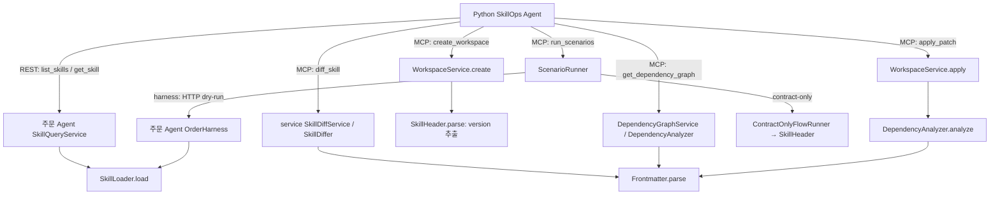

# SKILL 해석기 상세 분석: 함수·에이전트·데이터 흐름과 해결안

> **과거 검토 기록 — 기준 `dc261ba`.** 이 문서의 “현재”, 미완료 항목, 테스트 수와 줄 번호는 작성 당시 기준입니다. 최신 구현·계약·#72 완료 상태는 [리뷰 문서 안내](../README.md)를 우선합니다. 아래 제안을 현재 API나 새 작업 승인으로 간주하지 않습니다.

작성일: 2026-10-23 · 소스 기준: `dc261ba01ec6a13e6c7f7b488be4dfc17e270781`

백엔드만 대상으로 작성했다. 기존 코드·공통 명세·설정·DB는 수정하지 않았다. 아래에서 **현행**과 **해결 제안**을 구분한다. 외부 서버와 모델 호출은 수행하지 않았으며, 현재 Java 소스를 임시 디렉토리에서 컴파일해 함수 수준 재현 13건을 실행했다. 검증 범위는 10절에 적었다.

## 1. 지금 문제가 무엇인가

현재 같은 SKILL.md가 세 경로에서 서로 다르게 해석된다.

| 경로 | 담당 코드 | 목적 | 현재 문제 |
|---|---|---|---|
| 주문 실행·Skill 조회 | 주문 Agent `SkillLoader` | 실행 가능한 Skill 정의 생성과 검증 | 다른 경로보다 엄격하다. 진단용 메타데이터 조회도 이 로더를 사용해 잘못된 Skill의 원문 접근이 제한된다. |
| diff·정적 그래프·patch 검사 | service `Frontmatter`, `DependencyAnalyzer` | 변경 증거와 선언 연결 관계 분석 | YAML은 읽지만 실행 필수 필드·flow 규칙 일부를 검사하지 않는다. 분석 완료가 실행 가능을 뜻하지 않는다. |
| workspace 버전·간이 실행 | service `SkillHeader` | version 추출과 계약 흉내 실행 | 정식 YAML 파서가 아니다. 여러 줄 목록·따옴표 등을 다르게 읽고 잘못된 값을 빈 목록으로 바꾼다. |

핵심 증상은 다음과 같다.

1. **같은 목록의 의미가 다르다.** 여러 줄 `outputs`는 실행 로더에서 정상 목록이지만 간이 파서에서는 `[]`다.
2. **실행하지 않았는데 실행한 것처럼 보일 수 있다.** 여러 줄 `steps`는 간이 실행기에서 빈 순서가 되어 0단계 후 `SHIPPED`를 반환한다.
3. **patch 검사 통과가 실행 가능을 뜻하지 않는다.** owner 삭제를 patch가 받아도 실행 로더는 `INVALID_SKILL_FORMAT`으로 거부한다.
4. **의존성 위반이 응답에서 사라진다.** graph는 `missing_dependencies`를 계산하지만 patch의 `broken_links`에는 `missing_inputs`만 담는다.
5. **깨진 Skill을 진단하기 전에 막힐 수 있다.** 주문 Skill 목록의 `partial/parse_errors`를 Python이 전체 오류로 처리해 diff 수집 전 종료한다.

따라서 해결 과제는 “파서 셋을 없앤다”보다 **공통 문법 해석·타입 규칙을 고정하고, 실행·분석·수정 검증의 결과 의미를 명확히 나누는 것**이다.

## 2. 구성 요소와 호출 관계

### 2.1 세 서버의 역할

| 구성 | 실제 역할 | SKILL을 어떻게 다루는가 |
|---|---|---|
| Python `skillops-agent` · 기본 8000 | 장애 진단, 원인 실험, 후보 생성·검증 조정 | REST/MCP로 받은 dict와 원문 문자열을 사용한다. 아래 Java YAML 파서와 같은 파서를 Python이 직접 실행하는 구조는 아니다. |
| Spring `service` · 기본 8080 | MCP 서버, diff/graph, workspace, 시나리오 실행·채점 | snapshot 원문을 HTTP로 받아 분석하거나 workspace 원문을 직접 해석한다. |
| Spring `order-agent/backend` · 기본 8081 | 주문 Harness·업무 도구, snapshot·trace 원본 | 고정 snapshot의 UTF-8 바이트를 SkillLoader로 읽고 실제 업무 실행에 사용한다. |

이 문서에서 C-1/C-2/B는 기존 담당 경계를 뜻한다. 세 개의 파서가 각각 독립 LLM Agent라는 의미는 아니다.



diff/graph 경로의 service는 주문 Agent의 **파일 원문 조회 API**를 사용한다. SkillQueryService의 엄격한 `get_skill` 결과를 다시 분석하는 구조가 아니다. 이 차이 때문에 service의 diff는 깨진 YAML도 비교할 수 있지만 Python 전체 진단은 더 앞 단계에서 막힐 수 있다.

### 2.2 실제 후보 생성·검증 순서

```text
fetch_evidence
  ├─ _fix_snapshots: 기준/후보 snapshot과 trace 고정
  ├─ list_skills → SkillQueryService.list → SkillLoader.load
  ├─ check_skill_listing: partial/parse_errors면 중단
  └─ _collect_changes → MCP diff_skill → SkillDiffer / Frontmatter

generate_candidates
  ├─ _repair_inputs
  │   ├─ MCP get_dependency_graph → DependencyAnalyzer / Frontmatter
  │   └─ REST get_skill → SkillQueryService.get → SkillLoader.load
  ├─ graph.complete가 true인지 확인
  ├─ LLM에 graph·diff·현재 원문을 프롬프트 문자열로 전달
  └─ LLM의 수정 후 full_text → Python unified_patch 생성

verify_candidates
  ├─ MCP create_workspace → SkillHeader로 시작 version 추출
  ├─ MCP apply_patch → DependencyAnalyzer로 변경 후 분석
  └─ MCP run_scenarios
      ├─ contract-only → SkillHeader 기반 흉내 실행
      └─ harness → 후보 snapshot 발행 → 주문 Agent SkillLoader / Harness
```

루트 예제 설정은 `contract-only`이고, Python과 실제 주문 실행을 연동하려면 `harness`를 사용해야 한다. 간이 실행기의 `r_fake...` ID는 Python `validate_report`의 실제 실행 UUID 검증과 맞지 않는다. 따라서 간이 실행기의 오판을 그대로 “현행 Python 전체 흐름에서 승인 가능한 합격”이라고 확대 해석하면 안 된다.

## 3. 입력 데이터는 어떤 형식인가

### 3.1 SKILL.md 원본

frontmatter는 YAML, 뒤쪽 body는 자연어 문자열이다. 아래는 파서 비교용 최소 fixture다. 실제 주문 전체 흐름을 대체하는 fixture가 아니다.

`skills/order-flow/SKILL.md`:

```yaml
---
name: order-flow
description: demo
owner: team
version: 1
steps: [inventory-check, payment]
---
body
```

`skills/inventory-check/SKILL.md`:

```yaml
---
name: inventory-check
description: demo
owner: team
version: 1
inputs: [order.items]
outputs: [inventory.reserved]
depends_on: []
---
body
```

`skills/payment/SKILL.md`:

```yaml
---
name: payment
description: demo
owner: team
version: 1
inputs: [inventory.reserved]
outputs: [payment.status]
depends_on: [inventory-check]
---
body
```

### 3.2 서버 간 데이터와 내부 데이터의 차이

| 위치 | 입력 형식 | 구체적인 모양 |
|---|---|---|
| 주문 snapshot 내부 | Java `SortedMap<String, byte[]>` | key=`skills/payment/SKILL.md`, value=원본 UTF-8 bytes |
| snapshot manifest REST | JSON | snapshot_id, hash, created_at, metadata, files[{path, hash, size}] |
| 파일 원문 REST | JSON | snapshot_id, path, hash, size, encoding, content |
| service 원문 조회 후 | Java `String` | encoding=utf-8의 content. base64는 `readText`가 거부 |
| service graph 입력 | `Map<String, SkillSource>` | Skill ID → `SkillSource(path, fileHash, text)` |
| workspace DB | Skill별 JSON | `{baseVersion, fullText, revision}`. 내부 키는 camelCase |
| Python REST/MCP 조회 후 | Python `dict`, `list`, `str` | JSON을 해석한 값. content/full_text/patch는 각각 문자열 |

실행 서버는 **바이트**, service 분석기는 **원문 문자열**, Python은 **JSON을 해석한 dict와 원문 문자열**을 다룬다. 내부 Java record와 외부 JSON의 필드 이름도 동일하지 않을 수 있다.

파일 원문 API 예시 — 해시와 ID는 설명용 표시다.

```json
{
  "snapshot_id": "<snapshot UUID>",
  "path": "skills/payment/SKILL.md",
  "hash": "<원본 바이트 SHA-256>",
  "size": 180,
  "encoding": "utf-8",
  "content": "---\nname: payment\n...\n---\nbody\n"
}
```

`size`는 예시 값이다. 원문 줄바꿈·인코딩·해시는 증거이며 파싱 편의를 위해 원본을 덮어쓰면 안 된다. SkillLoader는 해석용 문자열에서 CRLF를 LF로 바꾸지만 Skill의 hash는 원본 bytes에서 계산한다. `get_skill`의 content도 원본 줄바꿈을 유지한다.

## 4. 경로 A: 주문 Agent의 실행 로더

근거: [SkillLoader.java](../../../order-agent/backend/src/main/java/com/capstone4/orderagent/harness/SkillLoader.java).

### 4.1 함수별 입력·처리·출력

| 함수 | 입력 | 처리 / 언제 호출되는가 | 출력·실패 |
|---|---|---|---|
| `skillPath(id)` | Skill ID | snapshot 내부 경로 구성 | `skills/<id>/SKILL.md` 문자열 |
| `validateName(id)` | 문자열 ID | load와 단건 조회의 경로 구성 전 검사 | 정상 시 반환값 없음. 소문자로 시작하는 64자 이하 kebab-case가 아니면 INVALID_SKILL_NAME |
| `load(files, id)` | 고정 파일 bytes map, ID | 아래 해석·검증을 조합하는 진입점 | `Skill` record. 파일 없음 UNKNOWN_SKILL, 형식 오류 INVALID_SKILL_FORMAT |
| `decodeUtf8(bytes)` | 원본 bytes | 잘못된 UTF-8 거부, 해석용 CRLF→LF | 원문 문자열. 디코딩 실패는 load에서 형식 오류로 변환 |
| `splitFrontMatter(text)` | 문자열 | 시작 `---\n`, 닫는 `\n---\n` 경계 분리 | 내부 `FrontMatter(yaml, body)` |
| `parseMetadata(yaml)` | YAML 부분 문자열 | SnakeYAML SafeConstructor, 중복 키 금지, collection alias 금지, code point 100,000 제한 | YAML map/list/scalar 등 Java 값. load가 map 여부를 후속 검사 |
| `requireMetadata(parsed, id)` | YAML 값, 폴더 ID | name 일치, description/owner 비공백 문자열, version은 1 이상 Integer | 내부 `Metadata(fields, description, version, owner)` 또는 형식 오류 |
| `strings(fields, key, required)` | YAML map, 필드명, 필수 여부 | 문자열 목록 타입 검사. 필수 필드 누락/null은 거부 | `List<String>`. 선택 필드 누락/null은 `[]`; 빈 목록 자체는 허용 |
| `candidates(files)` | snapshot bytes map | 엔트리 선택 전 모든 후보 파일 load | 메타데이터 map 목록. 후보 하나가 잘못돼도 전체 실패 |
| `validateFlow(files, flow)` | bytes map, 해석된 flow | 업무 도구 실행 전에 steps·선언 관계 검사 | 단계 `List<Skill>` 또는 INVALID_FLOW/CONTRACT_VIOLATION 등 |
| `validateInputs(skill, available, completed, phase)` | Skill, 공급 키·완료 단계 집합 | 정적 검증과 각 단계 실행 직전 모두 사용 | 정상 시 반환값 없음. 누락 키/선행 단계가 담긴 CONTRACT_VIOLATION |

`strings`는 문자열 항목의 공백을 자동 제거하지 않는다. 공백뿐인 항목은 거부하지만 `" inventory.reserved "`처럼 양끝에 공백이 있는 값은 그대로 남아 다른 키가 될 수 있다. 빈 목록 허용과 “빈 문자열 항목 거부”를 혼동하면 안 된다.

### 4.2 load의 출력과 실제 사용처

```java
Skill(
    String id, String description, int version,
    List<String> inputs, List<String> outputs,
    List<String> dependsOn, List<String> steps,
    String body, String path, String hash, String owner
)
```

정상 inventory-check의 핵심 값은 다음과 같다.

```json
{
  "id": "inventory-check",
  "version": 1,
  "inputs": ["order.items"],
  "outputs": ["inventory.reserved"],
  "depends_on": [],
  "steps": [],
  "body": "body"
}
```

이는 내부 record를 모델 JSON으로 바꿀 때의 일부 필드 예시다. HTTP Skill 조회에서는 같은 식별자를 `skill_id`와 `name`으로 내보낸다.

| 호출 함수 | 사용하는 시점 | 후속 처리 |
|---|---|---|
| `OrderHarness.selectEntry()` → `loader.candidates()` | 엔트리 선택 | 후보 이름·description·version 목록을 결정 provider에 전달 |
| `OrderHarness.loadValidatedFlow()` → `load()` / `validateFlow()` | 선택된 루트 로딩, 업무 실행 전 | 루트 order-flow 확인, 단계 도구 바인딩 검사, FLOW_VALIDATED 기록 |
| `OrderHarness.runStep()` → `load()` / `validateInputs()` | 단계 실행 직전 | 선언된 입력만 모델에 전달하고, 도구 결과에서 선언된 출력만 다음 단계 context에 반영 |
| `SkillQueryService.list()` → `load()` | `GET /api/snapshots/{id}/skills` | 정상 items와 파일별 parse_errors를 분리, 실패가 있으면 partial=true |
| `SkillQueryService.get()` → `load()` | `GET /api/snapshots/{id}/skills/{skillId}` | 정상 메타데이터+content 반환. 해석 실패는 SKILL_METADATA_INVALID |

### 4.3 LLM과의 관계

`DecisionProvider.Question.tool(skill, inputs, toolDefinition)`이 Skill record·선언 입력 map·허용된 업무 도구 정의를 묶는다. OpenAI 모드에서는 `Json.write(question)`으로 JSON 문자열을 만든 뒤 모델 사용자 메시지로 전달한다. 여기서 dependsOn, toolDefinition 등의 record 이름은 snake_case로 직렬화된다.

모델 응답 형식은 다음과 같다.

```json
{"tool":"<해당 단계에 허용된 도구>","arguments":{"<인자>":"<값>"}}
```

YAML의 문법·필수 필드를 최종 검증하는 주체는 Java다. 모델이 본문을 읽었다고 파싱·의존성 검증이 대체되지는 않는다. fixed 모드는 본문을 해석하지 않고 코드에 정한 도구와 인자를 사용한다.

## 5. 경로 B: service의 YAML 분석·diff

근거: [Frontmatter](../../../service/src/main/java/com/capstone4/skillops/snapshot/Frontmatter.java), [DependencyAnalyzer](../../../service/src/main/java/com/capstone4/skillops/snapshot/DependencyAnalyzer.java), [SkillDiffer](../../../service/src/main/java/com/capstone4/skillops/snapshot/SkillDiffer.java).

### 5.1 Frontmatter 함수

| 함수 | 입력 | 출력·현재 규칙 |
|---|---|---|
| `parse(text)` | UTF-8 원문 String 또는 null | YAML을 `Map<String,Object>`로 반환. 파일 경로·Skill ID는 받지 않는다. |
| `parse`의 경계 검색 | 같은 원문 | LF/CRLF 지원, 닫는 `---`가 EOF에 있어도 허용. 구분선 뒤 공백은 허용하지 않음. |
| `parse`의 빈 값 처리 | frontmatter 없음, null, map이 아닌 YAML | 모두 빈 map으로 반환. “없는 문서”와 “map이 아님”의 구분 정보가 없다. |
| `parse`의 YAML 처리 | YAML 블록 | SafeConstructor, 중복 키 금지·collection alias 금지. 실행 로더의 100,000 code point 제한을 명시적으로 동일 설정하지는 않음. 라이브러리 기본 제한은 별개다. |
| `closingLine(text)` | 원문 | 닫는 구분선의 1부터 시작하는 줄 번호, 없으면 0. YAML 파싱 없이 diff hunk의 frontmatter/body 위치에 사용 |

`parse()`와 `closingLine()`은 빈 블록의 경계 판정도 완전히 같지 않다. `---\n---\n`에서 parse는 빈 map, closingLine은 2다. 구분선 판정은 공통화 대상이다.

### 5.2 DependencyAnalyzer 함수

| 함수 | 입력 | 처리 | 출력·오류 |
|---|---|---|---|
| `analyze(entrySkillId, sources)` | ID, `Map<String,SkillSource>` | entry steps를 따라 선언 그래프 계산 | `DependencyGraph` |
| `flowSteps(entrySkillId, entry)` | entry의 원문·경로·해시 | Frontmatter.parse 후 문자열 steps 추출 | 비어 있지 않은 List<String>. entry 없음 SKILL_NOT_FOUND, 읽기 실패 INVALID_FLOW |
| `declaration(id, text)` | 단계 ID와 원문 | name 일치, 중첩 flow 여부, inputs/outputs/depends_on 타입 검사 | 내부 `Declaration(inputs, outputs, dependsOn)` |
| `strings(fm, key, required)` | YAML map·필드 | 목록·항목 타입 검사 | List<String> 또는 IllegalArgumentException |
| `FlowWalk.visit(id, source)` | 단계 source 또는 null | 선언 읽기 후 connect/finish, 실패 시 unreadable | 노드·edge·오류 상태 누적 |
| `FlowWalk.connect(id, declaration)` | 해석된 선언 | input 공급자, depends_on 선행 여부 확인 | missing_inputs / missing_dependencies, io·depends_on edge 누적 |
| `FlowWalk.finish(id, outputs)` | 단계와 출력 키 | 완료 단계와 공급자에 추가 | 내부 상태 변경 |
| `FlowWalk.unreadable(node)` | 읽지 못한 단계 노드 | parse_error 저장, complete=false | 해당 단계를 done에 추가하지만 outputs 공급자는 등록하지 않음 |
| `FlowWalk.flowOrder(from, to)` | 이웃 단계 ID | 선언 순서 edge 추가 | flow_order edge |
| `FlowWalk.toGraph(entry, steps)` | entry, 순서 | 누적 결과 조립 | DependencyGraph. edge는 flow_order→depends_on→io 순서 |

실행 로더와 다른 부분:

- entry에서 name/description/owner/version/body를 검증하지 않고 steps를 읽는다.
- 단계에서는 name과 연결 선언을 검사하지만 description/owner/version/body는 검사하지 않는다.
- steps 중복과 최대 12단계 제한을 검사하지 않는다.
- 첫 위반에서 멈추지 않고 뒤 연결도 분석한다. 앞 단계에 입력 위반이 있어도 선언 outputs를 이후 공급자로 등록한다.
- 읽기 실패 단계도 done에 넣는다. 따라서 후속 depends_on은 충족처럼 보일 수 있다. 이는 실제 완료 관찰이 아니라 분석 진행 상태다.

### 5.3 get_dependency_graph의 서버 간 호출과 출력

```text
Python MCPTools.get_dependency_graph(snapshot_id, entry_skill_id)
 → MCP DependencyGraphTools.getDependencyGraph(...)
 → DependencyGraphService.dependencyGraph(...)
 → 주문 REST: GET /api/snapshots/{id}
 → fetchFlowSources: entry 원문 → flowSteps → 단계 원문
 → 주문 REST: GET /api/snapshots/{id}/files?path=...
 → DependencyAnalyzer.analyze(...)
 → DependencyGraphResult.of(manifest, graph)
```

MCP 입력:

```json
{"snapshot_id":"<UUID>","entry_skill_id":"order-flow"}
```

출력 필드:

```text
snapshot_id, snapshot_hash, entry_skill_id, steps
nodes[{skill_id,path,file_hash,inputs,outputs,depends_on,parse_error}]
edges[{type,from,to,keys}]
missing[{skill_id,missing_inputs,missing_dependencies}]
ambiguous[{skill_id,key,providers}]
complete
```

`complete=true`는 **단계 선언을 모두 읽을 수 있었다**는 현재 의미다. `missing=[]`, 메타데이터 유효, 실행 성공을 뜻하지 않는다. Python `generate_candidates`는 complete를 검사하고 이 그래프를 LLM에 전달하므로, 앞으로 결과 의미를 확장할 때 소비자도 함께 바꿔야 한다.

### 5.4 diff 함수와 출력

| 함수 | 입력 | 출력·사용처 |
|---|---|---|
| `SkillDiffService.diffSkill()` | skill_id, 두 snapshot ID | manifest 해시·원문 조회 후 외부 DiffSkillResult 조립 |
| `compareSkillMd()` | 경로, 두 ID·파일 해시 | 해시 같으면 원문/파싱 생략 후 unchanged. 다르면 SkillDiffer.diff 호출 |
| `SkillDiffer.diff()` | path, before/after 원문·해시 | 상태, hunk, frontmatter_changes, 파싱 오류 |
| `unifiedDiff()` / `splitHunks()` | 두 원문 → diff 줄 목록 | 문맥 3줄의 unified diff와 hunk별 줄 목록 |
| `toHunk()` / `HunkBody.read()` | hunk 줄·경계·해시 | index, hunk_id, part, header, before, after, diff |
| `standaloneDiff()` / `hunkId()` | 한 hunk와 원본 해시 | 단독 적용 가능한 diff 문자열, 고정 hunk ID |
| `withFrontmatterChanges()` | hunk와 두 원문 | YAML 실패해도 hunk 보존, frontmatter_parse_error 설정 |
| `frontmatterChanges()` / `minus()` | 두 YAML map | 변경된 키와 before/after/added/removed |
| `lines()` | String/null | 줄 목록. 원본 바이트 전체 보존 기능과 별개 |

MCP 입력과 출력 핵심:

```json
{"skill_id":"inventory-check","before_snapshot_id":"<기준 UUID>","after_snapshot_id":"<후보 UUID>"}
```

```text
skill_id, before/after {snapshot_id,snapshot_hash,path,file_hash}, status
frontmatter_changes[{field,before,after,added,removed}]
hunks[{index,hunk_id,part,header,before,after,diff}]
frontmatter_parse_error, related_files
```

Python `_collect_changes`는 각 hunk에 `change_no`, `skill`을 붙이고, 원인 실험에서 `reverse_hunk`로 되돌릴 patch를 만든다. 따라서 hunk ID·원본 줄·파일 해시는 유지해야 한다.

현재 파싱 오류 필드가 null이어도 “유효한 SKILL”이라는 뜻은 아니다. 해시가 같아 파싱을 생략했을 수도 있고, Frontmatter.parse가 구분선 미검출을 빈 map으로 반환했을 수도 있다.

## 6. 경로 C: workspace 간이 파서와 실제 호출 위치

근거: [SkillHeader](../../../service/src/main/java/com/capstone4/skillops/workspace/SkillHeader.java), [WorkspaceService](../../../service/src/main/java/com/capstone4/skillops/workspace/WorkspaceService.java), [ContractOnlyFlowRunner](../../../service/src/main/java/com/capstone4/skillops/scenario/ContractOnlyFlowRunner.java).

### 6.1 SkillHeader 함수

| 함수 | 입력 | 출력·현재 처리 |
|---|---|---|
| `parse(fullText)` | SKILL 전체 String | `SkillHeader(name, version, inputs, outputs, steps)` |
| `indexOfClosing(lines)` | 원문 줄 목록 | 닫는 구분선 위치, 없으면 -1. 구분선 앞뒤 공백을 strip해 검사 |
| `list(value)` | 콜론 뒤 한 줄 문자열 | `[a, b]`를 쉼표로 분리·strip. 그 밖에는 `[]` |

`parse`는 name/version/inputs/outputs/steps만 읽는다. description, owner, depends_on, body는 결과에 없다. 잘못된 YAML 전체를 검증하지 않으며, version이 숫자 패턴과 맞지 않으면 null이다. 중복 키는 이전 값을 뒤 값이 덮어쓴다. `version: 0`도 이 함수 자체에서는 정수 0으로 읽는다.

예를 들어 `outputs: ["inventory.reserved"]`는 아래처럼 다르다.

```text
SkillLoader / Frontmatter: [inventory.reserved]
SkillHeader:              ["inventory.reserved"]  ← 따옴표가 항목 문자열에 포함
```

### 6.2 workspace 생성 시 호출

```text
MCP create_workspace({snapshot_id})
 → WorkspaceService.create(...)
 → createFromSnapshot(snapshotId)
 → OrderAgentClient.getSnapshot / readText
 → versionOf(path, text)
 → SkillHeader.parse(text).version()
 → WorkspaceSkill(baseVersion, fullText, revision=0)
 → DB workspaces
```

snapshot 생성 경로가 아닌 `createFromLive()`는 `LiveFolderSkillVersionStore.liveVersions/fullText()`를 통해 version을 읽으며 그 저장소의 `versionOf()`도 SkillHeader를 사용한다.

중요한 구분: **harness 모드도 workspace를 생성할 때는 SkillHeader로 version을 읽는다.** 간이 실행기를 끄는 것만으로 SkillHeader 의존성이 없어지지 않는다. 반면 여러 줄 outputs를 잘못 읽어도 여기서는 version만 사용하므로 그것만으로 workspace 생성이 실패하지는 않는다.

생성 응답:

```json
{"workspace_id":"w_example","skill_versions":{"inventory-check":1,"payment":1,"order-flow":1},"created_at":"<ISO 시각>"}
```

### 6.3 patch 적용 시에는 다른 분석기를 사용

```text
MCP apply_patch({workspace_id, patches})
 → WorkspaceService.apply()
 → applyOne(): base_version 검사 → PatchApplier.apply → 원문·편집 횟수 변경
 → analyze(): Map<String,SkillSource> 구성 → DependencyAnalyzer.analyze()
 → rejectUnreadableHeaders(): 변경한 단계의 parse_error 거부
 → 저장
 → brokenLinksOf(): missing_inputs만 broken_links로 변환
```

요청 예시:

```json
{
  "workspace_id": "w_example",
  "patches": [{"skill":"payment","base_version":1,"patch":"<unified diff 문자열>"}]
}
```

응답 예시:

```json
{"workspace_id":"w_example","changed_skills":[{"skill":"payment","version":2}],"broken_links":[]}
```

여기의 version=2는 `baseVersion + 편집 횟수`이며 SKILL 원문의 version 필드를 자동으로 2로 고쳤다는 뜻은 아니다.

검사 범위의 빈틈:

- `missing_dependencies`는 `broken_links`에서 빠진다.
- description/owner/version/body 오류는 DependencyAnalyzer의 검사 대상이 아니다.
- `rejectUnreadableHeaders`는 entry flow의 steps에 있는 **변경한 단계 노드**만 검사한다. entry 자체의 메타데이터와 steps 밖 Skill은 이 노드 검사로 보호되지 않는다.
- 끊긴 입력이 있어도 patch 자체는 저장한다. 원인 실험에 결함 후보를 만들 수 있어야 하므로 “patch 저장 성공”과 “실행 검증 통과”를 구분하는 정책이 필요하다.

### 6.4 contract-only와 harness의 출력 차이

| 함수 | 입력 | 처리·출력 |
|---|---|---|
| `ScenarioRunner.runScenario()` | workspace Skill map, 시나리오, repeat | 매 trial에 DryRunRequest 구성 → FlowRunner 호출 → 채점·원장 저장 |
| `ContractOnlyFlowRunner.stepsOf()` | `Map<String,WorkspaceSkill>` | order-flow를 SkillHeader로 읽어 단계 이름 목록 추출 |
| `ContractOnlyFlowRunner.initialContext()` | order JSON map | 각 키에 `order.`를 붙인 context 구성 |
| `ContractOnlyFlowRunner.simulate()` | 단계 ID, SkillHeader, context | inputs가 있으면 outputs를 canned/fake 값으로 생성. depends_on·본문은 검사하지 않음 |
| `ContractOnlyFlowRunner.skipped()` | 단계 ID | 앞 오류 이후 skipped 단계 결과 |
| `ContractOnlyFlowRunner.runDryRun()` | DryRunRequest | `RunOutcome(r_fake..., SHIPPED/FAILED, steps)` |
| `HarnessFlowRunner.runDryRun()` | DryRunRequest | filesOf()로 전체 파일 export → 후보 발행 → HTTP dry-run → trace 변환 |
| `OrderAgentTraceConverter.toOutcome()` | run_id, 실제 trace dict | 실제 실행을 공통 RunOutcome 형식으로 변환 |

공통 내부 결과:

```java
RunOutcome(String runId, String finalStatus, List<Step> steps)
Step(String skill, String status, Map<String,Object> input,
     Map<String,Object> output, String error)
```

harness의 서버 간 요청은 다음 두 단계다.

```text
POST /api/snapshots/candidates
  {files: {"skills/.../SKILL.md": "원문", ...}, metadata: {...}}
  → snapshot_id 등 manifest

POST /api/dry-runs
  {snapshot_id: "UUID", order: {customer,items,payment_method,shipping}}
  → execution_id, run_id, order_id, final_status, completion

GET /api/executions/{execution_id}/trace
  → 실행 요약 + events
```

MCP의 `run_scenarios` 최종 응답은 내부 RunOutcome 전체와 다르다.

```text
{workspace_id, all_passed,
 results:[{scenario_id,replay_of_run_id,passed,run_ids,
           failures:[{run_id,skill,reason}]}]}
```

## 7. Python이 받는 데이터와 실패 전파

### 7.1 메타데이터 조회 결과

`SkillQueryService.list`의 HTTP 응답:

```json
{
  "snapshot_id": "<UUID>",
  "snapshot_hash": "<hash>",
  "items": [{"skill_id":"payment","name":"payment","version":1,"inputs":["inventory.reserved"],"outputs":["payment.status"],"depends_on":["inventory-check"],"steps":[]}],
  "partial": true,
  "parse_errors": [{"path":"skills/inventory-check/SKILL.md","code":"INVALID_SKILL_FORMAT","message":"<오류 설명>"}]
}
```

items는 정상 Skill만 담는다. 위 예시에서 깨진 inventory-check는 parse_errors에 있고 items에는 없다. 정상 항목의 나머지 메타데이터 필드는 설명상 생략했다.

`contracts.check_skill_listing()`은 snapshot ID/hash를 대조한 뒤 partial 또는 parse_errors가 있으면 `ContractError("candidate skill metadata is incomplete")`를 던진다. 따라서 `fetch_evidence`의 다음 `_collect_changes`는 호출되지 않는다. 그래프 guard는 오류를 진단 ERROR 상태로 기록한다.

단건 `get_skill`도 파싱 실패 파일의 content를 반환하지 않는다. 원문은 `/api/snapshots/{id}/files?path=...`에서 별도로 읽을 수 있지만, 현재 Python `_repair_inputs`는 엄격한 get_skill을 사용한다.

### 7.2 LLM 후보가 돌아오는 형식

Python `_ask_llm()`은 prompt template에 dict·원문을 `str.format`으로 넣어 **프롬프트 문자열**을 만든다. dict 자리에는 Python 문자열 표현이 들어갈 수 있으므로 이것을 원문 그대로의 HTTP JSON payload와 동일하다고 부르면 안 된다.

구조화 출력은 `_CandidatesOutput` Pydantic 모델이다.

```json
{
  "candidates": [{
    "kind": "same_skill",
    "patches": [{"skill":"inventory-check","full_text":"---\nname: inventory-check\n...\n---\nbody\n"}]
  }]
}
```

`_patches_from_spec()`는 대상 존재·중복·`---\n` 시작·실제 변경 유무를 확인하고, 현재 snapshot content와 full_text 사이 unified patch를 만든다. Python이 이 단계에서 YAML의 owner·목록 타입·선행 관계까지 검증하는 것은 아니다. 이후 service와 주문 Agent가 서로 다른 수준으로 검사한다.

### 7.3 오류 형식과 통과 신호를 구분

| 위치 | 실패/상태 | 소비자에게 보이는 결과 |
|---|---|---|
| SkillLoader | 파일/메타데이터 오류 | AgentException category. 실행 trace 또는 조회 HTTP 오류로 변환 |
| SkillQueryService.list | 일부 Skill 해석 실패 | HTTP 정상 응답 + partial=true/parse_errors |
| SkillQueryService.get | 단건 해석 실패 | SKILL_METADATA_INVALID 오류 |
| graph entry | steps 파싱 불가 | MCP isError=true, code=INVALID_FLOW |
| graph 단계 | YAML·선언 파싱 불가 | 도구 성공 결과 안의 nodes[].parse_error + complete=false |
| graph 연결 | input/선행 단계 누락 | 도구 성공 결과 안의 missing; complete는 true일 수 있음 |
| apply_patch | 변경한 단계 선언 파싱 불가 | MCP INVALID_INPUT 오류 |
| apply_patch | owner 누락/선행 단계만 위반 | 현행에서는 저장 성공·broken_links=[] 가능 |
| diff | 변경된 YAML 파싱 실패 | hunk 보존 + frontmatter_parse_error. 도구 호출 자체는 성공 가능 |
| Python 목록 검사 | partial 목록 수신 | ContractError → 해당 진단 ERROR |

ping을 제외한 현재 MCP 도구는 결과 객체를 **단일 text content의 JSON 문자열**로 감싼다. Python `_call()`은 이를 dict로 풀고, `isError=true`이면 MCPToolError로 올린다. 결과 안의 parse_error/complete/missing은 도구 호출 오류와 별개로 소비자가 해석해야 한다.

## 8. 실제 함수 재현 결과와 영향

### 8.1 검증 방법

3.1의 최소 fixture를 한 부분씩 변경했다. 현재 소스를 JDK 21로 새로 컴파일했고, 캐시된 SnakeYAML 2.6 등을 사용했다. 저장소의 예전 build/classes는 일부 상수가 현재 소스와 달라 최종 실행에 사용하지 않았다. 최종 컴파일은 `-proc:none`으로 수행했다.

- 10개 fixture에서 실제 `SkillHeader.parse`, `DependencyAnalyzer.analyze`, `SkillLoader.load/validateFlow`, `ContractOnlyFlowRunner.runDryRun`을 호출했다.
- 2건은 실제 `WorkspaceService.apply`를 호출했다. WorkspaceRepository만 메모리 proxy로 대체했으며 patch 처리·분석·응답 조립은 현재 코드를 실행했다.
- 1건은 실제 `SkillDiffer.diff`로 깨진 YAML 변경을 비교했다.

### 8.2 10개 fixture 결과

| 변경 | SkillHeader·간이 실행 | graph | 실행 로더의 load/validateFlow |
|---|---|---|---|
| 정상 fixture | SHIPPED, 2단계 | complete=true, missing=[] | 정상 |
| steps를 여러 줄 목록으로 변경 | steps=[], **SHIPPED, 0단계** | 정상 두 단계 분석 | 정상 두 단계 검증 |
| outputs를 여러 줄 목록으로 변경 | outputs=[], payment 입력 누락으로 FAILED | 정상 | 정상 |
| outputs 항목에 YAML 따옴표 사용 | 따옴표가 키에 포함, payment 입력 누락으로 FAILED | 정상 | 정상 |
| version을 문자열 `"1"`로 변경 | version=null. 원문을 직접 넘긴 간이 실행은 SHIPPED | complete=true, missing=[] | INVALID_SKILL_FORMAT |
| inventory-check owner 삭제 | SHIPPED | complete=true, missing=[] | INVALID_SKILL_FORMAT |
| payment depends_on을 `[notify]`로 변경 | depends_on을 읽지 않아 SHIPPED | complete=true, missing_dependencies=[notify] | CONTRACT_VIOLATION |
| steps에 inventory-check 중복 | SHIPPED, 3단계 | complete=true, missing=[] | INVALID_FLOW |
| entry의 name을 other-flow로 변경 | SHIPPED | entry name을 안 봐 complete=true | INVALID_SKILL_FORMAT |
| outputs의 닫는 `]` 삭제 | 해당 outputs=[]; 후속 입력 누락으로 FAILED | complete=false, 노드 parse_error·후속 missing_inputs | INVALID_SKILL_FORMAT |

주의할 범위:

- quoted version은 workspace `versionOf()`에서 이미 거부된다. 표의 간이 SHIPPED는 원문을 담은 WorkspaceSkill을 직접 구성했을 때의 함수 결과이며 실제 workspace 생성 성공을 뜻하지 않는다.
- 로더 검증 정상은 최소 fixture의 문법·선언 관계가 정상이라는 뜻이다. 실제 Harness는 필수 마지막 notify, 업무 도구 인자·업무 결과도 확인하므로 이 두 단계 fixture의 운영 성공까지 검증한 것은 아니다.
- 간이 SHIPPED는 ScenarioGrader의 전체 합격과 다르다. 기대 Skill 순서·배송 수·assertion이 있으면 채점에서 실패할 수 있다.

### 8.3 patch 함수에서 확인한 두 가지 누락

정상 payment를 기준으로 `depends_on: [notify]`로 바꾸는 patch와 owner를 삭제하는 patch를 각각 독립 workspace에 적용했다. 둘 다 아래 형태의 **실제 함수 반환값**을 받았다.

```json
{
  "workspace_id": "w_probe",
  "changed_skills": [{"skill":"payment","version":2}],
  "broken_links": []
}
```

선행 단계 위반의 graph 결과는 다음과 같았다.

```json
{
  "complete": true,
  "missing": [{
    "skill_id": "payment",
    "missing_inputs": [],
    "missing_dependencies": ["notify"]
  }]
}
```

같은 데이터에서 실행 로더의 정적 검증은 CONTRACT_VIOLATION을 냈다. patch 저장 성공은 설계상 허용할 수 있지만, 이 응답을 근거로 Python `_judge()`가 `no_broken_links = not applied["broken_links"]`를 계산하면 **의존성 위반이 없다고 표시하는 항목은 부정확**해진다. harness 평가가 별도로 실패할 수 있으므로 이것만으로 최종 후보 전체가 자동 합격한다고 단정하지는 않는다.

### 8.4 깨진 YAML의 diff는 보존된다

닫는 `]`를 삭제한 원문 변경에서 `SkillDiffer.diff` 결과는 다음과 같았다.

```json
{"status":"modified","hunk_count":1,"frontmatter_changes":[],"parse_error_present":true}
```

즉 diff 기능은 실패 원문의 변경 증거를 이미 만들 수 있다. 문제는 Python fetch_evidence의 목록 완전성 검사와 get_skill 경로가 그 원문을 수정 단계까지 전달하지 않는다는 데 있다. 해결 과정에서 diff까지 실행 로더처럼 엄격하게 거부하도록 바꾸면 현재 가능한 진단 증거 수집도 잃는다.

## 9. 해결안: 무엇을 공통화하고 무엇을 유지할 것인가

### 9.1 공통 계약을 먼저 정의

**제안**: 공통 파서가 원문 바이트·YAML·본문·타입 정보를 만들고, 목적별 validator가 그 결과를 소비하게 한다. 실행 로더 전체를 diff에 그대로 재사용하는 방식은 피한다.

```text
원본 bytes + path + file hash
  → 공통 UTF-8/구분선 해석
  → 안전한 YAML 파싱
  → 필드 존재·타입·정규화 결과와 진단
       ├─ 실행 검증 → 실행 가능한 SkillDefinition → Harness
       ├─ 정적 분석 → graph + 구조화 진단
       ├─ workspace → version/정의 조회·후보 검증
       └─ diff → 파싱 실패해도 원문 hunk와 오류 보존
```

공통 입력·출력의 내부 타입 예시 — 미구현 설계안:

```text
SkillDocumentInput
  path, skill_id, raw_bytes, file_hash

ParsedSkillDocument
  path, skill_id, file_hash, raw_text
  frontmatter_range, body_range
  yaml_fields / typed_fields
  diagnostics[{code, severity, field, line, column, message}]

SkillDefinition
  id, version, owner, description
  inputs, outputs, depends_on, steps, body

SkillValidationResult
  syntax_valid, metadata_valid, flow_valid, analysis_complete
  diagnostics, definition(검증 성공 시)
```

누락·명시적 null·빈 목록·잘못된 타입을 파서에서 모두 `[]`로 합치지 않는다. 필드의 원래 상태를 보존하고 validator가 허용 여부를 정한다. version은 우선 현행 실행 규칙대로 1 이상 정수로 고정하고 `"1"`을 임의 변환하지 않는 안을 권장한다. 다른 정책을 선택하면 명시적 계약 변경이다.

공통화할 세부 항목:

| 항목 | 권장 규칙 |
|---|---|
| UTF-8·줄바꿈 | 잘못된 바이트는 명시적 오류. 원본 hash·원문은 보존하고 해석용 줄바꿈만 정규화 |
| frontmatter 구분선 | LF/CRLF, 마지막 개행·구분선 공백·BOM 허용 여부를 한 계약으로 확정 |
| YAML 안전 옵션 | 중복 키·alias·크기 제한을 같은 버전·설정으로 명시 |
| 목록 | inline/block·따옴표는 YAML 의미대로 동일. 문자열 아닌 항목·공백 키의 정책 명시 |
| 필수 필드 | 단계와 flow의 필드 요구사항 정의. 기본값 보충을 원문에 몰래 적용하지 않음 |
| Skill ID | SkillPaths와 SkillLoader의 다른 정규식·최대 길이 통일 |
| flow | 중복 단계·최대 개수·중첩 flow·입출력 공급·선행 단계 검증을 공통 규칙으로 정의 |
| 원문 오류 | 정상 목록에서 빠진 파일도 진단용 원문·해시·오류 참조는 유지 |

### 9.2 Java 공통 모듈과 목적별 정책

service와 주문 Agent는 독립 Gradle 프로젝트다. 폴더에 공용 클래스 하나를 추가한다고 두 서버가 자동으로 공유하지 않는다.

권장안은 의존성이 작은 Java `skill-contract` 라이브러리를 별도 모듈/배포 artifact로 두고 두 서버가 명시적으로 같은 버전을 참조하는 것이다. Spring controller, JPA, 모델 client는 이 라이브러리에 넣지 않는다. snapshot 네트워크 조회도 각 서버에 남긴다.

첫 단계에서 배포 모듈 도입이 부담되면 두 구현에 같은 계약 fixture를 적용하는 방법으로 의미를 먼저 고정할 수 있다. 이 경우 코드가 여전히 두 벌이라는 사실과 향후 라이브러리 전환 계획을 문서화한다. Python에 별도 YAML 파서를 추가할 필요는 없다.

목적별로 유지할 차이:

- 실행: 형식/필수 값/flow 위반이면 업무 도구 실행 전에 거부한다.
- graph: 위반을 모두 수집할 수 있지만, 실제로 완료되지 않은 단계를 완료 증거처럼 표현하지 않는다. 파싱 실패·연결 위반·분석 불완전 상태를 구분한다.
- patch: 결함 실험을 위해 의미 위반 후보를 저장할 수 있으나 diagnostics를 빠짐없이 반환한다. 운영 반영 가능 여부는 별도 검증한다.
- diff: 깨진 YAML도 원문 hunk를 반환한다. 의미 분석 불가를 “변경 없음”으로 바꾸지 않는다.

### 9.3 구체적인 파일별 변경 계획

| 대상 함수·모듈 | 제안 변경 | 연결되는 소비자·계약 |
|---|---|---|
| SkillHeader.parse/list | 공통 파서의 version/정의 조회로 교체 후 간이 파서 폐기 | workspace 생성, LiveFolderSkillVersionStore, ContractOnlyFlowRunner |
| Frontmatter.parse/closingLine | 같은 경계 인식·안전 옵션·원문 범위 모델 사용 | SkillDiffer hunk 위치, DependencyAnalyzer |
| SkillLoader.load | 공통 해석 결과 + 실행 validator 조합 | Harness, SkillQueryService, 모델 Question, trace |
| DependencyAnalyzer.flowSteps/declaration | 공통 typed 정의와 진단 사용 | graph, patch, Python 후보 프롬프트 |
| FlowWalk | 위반 뒤 진행 여부·미확정 공급자 상태를 명시 | complete/missing/diagnostics 의미와 기존 소비자 |
| WorkspaceService.rejectUnreadableHeaders | entry·steps 밖의 변경 파일도 직접 문법 검증 | patch의 오류·저장 정책 |
| WorkspaceService.brokenLinksOf | missing_dependencies를 버리지 않도록 결과 확장 | MCP 응답 DTO, Python `_judge`, stub와 계약 fixture |
| ContractOnlyFlowRunner | 공통 의미로 steps/선행 관계 검증. 빈 순서를 실행 성공으로 만들지 않음 | service 테스트·샘플 실행. 실제 평가 결과와 구분 |
| SkillQueryService | 기존 엄격 조회 유지 여부와 진단용 원문 제공 경계를 분리 | REST 오류·partial 응답, Python fetch_evidence/_repair_inputs |
| Python check_skill_listing/fetch_evidence | 불완전 metadata를 정상으로 가장하지 않고 raw evidence 수집 경로 추가 | 상태·원문 조회·version 불명 처리 |
| Python _repair_inputs/_patches_from_spec | 깨진 파일도 고정 raw 원문 기준으로 수정 후보 구성 가능하게 확장 | 원본 hash 검증, full_text→patch, 후보 유효성 검증 |

### 9.4 응답 개선안

기존 `broken_links` 필드는 호환을 고려해 유지하면서 구조화 진단을 추가하는 안이다. 실제 필드명과 버전은 합의가 필요하다.

```json
{
  "workspace_id": "w_example",
  "changed_skills": [{"skill":"payment","version":2}],
  "broken_links": [],
  "validation": {
    "syntax_valid": true,
    "metadata_valid": true,
    "flow_valid": false,
    "analysis_complete": true,
    "diagnostics": [{
      "code":"MISSING_DEPENDENCY",
      "skill_id":"payment",
      "field":"depends_on",
      "dependency":"notify",
      "severity":"error"
    }]
  }
}
```

이는 **미구현 응답 제안**이다. Python은 새 검증 결과를 우선 사용하도록 함께 전환해야 하며, 필드를 추가하는 것만으로 현행 `_judge`의 오판이 고쳐지지는 않는다. 반영 가능한 Skill의 판정은 `analysis_complete` 하나가 아니라 필수 검증 결과와 실제 평가를 함께 사용한다.

### 9.5 깨진 YAML을 고치는 진단 경로

1. Python은 manifest와 변경 경로를 먼저 고정한다.
2. metadata 목록이 partial이어도 parse_errors를 저장하고, 해당 파일 원문은 hash가 고정된 files API로 조회한다.
3. 변경 파일의 raw diff를 먼저 수집한다. metadata 파싱 실패 자체를 증거로 남긴다.
4. 정상 baseline의 정의·원문과 깨진 후보 원문을 함께 후보 생성에 제공한다. baseline version을 후보의 version으로 조용히 대입하지 않는다.
5. 원인 실험 workspace는 정상 baseline에서 생성한 뒤 결함 hunk를 재적용하는 방법 등을 별도 정책으로 정의한다. 깨진 version 때문에 생성할 수 없는 경우도 표현한다.
6. 수정 후보를 공통 문법/필수 값/flow 규칙으로 검증하고 harness로 실행한다.
7. 지원하지 않는 신규·삭제 Skill, resource-only, 비 UTF-8 입력은 명확한 미지원/진단 불가 상태로 남긴다. 정상이나 합격으로 처리하지 않는다.

현재 Python의 추가·삭제 Skill 제한은 `_collect_changes`에도 있으므로 파서만 바꿔 자동 지원되는 기능은 아니다.

## 10. 검증 계획과 완료 기준

### 10.1 이번에 확인한 범위

현재 소스의 함수 수준 실행 13건과 호출 경로 정적 추적을 수행했다. 임시 probe·클래스는 OS 임시 디렉토리에만 생성했다. 외부 HTTP, DB migration, Spring 서버 기동, 실제 주문, 모델 호출은 없었다. 기존 전체 테스트 통과나 배포 환경 정상 동작을 확인한 보고서는 아니다.

### 10.2 구현 후 반드시 확인할 계약 fixture

| 분류 | 필수 사례 | 완료 기준 |
|---|---|---|
| 표현 동등성 | inline/block 목록, 따옴표, 주석, LF/CRLF | 같은 YAML 의미는 같은 typed 값 |
| 타입·존재 | version 정수/문자열/0, 목록 누락/null/빈 목록/숫자 항목 | 필드별 허용·거부가 모든 공통 소비자에서 일치 |
| 문서 경계 | BOM, 구분선 공백, EOF, 빈 frontmatter/body | 동일한 문법 진단과 줄 위치 |
| 안전 제한 | 중복 키, collection alias, 크기 초과, 잘못된 UTF-8 | 같은 명시적 오류. 원문 증거 손실 없음 |
| 메타데이터 | owner/description 누락, name 불일치, 잘못된 ID | 실행 거부, 분석에서는 해당 진단 노출 |
| flow | 빈 steps, 중복·13단계·중첩 flow, 누락 input/depends_on | 같은 위반 코드, 빈 순서 성공 방지 |
| 그래프 | 위반한 앞 단계와 읽지 못한 앞 단계 | 실제 완료와 분석상 진행을 구분해 후속 진단 |
| patch | entry·steps 밖 Skill 변경, owner 삭제, depends_on-only 위반 | 원문 적용과 유효성 판정 분리, 진단 누락 없음 |
| diff | YAML 깨짐·구분선 삭제·동일 해시 | raw hunk 유지, parse 미실행/실패/성공 구분 |
| 진단 전체 | partial 목록→raw diff→수정 후보→harness | 잘못된 파일도 오류 증거를 보존하며 지원 범위 내 복구 가능 |
| 증거 일치 | 원본 hash·snapshot·line range | 파싱 정규화가 snapshot/file hash와 hunk ID를 변조하지 않음 |

기존 테스트 자산: `SkillLoaderContractTest`, `SkillBoundaryTest`, `FrontmatterTest`, `DependencyAnalyzerTest`, `SkillDifferTest`, `SkillHeaderTest`, `ApplyPatchTest`, `ContractOnlyFlowRunnerTest`, Python `test_contract_helpers.py`, `test_flow_characterization.py`. 파서 변경 시 기존 단언 중 어떤 것이 새 계약으로 바뀌는지 명시해야 한다.

## 11. 작업 순서와 담당 경계

1. **공통 계약 확정:** 문법·필수 타입·ID·안전 제한·진단 코드·목적별 정책을 결정한다.
2. **계약 fixture 고정:** 이 문서의 불일치 사례를 반복 실행할 테스트로 정리한다.
3. **SkillHeader 의존성 제거:** version 조회와 간이 실행부터 공통 의미로 바꾼다. 이는 동작 변경이다.
4. **실행·graph 연결:** 공통 파싱/검증을 적용하고 불완전·위반 결과를 구분한다.
5. **patch 응답·Python 판정 전환:** 의존성·메타데이터 오류가 no_broken_links 계산에서 누락되지 않게 한다.
6. **깨진 원문 진단 경로 추가:** strict metadata 조회와 raw evidence 경로를 연결한다.
7. **명세·회귀 확인:** 변경된 요청·응답·오류와 지원 범위를 문서에 반영한다.

| 관리 경계 | 변경 전 확인할 대상 |
|---|---|
| 주문 Agent 담당 | SkillLoader, SkillQueryService, Harness 입력·trace·fixed/openai 동작 |
| C-1 담당 | Frontmatter, DependencyAnalyzer, SkillDiffer, graph/diff 계약 |
| C-2 담당 | SkillHeader, workspace 생성·patch 응답, 간이/실제 Runner |
| B 담당 | partial 목록 처리, raw 원문 수집, 후보 생성·판정·stub |
| 공통 명세 관리 | skill-frontmatter, MCP 입출력, 주문 조회 API, JSON Schema·fixture |

사용자의 지시에 따라 위 기존 코드를 수정하기 전에는 대상 파일·동작 변화·호환 방식을 정리해 확인받아야 한다. 이번 작업은 이 새 문서 작성과 임시 함수 재현에 한정했다. 이후 구현 시 새로 만들거나 수정하는 함수에는 짧은 기능 주석을 남기고, API·공통 동작 변경과 검증 결과를 함께 요약한다.

## 12. 소스 찾아보기

- 실행·모델 입력: [SkillLoader](../../../order-agent/backend/src/main/java/com/capstone4/orderagent/harness/SkillLoader.java), [OrderHarness](../../../order-agent/backend/src/main/java/com/capstone4/orderagent/harness/OrderHarness.java), [DecisionProvider](../../../order-agent/backend/src/main/java/com/capstone4/orderagent/harness/DecisionProvider.java), [FixedDecisionProvider](../../../order-agent/backend/src/main/java/com/capstone4/orderagent/harness/FixedDecisionProvider.java)
- 조회·원문: [SkillQueryService](../../../order-agent/backend/src/main/java/com/capstone4/orderagent/workspace/SkillQueryService.java), [EvidenceController](../../../order-agent/backend/src/main/java/com/capstone4/orderagent/controller/EvidenceController.java), [OrderAgentClient](../../../service/src/main/java/com/capstone4/skillops/snapshot/OrderAgentClient.java)
- graph·diff: [Frontmatter](../../../service/src/main/java/com/capstone4/skillops/snapshot/Frontmatter.java), [DependencyAnalyzer](../../../service/src/main/java/com/capstone4/skillops/snapshot/DependencyAnalyzer.java), [DependencyGraphService](../../../service/src/main/java/com/capstone4/skillops/snapshot/DependencyGraphService.java), [SkillDiffer](../../../service/src/main/java/com/capstone4/skillops/snapshot/SkillDiffer.java), [SkillDiffService](../../../service/src/main/java/com/capstone4/skillops/snapshot/SkillDiffService.java)
- workspace·실행기: [SkillHeader](../../../service/src/main/java/com/capstone4/skillops/workspace/SkillHeader.java), [WorkspaceService](../../../service/src/main/java/com/capstone4/skillops/workspace/WorkspaceService.java), [LiveFolderSkillVersionStore](../../../service/src/main/java/com/capstone4/skillops/workspace/LiveFolderSkillVersionStore.java), [ContractOnlyFlowRunner](../../../service/src/main/java/com/capstone4/skillops/scenario/ContractOnlyFlowRunner.java), [HarnessFlowRunner](../../../service/src/main/java/com/capstone4/skillops/scenario/HarnessFlowRunner.java)
- Python 소비자: [nodes.py](../../../skillops-agent/skillops_agent/nodes.py), [contracts.py](../../../skillops-agent/skillops_agent/contracts.py), [tools.py](../../../skillops-agent/skillops_agent/tools.py), [후보 생성 프롬프트](../../../skillops-agent/prompts/generate_candidates.md)
- 함께 볼 문서: [백엔드 작업 목록](backend-work-items.md), [MCP 정리](mcp-cleanup.md), [후속 검토](backend-followup-review.md)
