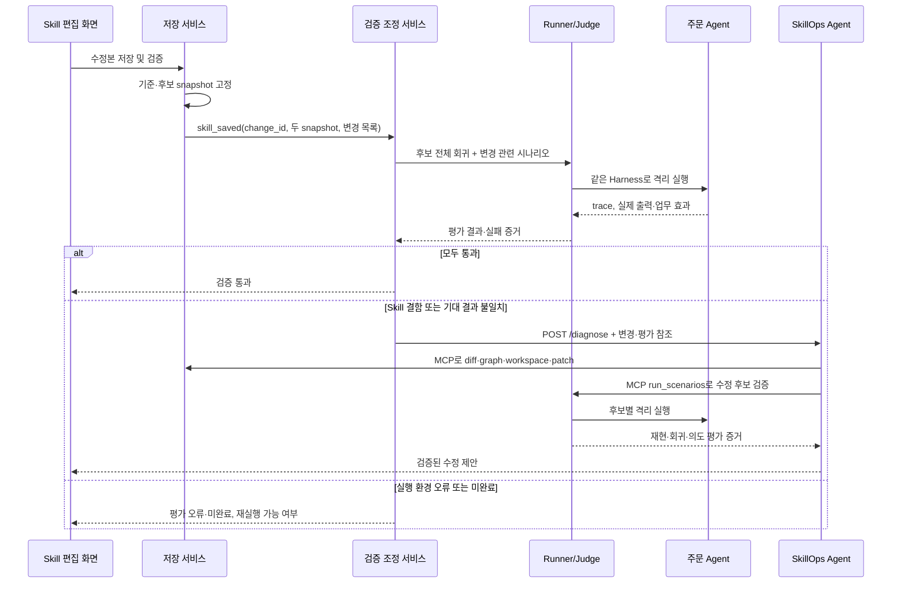

# Skill 수정 → 주문 검증 → SkillOps 진단 연결 설계

2026-10-21 · 현재 소스 정적 검토에 근거한 협의안. 실행 확인·구현 완료 보고가 아니다.
기존 order-agent/docs/runner-integration-design.md의 실행 격리 설계를 전제로 하며, 이 문서는 수정 이벤트와 진단 연결 및 인수 시나리오를 구체화한다. 기존 문서의 현재 구현 상태는 아래 조사 결과로 갱신해 읽는다.

## 1. 현재 무엇이 구현됐나

| 구간 | 현재 코드 | 실제 범위 / 빠진 연결 |
|---|---|---|
| Skill 편집 | frontend/src/stores/workspace.js | 초안은 브라우저 localStorage에만 존재. 서버 저장·snapshot 발행·검증 이벤트 없음 |
| 주문 실행 | order-agent/.../harness/OrderHarness.java | 선택한 snapshot의 flow·단계 로드, 정적 입출력/의존 검사, 실제 Mock 도구 실행, trace 저장 |
| 데모 변경 | order-agent/.../workspace/SnapshotService.java의 demo | 정상본·결함본·수정본을 코드로 생성. 사용자가 편집한 초안이 아님 |
| 변경 비교 | service/.../mcp/SkillDiffTools.java | diff_skill(skill_id, before_snapshot_id, after_snapshot_id) 구현 |
| 의존 분석 | service/.../mcp/DependencyGraphTools.java | get_dependency_graph(snapshot_id, entry_skill_id) 구현 |
| Workspace | service/.../workspace/WorkspaceService.java | create_workspace(base) 구현. 기본 소스는 루트 skills/의 현재 버전뿐. 주문 snapshot 복사·과거 버전 조회 미연결 |
| Runner/Judge | service/.../scenario/ScenarioRunner.java, ScenarioGrader.java | 시나리오 사전 검사, k회 실행, 순서·상태·배송 건수·조건 비교 구현 |
| 실행기 | service/.../scenario/ContractOnlyFlowRunner.java | 헤더만 읽고 CANNED/fake 출력 생성. 주문 Agent HTTP/Harness·본문·실제 예약/결제 정책을 실행하지 않음 |
| MCP 쓰기 | service/.../mcp/WorkspaceTools.java | create_workspace와 run_scenarios 구현. apply_patch/save_proposal/promote_workspace/rollback 서버 도구 미구현 |
| 진단 수신 | skillops-agent/skillops_agent/main.py | POST /diagnose가 failure/skill_saved를 받아 LangGraph 시작. 수정 저장 시 보내는 측은 없음 |
| 진단 파이프라인 | skillops-agent/skillops_agent/nodes.py | 가설·ablation·후보·검증·승인 흐름 존재. 실제 데이터·도구 계약과 미연결 부분 존재 |
| 주문 조회 클라이언트 | skillops-agent/skillops_agent/order_agent.py | trace·실패 목록·skill 목록 HTTP 함수 존재. nodes가 사용하는 tools.py 경로에는 아직 연결 안 됨 |
| 개발 기본값 | skillops-agent/skillops_agent/config.py | SKILLOPS_USE_STUB_MCP 기본 true. stub의 시나리오는 항상 통과하므로 통합 검증 증거가 아님 |
| 시나리오 파일 | scenarios/golden/g-01.json | golden은 g-01만 존재. SKU-APPLE-1KG는 캠핑 주문 Agent와 불일치. failures/F1.md는 설명 문서이며 f-01 실행 fixture가 아님 |

현재 Java MCP annotation 기준 도구는 ping, diff_skill, get_dependency_graph, create_workspace, run_scenarios 다섯 개다. Python 래퍼에 메서드가 있다고 서버 도구가 구현된 것은 아니다.

현재 재현 가능한 핵심은 inventory-check 출력에서 inventory.reserved를 삭제해 payment 정적 계약 검사에서 실패하는 데모다. 업무 도구 실행 전에 차단된다. 정상적인 재고 부족(REJECTED), 결제 거절(HOLD)은 Skill 결함과 구별해야 한다.

## 2. 목표와 책임

사용자가 실제로 수정한 파일 묶음을 고정하여 다른 skill과의 연결, 업무 결과, 변경 의도, 기존 정상 동작을 검증한다. 실패하면 그 수정과 실행 증거를 SkillOps Agent로 전달한다. 정상 변경은 검증 결과를 남기고 종료한다. 검증 통과가 곧 운영 반영은 아니다.

- 저장 서비스: 초안을 서버에 저장하고 기준/후보 snapshot과 변경 파일 목록을 확정한다.
- 러너 측 검증 조정 서비스: 변경 이벤트 접수, 검증 실행, 결과 저장, 필요 시 /diagnose 호출을 소유한다.
- ScenarioRunner: 고정 후보로 시나리오×k를 실행하고 Judge 결과를 집계한다. HTTP 진단 전송은 작은 조정 서비스로 분리한다.
- 주문 Agent: 전달된 후보의 실제 Skill을 기존 Harness로 실행하고 trace·업무 효과를 제공한다.
- Judge: 기대값과 관찰 결과를 비교한다. 기대값은 모델에 전달하지 않는다.
- SkillOps Agent: 변경 diff·의존 그래프·실패 증거로 원인을 실험하고 수정 후보를 생성한다. 후보 검증에는 같은 Runner를 사용한다.
- MCP: SkillOps Agent가 분석·workspace·patch·검증 기능을 호출하는 경계다. MCP 자체가 변경 감시자는 아니다.



이때 skill_saved는 저장 서비스→검증 조정 서비스의 이벤트다. 기존 /diagnose의 skill_saved 분기는 그대로 보내면 사전 검증 없이 가설 생성으로 진입하므로 위 의미로 연결하려면 수정해야 한다. 직접 /diagnose로 받는 대안을 택하면 Agent의 첫 노드에 사전 검증과 정상 종료 분기가 필요하다. 본 안은 러너 측 조정을 선택한다.

## 3. 저장·트리거 계약 제안

아래는 새 계약 제안이며 현재 /diagnose에 바로 보낼 수 없다.

```json
{
  "event_id": "UUID",
  "change_id": "UUID",
  "type": "skill_saved",
  "origin": "user_edit",
  "baseline_snapshot_id": "UUID",
  "candidate_snapshot_id": "UUID",
  "changed_paths": ["skills/inventory-check/SKILL.md"],
  "entry_skill_id": "order-flow",
  "suite_id": "camping-regression-v1"
}
```

1. 서버는 기준 snapshot에 편집 내용을 적용해 관련 resources까지 포함한 전체 파일 묶음을 원자적으로 발행한다. 기준 snapshot을 덮어쓰지 않는다.
2. 저장 확정과 이벤트 기록은 같은 트랜잭션으로 처리하고, outbox 전송으로 누락을 방지한다. 중복 event_id는 같은 검증을 반환한다.
3. UI는 change_id/validation_id로 상태를 조회한다. 상태는 QUEUED/RUNNING/PASSED/FAILED/ERROR/INCOMPLETE다.
4. 빠르게 연속 저장한 경우 각 검증은 자기 snapshot을 계속 사용한다. 예전 결과는 해당 변경의 결과로만 표시하고 최신 초안의 통과로 표시하지 않는다.
5. 검사에는 후보 전체와 기준 snapshot을 사용한다. 버전 번호를 단순히 1 빼서 기준을 추정하지 않는다.
6. 검증 대상이 결함이면 evaluation_id, 실패 execution_id 목록, 기준/후보 snapshot, changed_paths를 /diagnose에 전달한다. API는 diagnosis_id를 즉시 반환하고 진행 조회에 사용한다. 현재 내부 thread_id는 202 응답에 없으므로 보완한다.
7. origin=agent_candidate 또는 dry_run 실행 결과는 수정 이벤트를 재발행하지 않는다. 후보 검증은 기존 진단의 자식 평가다.
8. 운영 실패 트리거도 같은 증거 구조로 합류시킨다. 운영 실행에서 기준 변경을 찾지 못하면 변경 원인을 추정해서 만들지 않고 원인 불명 경로로 처리한다.

## 4. 실제 수정본 실행에 필요한 경계

기존 service의 FlowRunner 구현으로 OrderAgentFlowRunner를 추가한다. ContractOnlyFlowRunner는 개발용으로 남기고 실제 검증과 결과 표기를 구분한다.

- create_workspace에 source_snapshot_id 또는 불변 export를 받을 수 있게 한다. 현재 base 버전 맵만으로는 실제 주문 Agent snapshot을 복제할 수 없다.
- apply_patch는 정확한 기준 해시와 원문 일치 여부를 확인하고 원자적으로 적용한다. 평가 시작 시 후보 revision과 파일을 고정한다.
- 주문 Agent에 후보 snapshot import와 단일 dry-run 실행 경계를 추가한다. 상세 요청 형태는 order-agent/docs/runner-integration-design.md 참조.
- OrderHarness의 Skill 선택·검사·로드·실행 경로를 공유한다. 현재 OrderToolService/lifecycle/trace의 live DB 의존을 실행 환경 경계로 추출한다.
- 매 trial마다 재고·결제·배송·알림 Mock과 Clock을 독립 초기화한다. 운영 주문·재고는 변경하지 않는다. trace는 mode=dry-run으로 보존한다.
- 결과에는 snapshot/hash, execution_id, 모델 모드, 실제 입력/출력, 도구 요청/결과, 오류 단계, 업무 효과, 사용량을 연결한다.
- 지금의 fixed provider는 본문을 해석하지 않는다. 본문 정책 변경은 실제 모델 실행 또는 명시적으로 지원하는 실행 정책이 필요하다. 지원하지 않으면 UNSUPPORTED/평가 불가로 남기며 통과시키지 않는다.
- 기존 Harness는 skill마다 허용 도구 하나를 매핑한다. 본문 변경만으로 새 분기·다중 도구·새 출력 계산이 가능하다고 전제하지 않는다.

검증은 (1) 파싱·입출력·선행 의존 검사, (2) 같은 Harness의 실제 실행, (3) 회귀·의도·업무 효과 채점으로 나눈다. 정적 검사 실패도 trace와 오류를 남기며 실제 도구가 실행되지 않았는지 확인한다. 단순 설명 수정처럼 정상인 변경도 실제 저장→평가 경로를 통과해야 한다.

## 5. Agent/MCP 연결 시 반드시 고칠 부분

| 현재 문제 | 필요한 변경 / 인수 조건 |
|---|---|
| tools.py가 list_skills/get_trace 등을 없는 MCP 도구로 호출 | 기존 order_agent.py HTTP 조회에 연결하고 snapshot_id/execution_id를 명시. 원문 events와 Agent 내부 steps 변환은 어댑터 한 곳에서 수행 |
| diff 호출이 name/from_version/to_version | Java의 skill_id/before_snapshot_id/after_snapshot_id에 맞춤 |
| graph를 인자 없이 호출 | 조사할 snapshot_id와 entry_skill_id 전달 |
| 실패 skill 기준 diff·ablation | changed_paths의 실제 변경 skill들을 조사. payment 실패여도 inventory-check 변경 hunk를 실험해야 함 |
| create_workspace()가 현재 운영본을 복사 | 실패한 후보 snapshot을 명시해 복사. 진단 중 새 저장이 있어도 증거가 바뀌지 않아야 함 |
| ablation이 단순 문자열로 역패치 생성 | 실제 diff·hunk_id와 원문에 맞는 역패치 사용. 지정 hunk를 못 찾으면 실험하지 못한 것으로 처리 |
| ablation이 f-01, 후보 검증이 f-{run_id}를 호출 | 실제 fixture 등록 또는 inline/replay 계약 구현. 원래 주문과 초기 상태·기대값을 함께 고정 |
| g-02~g-06 파일 없음 | 아래 캠핑용 golden 6개 작성. 존재하지 않는 ID는 실행 전 거부 |
| _call이 MCP isError를 확인하지 않음 | 도구 오류와 정상 결과를 구분하고 응답 스키마 검증. 빈 결과를 통과로 해석하지 않음 |
| all([]), 빈 회귀 결과 등 | 계획한 시나리오×k 전체 결과와 실제 trace 존재를 검사. 미실행은 통과 금지 |
| assertion 오류가 True, 첫 재현 trace만 확인 | 미지원 문법은 오류, 타입/경로 문법 통일, 필요한 모든 반복에 적용. Java extra_checks를 Python 래퍼에도 연결 |
| valid가 contract_ok를 포함하지 않음 | 재현·회귀·의도·계약·평가 완결성이 모두 충족되어야 유효 |
| r_ablation_stub 등 fallback 증거 | 실제 실행 참조가 없으면 원인 확정·제안 저장 금지. LLM 실패의 가짜 patch도 제안으로 취급하지 않음 |
| proposal/promote/rollback 서버 미구현 | 진단·검증 연결과 별도 단계로 구현. 승인 대상은 평가한 revision/hash와 일치해야 함 |

의도 조건은 수정된 후보에만 적용하고, 기존 golden의 기대값을 후보에 맞춰 자동으로 완화하지 않는다. 업무 변경으로 기대값 변경이 필요하면 명시적인 요구사항으로 검토한다.

## 6. 주문 Agent로 실행할 시나리오

### A. 기본 회귀 6개: 캠핑 fixture로 새로 고정

| ID | 입력/초기 상태 | 기대 상태 및 업무 효과 |
|---|---|---|
| g-01 | c_1001, 랜턴 1개, card, 국내 일반, 충분한 재고 | SHIPPED, 서버 금액 30,000원 승인, 예약 1개, 배송 1건, 알림 1회 |
| g-02 | 랜턴 1개+의자 1개, card, 충분한 재고 | SHIPPED, 75,000원 승인, 두 상품 정확히 예약, 배송 1건 |
| g-03 | 머그컵 1개, 재고 0 | REJECTED, 결제·배송·성공 알림 없음, 재고 변경 없음 |
| g-04 | c_declined, 랜턴 1개, card | HOLD, 승인·배송 없음, 예약 해제 완료 |
| g-05 | c_declined, 랜턴 1개, prepaid | SHIPPED, 결제 승인·배송·알림 정상. 결제 거절 규칙의 적용 범위 확인 |
| g-06 | 정상 고객, 랜턴 1개, 해외 빠른 배송, 고정 Clock | SHIPPED, 현재 Mock 규칙의 해외 +7일에서 빠른 배송 1일 단축, 배송 중복 없음 |

위 매핑은 제안이며 아직 파일을 작성하지 않았다. 날짜·재고·가격은 fixture와 Mock 정책에 맞춰 고정한다. 모든 결과는 실제 도구 효과로 확인하고 성공한 단계 개수만으로 배송·알림 발생을 추정하지 않는다.

### B. 실제 편집으로 발생시킬 변경 시나리오

| ID | 사용자의 실제 변경 | 검증·진단 기대 | 수정 후보 인수 기준 |
|---|---|---|---|
| e-01 | 설명 문장만 수정, 계약·업무 의미 유지 | 저장 이벤트→실제 후보 snapshot→회귀 통과, 수정안 생성 없음 | 새 파일 해시가 실행 trace와 일치 |
| e-02 | inventory-check 출력에서 inventory.reserved 삭제 | 정적 CONTRACT_VIOLATION, 실패 지점 payment, 변경 원인 inventory-check. 도구 효과 0 | 해당 변경 hunk를 되돌리는 실험은 통과, 관련 없는 hunk는 실패 유지. 의도 필드 보존+예약 사실 유지 후 6개 회귀 통과 |
| e-03 | flow에서 배송을 결제 앞으로 이동 | shipping-reserve 입력/선행 의존 누락 검출 | 미결제 배송 0, 정상 주문 성공. 배송 가능 조회 의도라면 현재 미지원 도구 요구를 명시 |
| e-04 | flow에서 notify 제거 | 실행 후 INCOMPLETE_FLOW 또는 사전 업무 규칙 위반. 계약 연결만 검사해서 통과시키면 안 됨 | 알림 복구 후 정상 완료. 시험 실행의 기존 결제·배송을 재사용하지 않음 |
| e-05 | frontmatter는 그대로, payment 본문에 prepaid만 허용 추가 | 본문 정책 평가. fixed 모드는 검증 불가, 모델 실행 시 card/prepaid 쌍으로 정책 적용 확인 | 새 의도(card 보류, prepaid 승인)와 기존 변경 대상 외 회귀를 함께 확인. 현재 도구가 이 분기를 지원하지 않으면 기능 확장 필요로 판정 |
| e-06 | 새 출력 필드 선언을 추가했지만 실제 도구는 미제공 | 정적 연결 통과 가능하나 실행에서 MISSING_SKILL_OUTPUT | 실제 도구 출력 구현 또는 지원되는 출력으로 수정. 선언만 추가해서 통과시키지 않음 |
| e-07 | SKILL.md는 그대로, 관련 resources 정책 파일만 수정 | 변경 묶음·리소스 해시까지 snapshot과 diff 근거에 포함 | 현재 실행 경로에서 resource 내용이 모델에 제공되는지 확인. 미로딩이면 정책 검증 불가를 명시 |
| e-08 | 재고 출력 이름과 payment 입력을 함께 수정 | 양쪽 계약이 맞더라도 ToolCatalog/서버 필수 키와 충돌할 수 있음을 실행으로 확인 | 선언뿐 아니라 실제 인자·도구 출력·업무 효과가 모두 일치해야 통과 |

e-05는 지금 본문만 고치면 반드시 재현된다는 뜻이 아니다. 현재 단일 도구·고정 인자 구조의 지원 범위를 확인하는 확장 시나리오다. 잘못된 Skill 선택·잘못된 결제 금액 응답 주입은 별도 Harness 방어 회귀로 유지하고, 실제 skill 수정 시나리오와 구분한다.

### C. 파이프라인 자체 인수 시나리오

| ID | 상황 | 반드시 확인할 결과 |
|---|---|---|
| p-01 | 같은 저장 이벤트 2회 전송 | validation/diagnosis 중복 생성 없음 |
| p-02 | 평가 중 다시 편집·저장 | 각 결과의 snapshot/hash 고정, 오래된 통과 결과로 새 변경 승인 불가 |
| p-03 | 후보 2개×각 시나리오 k=2 | trial마다 재고·Mock 상태 초기화, 운영 재고 불변, 실제 모든 반복 실행 |
| p-04 | dry-run 실패 및 Agent 후보 저장 | 새로운 최상위 진단 자동 발생 없음 |
| p-05 | 주문 Agent timeout, MCP isError, 잘못된 응답 | ERROR/INCOMPLETE로 기록, 통과·Skill 결함 확정 금지, trace 확보 여부 명시 |
| p-06 | 재현 fixture 없음·잘못된 assertion·없는 golden | 실행 전 명시적 거부. 빈 결과로 통과 금지 |
| p-07 | 진단 중 프로세스 재시작 | 검증 기록·이벤트 재전송 복구. 현재 BackgroundTasks/메모리 승인 상태의 내구성 보완 필요 |
| p-08 | 통과 후보를 평가 후 재수정 | 평가 revision/hash와 승인/반영 대상 불일치 시 재검증 요구 |

## 7. 구현 순서와 첫 데모 완료 기준

1. 데이터 계약: snapshot 기반 변경 이벤트, workspace 원본, HTTP trace 어댑터, MCP 오류 처리부터 합의한다.
2. 실제 초안 저장 및 검증 접수: UI→서버→불변 후보→validation_id 조회를 연결한다.
3. 주문 Agent 격리 실행과 OrderAgentFlowRunner 연결, 캠핑 golden 6개와 실제 Judge 관찰값을 준비한다.
4. 러너 측 사전 검증→실패 시 /diagnose 연결, 정상 변경 종료 및 평가 오류 분기를 구현한다.
5. Agent의 snapshot/diff/graph 계약과 apply_patch·실제 재현 입력·모든 반복의 의도 검증을 연결한다.
6. e-01/e-02와 p-01~p-06을 먼저 종단 검증한다. 이후 e-03/e-04/e-06, 모델·도구 확장이 필요한 e-05/e-07/e-08로 넓힌다.
7. 검증된 제안 저장·승인·동일 해시 반영은 후속 연결로 완성한다.

첫 데모는 준비된 결함본 버튼을 사용하지 않는다. 정상 snapshot을 열어 inventory-check의 실제 출력 선언을 편집하고 저장한다. 자동 검증에서 payment 계약 오류와 도구 미실행을 확인하고, SkillOps가 수정한 inventory-check를 원인 후보로 조사한다. 실제 patch 후보를 별도 snapshot으로 실행하여 재현·전체 회귀·의도가 통과한 증거를 보여준다. 이때 변경→검증→진단→후보 평가의 ID와 snapshot/hash가 화면과 저장 기록에서 이어져야 한다.
