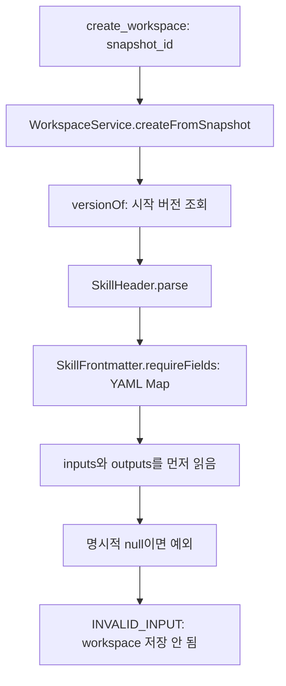

# #72 · SKILL 목록 null 호환성 수정 설계

작성일: 2026-10-23 · 상태: 구현 및 로컬 검증 완료 · [실제 적용 결과](changes/2026-10-23-skill-list-null-compatibility.md)

## 1. 권장 방향

`SkillHeader.parse`가 목록을 읽는 순서와 null 처리 정책을 조정해, 주문 Agent가 허용하는 정상 문법 6개를 workspace에서도 읽게 한다. 기존 정상 SKILL 6개의 해석 값과 원문은 유지한다.

이번 수정은 확인된 호환성 차이의 해결에 집중한다. 단계의 필수 목록 검사 강화나 모든 서버의 파서 라이브러리 통합까지 한꺼번에 진행하지 않는다. 특히 workspace 생성 시점에 실제 실행기의 모든 필수 검증을 추가하면 현재 복사할 수 있는 문서까지 거부할 수 있다.

## 2. 근거와 현재 호출 관계

[호환성 검사 결과](changes/2026-10-23-skill-document-compatibility-baseline.md)에서 확인한 내용은 다음과 같다.

| 대상 | 주문 Agent | snapshot 분석 | SkillHeader 및 snapshot workspace 생성 |
|---|---|---|---|
| 저장소의 정상 원문 6개 | 수락 | 수락 | 수락 |
| 추가 정상 목록 표현 20개 | 모두 수락 | 모두 수락 | 14개 수락, 6개 거부 |

workspace 생성이 거부되는 경로는 다음과 같다.



`versionOf`는 버전만 필요하지만 `SkillHeader.parse`가 목록도 함께 검사해 오류가 발생한다. 목록을 완전히 무시하는 버전 전용 파서로 우회하면 `ContractOnlyFlowRunner`에서 같은 null 오류가 다시 발생할 수 있으므로, 이번에는 공유 호출 지점인 `SkillHeader`에서 해결한다.

영향을 받는 실제 호출자는 다음과 같다.

| 호출자 | 용도 | 기대 변화 |
|---|---|---|
| WorkspaceService.versionOf | snapshot에서 workspace 시작 버전 읽기 | 정상 null 표현 때문에 복사가 실패하지 않음 |
| LiveFolderSkillVersionStore.versionOf | 운영 폴더 버전 조회·원문 읽기 | 같은 문법이 운영 폴더에서도 동일하게 읽힘 |
| ContractOnlyFlowRunner.stepsOf | entry 실행 순서 읽기 | steps null을 빈 목록으로 읽되 빈 entry는 실행 거부 |
| ContractOnlyFlowRunner.runDryRun | 단계의 입력·출력 읽기 | 일반 단계 steps null을 읽을 수 있고 기존 입출력 오류는 유지 |

## 3. 해결할 여섯 사례

| 사례 ID | 표현 | 수정 후 해석 |
|---|---|---|
| step-null-steps | 일반 단계의 `steps: null` | steps = [] |
| step-tilde-steps | 일반 단계의 `steps: ~` | steps = [] |
| step-implicit-null-steps | 일반 단계의 `steps:` | steps = [] |
| flow-inputs-null | flow의 `inputs: null` | inputs = [] |
| flow-outputs-null | flow의 `outputs: null` | outputs = [] |
| flow-all-null | flow의 inputs·outputs·depends_on 모두 null | inputs/outputs = []; depends_on은 기존 실행기·분석기 정책 유지 |

YAML null을 나타내는 세 표현은 이미 공통 YAML 파서에서 Java null로 읽힌다. 문자열을 치환하거나 YAML 파서를 새로 만들 필요가 없다. 따옴표를 붙인 `"null"`은 문자열이므로 허용 대상이 아니다.

flow의 `depends_on: null` 단독 사례는 현재도 정상이다. `SkillHeader`에는 depends_on 필드가 없으므로 record에 해당 필드를 추가하지 않는다. 단계의 선행 관계 검사는 기존 snapshot 분석기와 실제 주문 Agent가 계속 담당한다.

## 4. 목록 해석 규칙

flow 여부는 파일 이름이 아니라 **해석한 steps가 비어 있지 않은지**로 정한다. 실제 `SkillLoader.load`가 일반 단계의 목록 필수 여부를 결정하는 기준과 같다. 중복·개수·중첩 같은 구조 검사는 기존 경로에서 수행한다.

| 필드·상황 | 누락 | 명시적 null | [] | 잘못된 타입·항목 |
|---|---|---|---|---|
| steps | [] | [] | [] | 거부 |
| inputs/outputs, steps가 비어 있지 않은 flow | [] | [] | [] | 거부 |
| inputs/outputs, steps가 빈 일반 단계: workspace 어댑터 | 기존처럼 [] | 기존처럼 거부 | [] | 거부 |
| inputs/outputs/depends_on, 일반 단계: 실제 실행·snapshot 선언 검사 | 기존처럼 거부 | 기존처럼 거부 | 허용 | 거부 |

workspace 어댑터는 지금도 일반 단계의 누락 목록을 빈 목록으로 읽는다. 이번 호환성 수정에서 이를 필수로 바꾸지 않는다. workspace에서 읽을 수 있다는 사실은 실제 실행 가능 판정과 구분한다. 실제 단계의 누락·null 필수 목록은 기존 실행·선언 검증이 계속 거부한다.

잘못된 타입·항목에는 scalar, 숫자·불리언, map, 중첩 목록, null 항목, 빈 문자열·공백 문자열이 포함된다. `[null]`을 빈 목록으로 바꾸지 않는다. 유효한 문자열의 값과 순서도 그대로 보존한다.

## 5. 함수 설계

운영 코드 수정 대상은 `service/.../workspace/SkillHeader.java` 한 파일로 제한하는 것을 권장한다. 기존 공통 YAML 파서와 목록 검사 함수를 재사용한다.

### SkillHeader.parse

1. 기존처럼 YAML 객체와 name·version을 읽는다.
2. steps를 먼저 읽는다. 이 필드의 null은 빈 목록으로 해석한다.
3. steps가 비어 있지 않으면 inputs·outputs의 null도 빈 목록으로 해석한다.
4. steps가 비었으면 inputs·outputs의 null 거부 규칙을 유지한다.
5. 기존 SkillHeader record 형식으로 결과를 반환한다.

다음은 제어 흐름을 설명하는 의사 코드이며 실제 변경을 적용한 코드는 아니다.

```java
// 명시적 null의 처리만 선택하며 목록 타입·항목 검사는 공통 함수를 사용한다.
private enum NullListPolicy { AS_EMPTY, REJECT }

// name·version의 기존 검사를 마친 뒤 실행 순서로 목록 정책을 정한다.
List<String> steps = strings(fields, "steps", NullListPolicy.AS_EMPTY);
NullListPolicy policy = steps.isEmpty() ? NullListPolicy.REJECT : NullListPolicy.AS_EMPTY;
return new SkillHeader(name, version,
        strings(fields, "inputs", policy),
        strings(fields, "outputs", policy), steps);
```

### SkillHeader.strings

`strings(fields, key, nullPolicy)`로 정책을 명시한다.

- 키 누락: 기존처럼 빈 목록을 반환한다.
- 값이 null이고 정책이 AS_EMPTY: 빈 목록을 반환한다.
- 그 외: 현재와 같은 List 및 비공백 문자열 항목 검사를 수행한다.
- 실패: 기존과 같은 IllegalArgumentException 및 필드별 오류 문구를 사용한다.

정책 판단을 호출자마다 복제하지 않는다. WorkspaceService나 실행기에 별도의 null 치환을 추가하지 않는다. 함수와 새 정책에는 짧은 기능 주석을 남긴다.

## 6. 유지할 경계와 위험 관리

### 빈 entry가 실행 성공으로 바뀌지 않게 한다

steps null을 []로 읽는 것과 실행 가능한 flow라는 판정은 별개다. 이름이 order-flow여도 steps가 비었으면 실행할 수 없다.

- ContractOnlyFlowRunner.stepsOf의 비어 있는 실행 순서 거부를 유지한다.
- DependencyAnalyzer.flowSteps의 빈 entry 거부를 유지한다.
- 실제 SkillLoader.validateFlow의 빈 순서·중복·12단계 제한을 유지한다.
- workspace 복사 성공이 run_scenarios 성공이나 후보 합격으로 이어지지 않는지 회귀 테스트로 확인한다.

### 원문과 증거를 보존한다

null을 []로 바꾸는 것은 메모리의 해석 결과에만 적용한다. SKILL.md 원문, 줄바꿈, 파일 해시, 버전 번호를 자동 변경하지 않는다. YAML 재직렬화나 원문 치환을 하지 않는다.

### 다른 검증을 함께 강화하지 않는다

name·version·owner·description·본문, YAML 안전 옵션, 문서 경계, 입력·선행 단계 연결, flow 구조 검사에는 새 규칙을 추가하지 않는다. 기존 정상 문서를 막는 범위 확대를 피하기 위해 일반 단계의 누락 목록 필수화도 별도 작업으로 남긴다.

steps를 먼저 읽으므로 여러 필드가 동시에 잘못된 문서에서는 첫 오류가 달라질 수 있다. 정상 문서의 수락 여부와 단일 필드 오류의 코드·문구를 우선 보존하고, 복수 오류의 우선순위를 고정할 필요가 있으면 별도 테스트로 명시한다.

## 7. 테스트 변경 순서와 완료 기준

### 1단계: 현재 관찰 테스트를 목표 호환성 테스트로 전환

현재 fixture의 headerRejectedField는 현행 거부 동작의 관찰값이다. 수정 시 이 관찰 필드와 `if (거부 예상)` 분기를 제거하고 **추가 정상 문법 20개 모두**에 다음을 요구한다.

- 실제 주문 Agent가 같은 값을 읽는다.
- snapshot 분석이 정상이며 선언 값이 일치한다.
- SkillHeader가 같은 목록을 반환한다.
- snapshot workspace 생성이 성공한다.
- 저장한 원문과 출처가 입력 그대로다.

공통 JSON과 두 Java 테스트의 Document record에서 관찰 필드만 제거한다. 고정한 정상 원문 6개, SHA-256, 해석 기대값은 변경하지 않는다. 과거에 6개가 거부됐다는 기록은 기존 검사 결과 문서에 보존한다.

운영 코드 수정 전에는 해당 여섯 사례가 실패하고, 수정 후에는 통과하는지 확인한다. 실패를 비활성화하거나 허용하는 분기를 남기지 않는다.

### 2단계: 거부해야 할 경계를 추가

| 검사 | 기대 결과 |
|---|---|
| 일반 단계 inputs/outputs 명시적 null | SkillHeader 및 실제 실행기가 계속 거부 |
| 일반 단계 필수 목록 누락·null | snapshot 선언 검사와 실제 실행기가 계속 거부; workspace 누락 처리 자체는 기존대로 유지 |
| 단계·flow에서 scalar, [null], [1], [''], [' '] 등 | 계속 거부 |
| steps의 잘못된 타입 | inputs/outputs가 선택 사항이어도 거부 |
| root steps의 누락·null·[] | 실행·entry 분석이 계속 거부하며 0단계 성공을 반환하지 않음 |
| 여러 줄·따옴표 목록과 LF/CRLF | 기존 값·순서·원문 유지 |

`SkillHeaderTest.rejectsInvalidListValues`의 null 일괄 거부 항목은 역할별 검사로 나눈다. scalar·잘못된 항목 검사는 그대로 유지한다. 현재 누락 입력을 허용하는 workspace 테스트를 실행 검증 테스트로 오해해 일괄 수정하지 않는다.

### 3단계: 실제 호출 경로 검증

- 기존 정상 6개와 전체 flow의 고정본·현재 저장소 검사 유지.
- snapshot workspace 생성: 20/20 수락 및 CRLF·끝 줄바꿈 보존.
- LiveFolderSkillVersionStore: 임시 폴더의 정상 null 표현도 버전 조회·원문 읽기 성공.
- ContractOnlyFlowRunner: 정상 단계 steps null을 읽고, 빈 root flow는 실행 전에 거부.
- 기존 metadata_errors, flow_errors, broken_links, dependency_violations와 후보 판정 회귀 검사 유지.

검증 명령은 두 Java 모듈의 `./gradlew test --offline --no-daemon --console=plain`이다. 실제 서버·DB·LLM을 실행하지 않았다면 결과 문서에 미검증 범위를 계속 표시한다. 테스트 개수는 수정 이후 실제 실행 결과로 기록한다.

## 8. 파일별 변경 계획

| 파일 | 계획 |
|---|---|
| service/.../workspace/SkillHeader.java | steps 선조회, null 정책을 받는 목록 함수, 기능 주석 |
| service/.../workspace/SkillHeaderTest.java | null 일괄 거부를 역할별 검사로 분리, 타입 거부 유지 |
| service/.../skill/SkillDocumentCompatibilityTest.java | 정상 문법 전부의 workspace 수락을 요구하고 관찰 분기 제거 |
| order-agent/.../harness/SkillDocumentCompatibilityTest.java | 공유 fixture의 관찰 필드 제거에 맞춘 테스트 DTO 정리 |
| docs/contracts/examples/skill-document-compatibility.json | 관찰 필드 제거; 원문·해시·기대값 보존 |
| 관련 service 테스트 | 운영 폴더 버전 조회와 간이 실행기의 경계 확인 |
| docs/contracts/skill-frontmatter.md | 과거 null 거부 기록과 새 역할별 해석 규칙을 구분해 반영 |
| docs/contracts/mcp-tools-input-output.md | create_workspace와 간이 실행 설명에 null 수락 범위·빈 entry 거부 명시 |
| docs/changes/ | 실제 적용 결과, 이전 대비 수락 범위, 테스트·남은 한계 기록 |

## 9. API·MCP·배포 영향

REST 경로·요청 DTO, MCP 도구 이름·요청·응답 필드, DB 스키마를 추가하거나 제거할 필요가 없다. 기존에 INVALID_INPUT으로 거부했던 정상 문법 6개를 service가 수락하게 되는 동작 변경이다.

새 응답 필드를 추가하지 않으므로 이 수정만으로 apply_patch v1.3의 JSON Schema 버전을 올리거나 Python을 함께 변경할 필요는 없다. 기존 v1.3 계약을 사용하는 service·Python 조합은 유지한다. 과거 응답 필드 추가에 따른 동시 갱신 요구를 이번 수정이 없애는 것은 아니다.

AI 담당자에게는 허용 문법과 검증 결과를 공유하면 된다. 모델·프롬프트·주문 Agent 운영 로더 변경은 필요하지 않다. 동작을 바꾼 구현 전에는 변경 대상 소유권과 사용자의 승인 범위를 확인한다. 이 문서는 설계 근거를 보존하며 실제 적용 범위와 테스트 결과는 위 적용 결과 문서에서 확인한다. 서버 배포는 수행하지 않았다.

## 10. 완료 판단

정상 원본 6개의 의미와 바이트가 보존되고, 추가 정상 문법 20개가 모두 workspace로 복사되며, 잘못된 단계 목록과 빈 entry는 계속 실행 거부되어야 한다. 관련 명세와 실제 테스트 결과를 갱신한 뒤 수정 완료로 판단한다.
