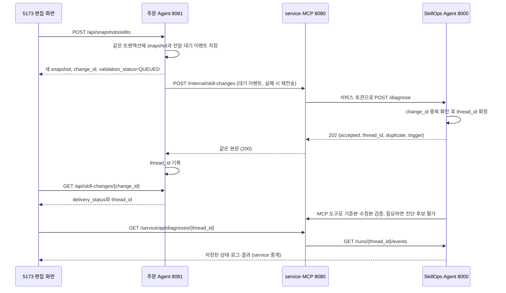

# Skill 수정본 반영 위치와 저장 후 자동 검증·진단

#60 에서 만든 기능의 사용 안내다. 운영 화면에서 Skill 수정본을 저장하면 주문 Agent 가 저장 이벤트를 service 를 거쳐 SkillOps Agent 로 보내고, Agent 가 기준본과 수정본을 검증한 뒤 필요하면 진단까지 이어 간다.

## 어디에 반영되는가

| 단계 | 저장/적용 위치 | 실제 의미 |
| --- | --- | --- |
| 5173에서 편집 중 | 브라우저 초안 | 아직 어떤 실행에도 적용되지 않는다. |
| 전체 수정본 저장 | 주문 Agent 8081의 snapshot DB | 기존 묶음을 보존하고 수정 원문을 포함한 새 파일 세트를 만든다. |
| 자동 검증 | service 의 `harness` 실행기가 수정 snapshot 으로 연습 공간을 만들고 주문 Agent 에서 모의 실행(dry-run)한다 | 수정 파일을 실제 Harness 에서 쓰고, 예약한 데모 재고는 실행이 끝나면 되돌린다. |
| 5173에서 수정본을 선택한 일반 주문 | 해당 주문 실행 | 선택한 snapshot 이 적용되며 일반 주문은 재고를 실제로 줄인다. |
| 5174에서 snapshot 을 지정하지 않은 기본 주문 | 게시 번들(`order-agent/skills`) | 5173의 저장본으로 자동 전환되지 않는다. |

저장은 운영 활성화가 아니다. 검증을 통과해도 기존 snapshot 이나 운영 skills/ 파일을 덮어쓰지 않으며, 화면에도 이 차이를 적어 두었다.

## 사용 순서

1. http://localhost:5173 에 로그인하고 Skill 편집에서 기준 세트를 선택한다.
2. 원문을 수정하고 전체 수정본 저장을 누른다.
3. 저장 완료 안내의 '자동 검증·진단 진행 확인'을 누른다. 주소는 `/diagnoses?change_id=<change_id>` 다.
4. 요청 전달 대기, 검증·진단 진행, 최종 결과를 차례로 확인한다. 전달이 끝나면 화면이 `/diagnoses/<thread_id>` 로 옮겨 간다.
5. 왼쪽 '검증·진단 기록' 메뉴에서 이전 결과를 다시 볼 수 있다. 상세 화면 주소를 새로고침해도 같은 진단을 조회한다.

먼저 description 만 바꿔 정상 검증을 확인할 수 있다. 결함을 재현하려면 inventory-check 출력에서 inventory.reserved 를 지운다. 이 경우 실제 LLM 기반 원인 가설과 후보 생성으로 이어질 수 있다. 기본 회귀가 통과했다고 해서 자연어 본문의 업무 의도 전체가 검증된 것은 아니다.

## 실행 전 설정

자동 검증이 실제 주문 Agent 에서 돌려면 service 와 SkillOps Agent 를 아래처럼 띄운다.

| 변수 | 읽는 곳 | 값 |
| --- | --- | --- |
| `SKILLOPS_SERVICE_URL` | 주문 Agent | service 주소다. 기본은 `http://localhost:8080` 이고, `order-agent/compose.yml` 로 띄우면 `http://host.docker.internal:8080` 이다. |
| `SKILLOPS_SERVICE_TOKEN` | 주문 Agent, service, SkillOps Agent | 세 곳에 같은 값을 준다. service 와 Agent 는 값이 비어 있으면 토큰을 검사하지 않는다(개발 모드). |
| `SKILLOPS_AGENT_URL` | service | SkillOps Agent 주소다. 기본 `http://localhost:8000` 이다. |
| `SKILLOPS_FLOW_RUNNER` | service | `harness` 로 둔다. 기본값 `contract-only` 는 frontmatter 만 보고 흉내 내는 가짜 실행기라 주문 Agent 에서 실제로 돌리지 않고, 재현 주문도 받지 않는다. |
| `SKILLOPS_SCENARIOS_DIR` | service | `../scenarios/order-agent` 로 둔다. 주문 Agent 의 상품으로 쓴 기준 주문 g-01~g-03 이 이 폴더의 golden 에 있다. |
| `SKILLOPS_GOLDEN_IDS` | SkillOps Agent | 회귀 세트로 돌릴 기준 주문이다. 기본 `g-01,g-02,g-03` 이며 service 가 읽은 기준 주문 번호와 같아야 한다. |
| `SKILLOPS_RUN_DB` | SkillOps Agent | 진단 기록 SQLite 파일이다. 기본 `skillops-agent/.data/runs.sqlite3` 이고 Git 에서 제외한다. |
| `SKILLOPS_USE_STUB_MCP` | SkillOps Agent | 기본 `false` 다. `true` 면 service 없이 stub 응답을 쓰므로 실제 검증이 되지 않는다. |

현재 로컬 SkillOps Agent 는 단일 프로세스로 실행한다.

## 서버 흐름



service 는 브라우저·주문 Agent 와 SkillOps Agent 사이의 HTTP 중계만 맡는다(`service/src/main/java/com/capstone4/skillops/diagnosis/DiagnosisController.java`). 서비스 토큰은 브라우저에 전달하지 않고, 브라우저의 진단 조회는 기존 로그인 JWT 를 쓴다. 화면의 `/service` 접두어는 Vite 프록시가 떼고 service 로 넘긴다.

## 중복 방지·복구

- 주문 Agent 는 `skill_change_events` 행을 snapshot 저장과 같은 트랜잭션에 기록한다. 저장 뒤 화면을 닫아도 서버가 전달한다.
- `SkillChangeDispatcher` 는 앞 실행이 끝나고 3초(`order-agent.skill-change-dispatch-delay-ms`) 뒤에 다시 돈다. 한 번에 thread_id 가 아직 없는 가장 오래된 행 하나를 `SELECT ... FOR UPDATE SKIP LOCKED` 로 잠가 보낸다. 연결 타임아웃은 2초, 읽기 타임아웃은 10초다.
- 응답의 thread_id 를 받으면 기록하고 재전송을 멈춘다. 실패하면 시도 횟수를 올리고 `last_error` 에 "진단 요청 전달 실패: <예외 클래스 이름>" 을 남긴 뒤 다음 차례에 다시 보낸다. 실패한 행이 계속 가장 먼저 골라지므로, 그 행이 계속 실패하면 뒤에 저장된 행도 전달되지 않는다.
- SkillOps Agent 는 같은 change_id 와 같은 본문이 다시 오면 기존 thread_id 를 `duplicate=true` 로 돌려준다. 같은 change_id 에 다른 본문이 오면 409 로 거부한다.
- service 는 토큰이 틀리면 401, `type=skill_saved` 와 `change_id` 가 없으면 400 으로 답한다. Agent 의 오류 응답은 404 만 그대로 두고 나머지(401, 409 포함)는 502 `DIAGNOSIS_UPSTREAM_ERROR` 로, 연결 실패나 5초 읽기 타임아웃은 502 `DIAGNOSIS_UNAVAILABLE` 로 바꾼다.
- SkillOps Agent 는 SQLite 에 요청, 중복 키, 노드별 진행, 최종 결과를 저장한다. 재시작하면 완료 결과는 유지하고, QUEUED 나 RUNNING 이던 진단은 ERROR(재시작으로 중단)로 바꾼다. 유료 모델 작업을 자동으로 다시 시작하지 않는다.
- 화면은 진단 결과가 아직 없거나, 진행 중(QUEUED, RUNNING)이거나, 직전 조회가 실패했을 때만 2초(`frontend/src/config.js` 의 `DIAGNOSIS_POLL_MS`) 뒤에 다시 조회한다. 주소가 바뀐 뒤 늦게 도착한 이전 응답은 무시한다.

## 상태 의미

전달 상태(주문 Agent `GET /api/skill-changes/{change_id}` 의 `delivery_status`)는 둘이다.

| 상태 | 의미 |
| --- | --- |
| PENDING | 저장은 끝났고 SkillOps Agent 에 아직 전달하지 못했다. 재전송 중이면 `attempts` 와 `last_error` 가 함께 보인다. |
| ACCEPTED | SkillOps Agent 가 접수해 thread_id 를 받았다. |

진단 상태(SkillOps Agent 의 `diagnosis_status`, `skillops-agent/skillops_agent/state.py` 의 `DiagnosisStatus`)는 아래와 같다.

| 상태 | 화면 의미 |
| --- | --- |
| QUEUED | 접수가 끝나고 실행을 기다린다. |
| RUNNING | 검증 또는 진단이 진행 중이다. |
| BASELINE_FAILED | 기준 세트도 회귀 세트를 통과하지 못했다. 재고 같은 검증 환경을 확인해야 하며, 수정본 결함으로 확정하지 않는다. |
| VALIDATED | 수정본이 등록된 기본 회귀 세트를 모두 통과했다. LLM 은 부르지 않는다. |
| VALIDATION_FAILED | 실행 오류 없이 끝났지만 기대 업무 결과와 다르다. 원인을 자동으로 확정하지 않는다. |
| NO_SKILL_CHANGES | 두 snapshot 사이에 Skill 변경이 없다. |
| INTENT_VIOLATION | 진단 전용 요청(`diagnosis_only`)에서 명시한 확인 조건이 실제 결과와 맞지 않았다. |
| EVALUATED | 진단과 수정 후보 평가를 마치고 제안서를 저장했다. 진단 전용 요청에서 의도 위반이 없을 때도 이 값이다. |
| ERROR | 실행 환경, 계약, 모델, 통신 오류나 재시작으로 중단됐다. |

자동 검증은 먼저 기준 snapshot 에서 회귀 세트를 돌리고, 통과했을 때만 수정 snapshot 에서 같은 세트를 돌린다. 모의 실행은 데모 재고를 쓰고 나서 되돌리지만, 기준 주문에 필요한 재고가 처음부터 없으면 정상 수정도 검증할 수 없다. 그래서 기준 세트가 실패하면 BASELINE_FAILED 로 멈추고 LLM 진단으로 넘기지 않는다. 이때는 주문 Agent 의 상품 재고(예: 캠핑 랜턴)를 확인한다. 머그컵은 재고 부족 기준 주문(g-02)을 위해 재고를 비워 둔다.

## API

- 주문 Agent `POST /api/snapshots/edits`: 201 응답의 `validation_status` 는 QUEUED 다. snapshot metadata 는 저장 당시 값이라 실제 진행은 아래 전달·진단 API 에서 읽는다.
- 주문 Agent `GET /api/skill-changes/{change_id}`: change_id, snapshot_id, thread_id, attempts, last_error, delivery_status 를 돌려준다. 없는 변경이면 404 `SKILL_CHANGE_NOT_FOUND` 다.
- service `POST /internal/skill-changes`: 서버 사이 저장 이벤트 중계다. `X-Service-Token` 을 확인하고 본문(type, change_id, baseline_snapshot_id, candidate_snapshot_id, changed_paths)을 고치지 않고 넘긴다.
- service `GET /api/diagnoses`, `GET /api/diagnoses/{thread_id}`: 로그인한 화면용 목록과 상세다. thread_id 가 UUID 가 아니면 400 이다.
- SkillOps Agent `POST /diagnose`: 202 로 `{accepted, thread_id, duplicate, trigger}` 를 돌려준다. 접수 직후부터 QUEUED 상태를 조회할 수 있다.
- SkillOps Agent `GET /runs`, `GET /runs/{thread_id}/events`: 서비스 토큰으로 보호하는 기록 조회다. 목록은 최근 100건이다.

## 후보 생성 방식

후보 생성에는 현재 snapshot 의 모든 Skill 원문을 주고, 모델은 수정 후 전체 원문(`full_text`)만 낸다. SkillOps Agent 가 현재 원문과 비교해 unified diff 와 `base_version` 을 정하므로, 모델이 과거 diff 를 그대로 다시 내서 현재 수정본에 적용되지 않는 일을 막는다. `apply_patch` 의 INVALID_INPUT 거절은 그 후보의 `validation_error` 로 남기고 다른 후보를 계속 검증한다. 통신 오류나 서버 오류는 평가 전체의 오류로 처리한다.

## 아직 포함하지 않는 것

- 운영 활성화(promote_workspace). 검증된 후보는 service 의 save_proposal 로 제안서가 되고 화면에서 승인·거절할 수 있지만, 승인해도 운영 Skill 은 바뀌지 않는다.
- 5174의 기본 주문을 최신 사용자 수정 snapshot 으로 자동 전환하는 기능.
- 자연어 본문만 보고 기대 정책을 자동으로 뽑아 모든 저장을 판정하는 기능. 명시한 확인 조건으로 판정하는 경로는 진단 전용 요청(`diagnosis_only`, `intent_checks`)으로만 쓸 수 있다.
- 사용자 편집이 아닌 후보 연습 공간 실행은 저장 API 를 부르지 않으므로 새 저장 이벤트를 만들지 않는다.

## 검증 방법

- 주문 Agent: 저장과 이벤트의 원자성, 전달 실패 뒤 재전송(`SkillChangeDispatcherTest`), 기존 전체 회귀.
- SkillOps Agent: 동시 중복 요청 가운데 한 번만 접수, 다른 본문의 키 재사용 거부, 상태 보존과 중단 처리, 기존 계약 테스트.
- service: 중계 요청, 서비스 토큰, 진단 상태 응답 테스트(`service/src/test/java/com/capstone4/skillops/diagnosis/`)와 기존 전체 테스트.
- 실제 브라우저: owner 로그인, 정상본 고정, description 편집, 저장, 자동 전달, 진단 상태 표시, 새로고침, 목록 재조회를 차례로 확인한다.

```bash
cd frontend
npm run test:e2e
```

브라우저 테스트(`frontend/tests/diagnosis.spec.js`)에는 localhost 5173/8081/8080/8000 이 모두 떠 있어야 하고 기본 데모 계정(owner)으로 로그인한다. 정상 설명 변경만 쓰므로 유료 LLM 을 부르지 않지만, 새 snapshot 과 모의 실행 기록은 만든다. 자동 전달과 기본 회귀는 데모 재고를 되돌리지만 사용자가 일반 주문을 넣으면 재고가 줄어든다.
