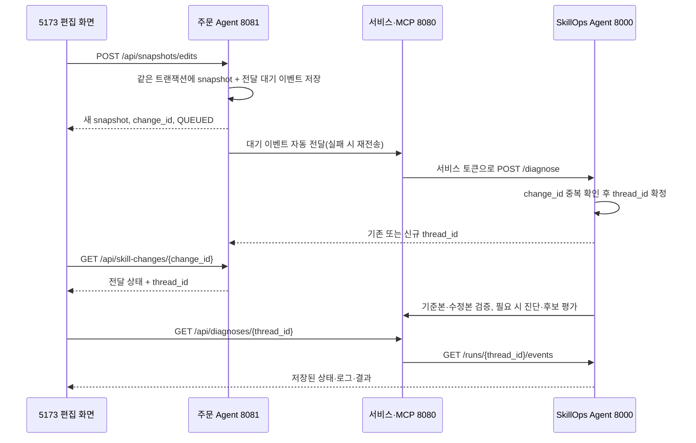

# Skill 수정본 반영 위치와 저장 후 자동 검증·진단

2026-10-21 · #60

## 어디에 반영되는가

| 단계 | 저장/적용 위치 | 실제 의미 |
| --- | --- | --- |
| 5173에서 편집 중 | 브라우저 초안 | 아직 어떤 실행에도 적용되지 않음 |
| 전체 수정본 저장 | 주문 Agent 8081의 snapshot DB | 기존 묶음을 보존하고 수정 원문을 포함한 새 파일 세트를 생성 |
| 자동 검증 | C Runner가 수정 snapshot을 workspace로 복사하고 주문 Agent dry-run 실행 | 수정 파일을 실제 Harness에서 사용하고, 데모 재고는 종료 후 복원 |
| 5173에서 수정본을 선택한 일반 주문 | 해당 주문 실행 | 선택한 snapshot이 적용되며 일반 주문 재고는 실제 감소 |
| 5174에서 snapshot을 지정하지 않은 기본 주문 | 기존 게시 bundle | 5173의 저장본으로 자동 전환되지 않음 |

저장은 운영 활성화가 아니다. 검증을 통과해도 기존 snapshot이나 운영 skills/ 파일을 덮어쓰지 않는다. 화면에 이 차이를 명시했다.

## 사용 순서

1. http://localhost:5173 에 로그인하고 Skill 편집에서 기준 세트를 선택한다.
2. 원문을 수정하고 전체 수정본 저장을 누른다.
3. 저장 완료 안내의 '자동 검증·진단 진행 확인'을 누른다.
4. 요청 전달 대기 → 검증·진단 진행 → 최종 결과를 확인한다.
5. 왼쪽 '검증·진단 기록' 메뉴에서 이전 결과를 다시 볼 수 있다. 상세 화면 URL을 새로고침해도 같은 진단을 조회한다.

먼저 description만 바꿔 정상 검증을 확인할 수 있다. 결함을 재현하려면 inventory-check 출력에서 inventory.reserved를 삭제한다. 이 경우 실제 LLM 기반 원인 가설·후보 생성으로 이어질 수 있다. 자연어 본문의 업무 의도 전체를 기본 회귀 통과만으로 검증했다고 해석하면 안 된다.

## 서버 흐름



C에는 브라우저/주문 Agent와 B 사이의 HTTP 중계만 추가했다. 기존 MCP 도구의 입출력·Runner 계약은 변경하지 않았다. 서비스 토큰은 브라우저에 전달하지 않는다. 브라우저의 진단 조회는 기존 로그인 JWT를 사용한다.

## 중복 방지·복구

- 주문 Agent의 skill_change_events 테이블은 snapshot 저장과 같은 트랜잭션에 기록한다. 저장 후 화면을 닫아도 서버가 전달한다.
- 스케줄러가 약 3초마다 대기 이벤트 하나를 처리한다. SELECT FOR UPDATE SKIP LOCKED로 같은 행의 동시 처리를 막는다.
- B 접수 응답이 유실되어 다시 보내도 같은 change_id·동일 요청이면 기존 thread_id를 반환한다. 다른 요청 내용으로 같은 change_id를 사용하면 409로 거부한다.
- 전달 성공 시 thread_id를 저장하고 재전송을 중단한다. 전송 실패 시 대기 상태·시도 횟수·오류를 유지하며 다시 시도한다.
- B는 SQLite에 요청·중복 키·노드별 진행·최종 결과를 저장한다. 단순 메모리 목록이 아니다.
- B 재시작 시 완료 결과는 유지하고, 실행 중이던 작업은 중단 오류로 표시한다. 유료 모델 작업을 자동으로 중복 재시작하지 않는다.
- 화면은 실행 중에만 상세 상태를 주기적으로 조회한다. 라우트 변경 후 늦게 도착한 이전 응답은 무시한다.

## 상태 의미

| 상태 | 화면 의미 |
| --- | --- |
| PENDING(전달 기록) | 저장 완료, B에 요청 전달 대기·재전송 중 |
| QUEUED | B 접수 완료·실행 대기 |
| RUNNING | 검증 또는 진단 진행 중 |
| BASELINE_FAILED | 기준 세트도 실패. 재고 등 검증 환경 확인 필요, 수정 결함으로 확정하지 않음 |
| VALIDATED | 등록된 기본 회귀 검증 통과 |
| VALIDATION_FAILED | 기대 업무 결과와 불일치하나 실행 오류 없이 종료. 자동 원인 확정하지 않음 |
| INTENT_VIOLATION | 명시한 의도 조건과 실제 결과 불일치 |
| EVALUATED | 진단·수정 후보 평가 결과 생성 |
| ERROR | 실행 환경·계약·모델·통신 등 오류로 중단 |

C의 현재 dry-run은 데모 재고를 사용한 뒤 복원한다. 기준 주문에 필요한 재고가 없다면 정상 수정도 검증할 수 없다. 그래서 수정본 전에 기준 세트를 검증하고, 기준이 실패하면 LLM 진단으로 오인해 넘기지 않는다. 이번 작업 중 랜턴 재고가 0인 상황을 확인했으며, 사용자 요청에 따라 랜턴만 2,000개로 늘렸다. 머그컵의 재고 부족 fixture는 유지했다.

## API와 설정

- 기존 POST /api/snapshots/edits 응답 validation_status는 이제 QUEUED다. immutable snapshot metadata는 저장 당시 상태이며, 실제 진행은 별도 전달/진단 API에서 읽는다.
- 주문 Agent GET /api/skill-changes/{change_id}: change_id, snapshot_id, thread_id, delivery_status, attempts, last_error.
- C POST /internal/skill-changes: 서버간 저장 이벤트 중계. 설정한 X-Service-Token 검증.
- C GET /api/diagnoses, GET /api/diagnoses/{thread_id}: 로그인된 화면용 목록·상세.
- B GET /runs, GET /runs/{thread_id}/events: 서비스 토큰으로 보호하는 영구 기록 조회.
- B POST /diagnose: duplicate 플래그와 thread_id 반환. 접수 직후에도 QUEUED 상태 조회 가능.

주문 Agent의 SKILLOPS_SERVICE_URL은 C 주소다. 현재 Mac Docker Compose 기본은 http://host.docker.internal:8080이며, 호스트 직접 실행은 http://localhost:8080이다. SKILLOPS_SERVICE_TOKEN은 주문 Agent·C·B에 동일하게 설정한다. B 상태 파일은 SKILLOPS_RUN_DB로 지정하며 기본 skillops-agent/.data/runs.sqlite3다. 상태 파일은 Git에서 제외하고 서비스 재시작 시 보존한다. 현재 로컬 B는 단일 프로세스로 실행한다.

## 아직 포함하지 않는 것

- 검증된 후보의 외부 제안 저장·승인·운영 활성화. 현재 C에 저장 도구가 없어 결과는 NOT_SAVED이며 화면은 평가 결과로 표시한다.
- 5174의 기본 주문을 최신 사용자 수정 snapshot으로 자동 전환하는 기능.
- 자연어만 보고 S5의 기대 정책을 자동 추출해 모든 저장을 판정하는 기능. S5 진단 전용 요청의 명시 조건 경로는 기존 B 구현을 사용한다.
- 사용자 편집 외의 후보 workspace 실행은 저장 API를 호출하지 않아 새 사용자 변경 이벤트를 만들지 않는다.

## 검증 방법

- 주문 Agent 전용 테스트 DB: 저장·이벤트 원자성, 전달 실패 후 재전송, 기존 전체 회귀.
- B: 동시 중복 요청 16회 중 한 번만 접수, 다른 본문의 키 재사용 거부, 상태 보존·중단 처리, 기존 계약 테스트.
- C: 중계 요청·서비스 토큰·진단 상태 응답 테스트와 기존 전체 테스트.
- 실제 브라우저: owner 로그인 → 정상본 선택 → description 편집 → 저장 → 자동 전달 → 진단 상태 표시 → 새로고침 → 목록에서 재조회.

```bash
cd frontend
npm run test:e2e
```

브라우저 테스트에는 localhost 5173/8081/8080/8000 실행과 기본 데모 로그인 계정이 필요하다. 정상 설명 변경만 사용하여 유료 LLM을 호출하지 않으며 새 snapshot과 dry-run 기록은 생성한다. 자동 전달·기본 회귀는 데모 재고를 복원하지만 사용자가 일반 주문을 넣으면 재고가 감소한다.

### 이번 실행 결과

- B 테스트 59개, 주문 Agent 테스트 54개, C 서비스 테스트 178개 모두 통과(실패·오류·건너뜀 0).
- 프론트 빌드와 변경 파일 ESLint 통과.
- 실제 Chromium E2E 1개 통과(5.9초). 새 설명 저장 → 자동 전달 → VALIDATED → 상세 새로고침 → 목록 재조회 확인.
- 실제 자동 진단 thread_id: cc64ee9f-c021-4c43-a2b3-b0946de44e38.
- 검증 후 캠핑 랜턴 재고는 2,000개 그대로다.

### 후보 patch 기준 오류 보완

실제 사용자 진단 bd56905a-3e33-426c-a964-83e07887de0e는 outputs를 inventory.availables로 변경한 저장본이다. 원인 복원 실험은 통과했으나 모델이 수정 전→수정 후의 과거 diff를 수정안으로 반복해, 현재 수정본에 적용할 수 없어 중단됐다.

후보 생성에는 현재 snapshot의 모든 Skill 원문을 제공하고, 모델 출력은 수정 후 전체 원문(full_text)으로 받도록 변경했다. B가 현재 원문과 비교해 unified diff 및 base_version을 결정한다. C apply_patch 계약은 그대로다. 후보 적용의 INVALID_INPUT은 해당 후보의 validation_error로 보존하고 다른 후보를 검증한다. 통신·서버 오류는 계속 전체 평가 오류로 처리한다.

보완 후 B 테스트 62개 및 실제 C patch 적용→후보 회귀·재현·의도 검사 통과를 확인했다(모델 판단만 고정 대역). 과거 오류 기록은 변경하지 않는다. 새 수정·저장은 새 진단을 만든다. inventory.availables는 현재 도구의 실제 출력이 아니므로 선언 유지 시 런타임 검증에서 별도 실패할 수 있다.
