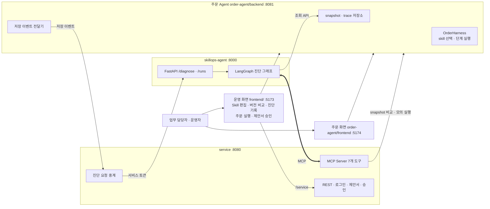
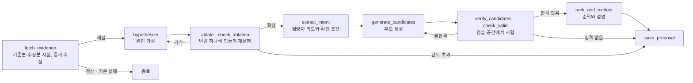

# SkillOps Agent 설계도

Capstone 4조 · 2026-10-20 설계, 2026-10-23 현재 코드 기준으로 갱신

업무 담당자가 **SKILL.md** 를 자기 업무 흐름에 맞춰 고쳤을 때 깨지는 에이전트 서비스를 실행 증거로 진단하고, 실제로 돌려서 통과한 **검증된 수정안**만 제안하는 에이전트다.

| 결정 | 내용 |
|---|---|
| 무대 | 주문 처리 에이전트(주문 Agent, `order-agent/`) |
| skill | SKILL.md 6개. 고치는 사람은 개발자가 아닌 업무 담당자다 |
| harness | Spring Boot 로 직접 만든 주문 Agent 실행 루프(`OrderHarness`) |
| 원칙 | **LLM 은 제안하고 harness 가 판정한다** |

## 1. 무엇을 만드나

### 무대 · 주문 Agent

SKILL.md 6개로 돌아가는 캠핑용품 주문 에이전트다. orchestrator skill(`order-flow`)이 정한 순서대로 단계 skill 을 실행한다. 각 skill 은 frontmatter 에 입력·출력·의존을 선언하고, 본문은 담당자가 쓰는 자연어 절차다.

```
order-flow: order-intake, inventory-check, payment, shipping-reserve, notify 순서
```

- 재고·결제·배송·알림은 mock 어댑터다. 외부 연동은 없다.
- 모든 실행은 실행 기록(trace)으로 남는다. 형식은 `order-agent/docs/agent-evidence.md` 에 있다.
- skill 파일 묶음은 불변 snapshot 으로 저장한다. 수정본을 저장하면 기존 묶음을 보존한 채 새 snapshot 이 생긴다.
- skill 선택과 도구 호출은 fixed 모드(결정적 규칙)와 openai 모드(LLM) 중 하나로 한다(`ORDER_AGENT_MODEL_MODE`).

### 주인공 · SkillOps Agent

담당자가 수정본을 저장하면 기준본과 수정본으로 기준 주문을 시험한다. 주문이 깨지면 실행 기록과 diff 를 읽고 원인을 실험으로 확정한 뒤, 수정안 후보를 격리된 연습 공간(workspace)에서 실제로 돌려 본다. 결과는 제안서로 저장하고 운영자가 화면에서 승인하거나 거절한다.

- "원래대로 되돌리기"는 해결책이 아니다. 담당자의 **의도는 보존**되어야 한다.
- 근본 수정은 바뀐 skill 하나가 아니라 이어진 skill 의 **계약(입출력)** 까지 맞추는 것이다.
- 제안서의 문장은 실행 번호와 시험 결과를 근거로 쓴다. 근거가 없는 후보는 저장을 거부한다.

## 2. 전체 구조

에이전트는 판정에 필요한 일을 MCP 도구로만 한다. 실행 기록과 skill 원문 조회는 주문 Agent 의 조회 API 를 직접 부른다.



| 구성 | 위치 · 포트 | 책임 | 스택 |
|---|---|---|---|
| 주문 Agent | `order-agent/backend` · 8081 | 주문 도메인, mock 어댑터, skill 실행 루프, snapshot·trace 저장, 모의 실행(dry-run) API, 저장 이벤트 전달 | Java 21 · Spring Boot · Spring AI(OpenAI) · PostgreSQL 17 · Docker Compose |
| 주문 화면 | `order-agent/frontend` · 5174 | 주문 실행과 실행 기록 확인 | Vue 3 · Vite |
| service | `service/` · 8080 | MCP 도구 7개, 로그인(JWT), 제안서 조회·승인·거절, 진단 요청 중계, 시험 실행 장부 | Java 21 · Spring Boot 4.1.0 · Spring AI 2.0.0 MCP Server · PostgreSQL 17 |
| SkillOps Agent | `skillops-agent/` · 8000 | 진단 그래프, 진단 기록(SQLite), 제안서 저장 요청 | Python 3.11 · uv · LangGraph · langchain-openai · mcp · FastAPI |
| 운영 화면 | `frontend/` · 5173 | Skill 편집·저장, 버전 비교, 진단 진행 확인, 제안서 읽기·승인 | Vue 3.5 · Vite · Pinia · Vue Router |

### MCP 도구 7개

| 도구 | 하는 일 | 구현 |
|---|---|---|
| `ping` | 연결 확인 | `service/src/main/java/com/capstone4/skillops/mcp/PingTools.java` |
| `diff_skill` | 두 snapshot 에서 skill 하나의 SKILL.md 를 비교한다 | `mcp/SkillDiffTools.java` |
| `get_dependency_graph` | snapshot 의 skill 연결과 끊긴 입력을 계산한다 | `mcp/DependencyGraphTools.java` |
| `create_workspace` | snapshot 이나 운영본으로 연습 공간을 만든다 | `mcp/WorkspaceTools.java` |
| `apply_patch` | 연습 공간에 후보 수정을 적용하고 연결 검사를 한다 | `mcp/WorkspaceTools.java` |
| `run_scenarios` | 연습 공간으로 기준 주문과 재현 주문을 모의 실행해 채점한다 | `mcp/WorkspaceTools.java` |
| `save_proposal` | 검증 결과를 검사하고 제안서로 저장한다 | `mcp/ProposalTools.java` |

입출력은 `docs/contracts/mcp-tools-input-output.md`, REST 와 이벤트 경로는 `docs/contracts/mcp-tools-and-rest.md` 에 있다. 실행 기록·skill 조회 API 는 `order-agent/docs/diagnosis-read-api.md` 에 있다.

## 3. 진단 파이프라인

유효성은 실행 결과로만 판정한다. LLM 은 원인 가설, 의도, 후보, 설명을 만들고, **원인 확정(ablation)과 후보 검증만 실제 모의 실행으로 판정**한다. 단계의 순서와 분기는 `skillops-agent/skillops_agent/graph.py` 의 `FLOW` 표 하나가 정한다.



| 튜닝 지점 | 값 | 위치 |
|---|---|---|
| 원인 가설 재시도 | 3회 | `skillops-agent/skillops_agent/config.py` 의 `MAX_HYPOTHESIS_RETRIES` |
| 후보 재생성 | 3회 | `MAX_CANDIDATE_RETRIES` |
| 사전 시험·원인 확정·후보 검증 반복 | 2회 · 1회 · 2회 | `PREFLIGHT_REPEAT` · `ABLATION_REPEAT` · `VERIFY_REPEAT` |
| 단계 한도 | 40 | `MAX_STEPS_DEFAULT` |
| 모델 | `gpt-4.1-mini` | 환경 변수 `SKILLOPS_MODEL` |
| 프롬프트 | 단계별 파일 | `skillops-agent/prompts/` |

승인 대기 노드는 없다. 그래프는 `save_proposal` 에서 끝나고, 승인은 service 가 화면 요청을 받아 기록한다.

### 합격 기준

`service/src/main/java/com/capstone4/skillops/proposal/ProposalRules.java` 가 저장할 때 다시 계산한다. 아래 넷을 모두 통과해야 합격 후보다.

| 칸 | 기준 | 판정 |
|---|---|---|
| `fixes_failure` | 실패했던 주문이 끝까지 처리된다 | 재현 주문 모의 실행 |
| `keeps_old_orders` | 기준 주문이 하나 이상이고 모두 이전과 같게 처리된다 | 기준 주문 모의 실행 |
| `keeps_intent` | 담당자가 바꾸려던 업무 규칙이 지켜진다. 되돌리기는 불합격이다 | 의도 확인 조건을 실행 기록 값으로 검사 |
| `no_broken_links` | 모든 skill 의 선언 입력이 앞 skill 의 선언 출력으로 공급된다 | `apply_patch` 의 연결 검사 |

후보 종류는 같은 skill 만 고치기(`same_skill`), 이어진 skill 까지 고치기(`linked_skills`), 실행 순서 바꾸기(`run_order`)다. 합격 후보가 없으면 제안서 상태는 `no_valid_fix` 이고, 이것도 정당한 결과로 담당자에게 보여 준다.

### 제안서와 승인

- 제안서 본문은 service 가 저장할 때 정해진 목차와 문장 틀로 한 번 만든다(`proposal/ProposalDocumentWriter.java`). 문체 규칙은 `proposal/ToneCheck.java` 와 `skillops-agent/prompts/style.md` 가 같이 지킨다.
- 상태는 `proposed`, `no_valid_fix`, `approved`, `rejected` 다. 운영자(OPERATOR)만 승인·거절할 수 있고, 승인은 합격 후보와 의도 확인이 있어야 한다.
- 승인한 수정본을 운영 skill 로 반영하는 단계(promote)와 되돌리기(rollback)는 아직 없다.

## 4. 수정본 저장에서 제안서까지

1. 담당자가 운영 화면의 Skill 편집에서 수정본을 저장한다. 주문 Agent 가 새 snapshot 과 전달 대기 이벤트를 한 트랜잭션에 저장한다.
2. 주문 Agent 의 전달기가 service 로 이벤트를 보내고, service 가 서비스 토큰을 붙여 SkillOps Agent 의 `/diagnose` 로 넘긴다.
3. SkillOps Agent 가 진단 그래프를 돌리고 `save_proposal` 로 제안서를 저장한다.
4. 화면은 진단 진행을 service 를 거쳐 조회하고, 저장된 제안서를 받은 제안서 목록에서 보여 준다.

자세한 사용법, 중복 방지, 복구 규칙은 `docs/skill-save-auto-diagnosis.md` 에 있다.

## 5. 시험 주문

| 폴더 | 내용 |
|---|---|
| `scenarios/golden/` | 기본 설정(`SKILLOPS_SCENARIOS_DIR=../scenarios`, 계약만 보는 가짜 실행기 `SKILLOPS_FLOW_RUNNER=contract-only`)의 기준 주문 g-01 |
| `scenarios/order-agent/golden/` | 주문 Agent 로 실제 모의 실행할 때 쓰는 캠핑 기준 주문 g-01~g-03. `SKILLOPS_SCENARIOS_DIR=../scenarios/order-agent`, `SKILLOPS_FLOW_RUNNER=harness` 로 켠다 |
| `scenarios/failures/F1.md` | 장애 시나리오 F1 설명 |

재현 주문은 SkillOps Agent 가 실패한 실행 번호로 만들어 `run_scenarios` 에 넘기며 파일로 두지 않는다. 처음 설계한 F2(배송 예약을 결제 앞으로 옮김), F3(결제에 보류 조건 추가) 시나리오와 기준 주문 g-04~g-06 은 아직 만들지 않았다.

## 6. 기술 스택과 커리큘럼

| 개발 단위 | 프레임워크 | 배운 과목 |
|---|---|---|
| 주문 Agent · service | Java 21 · Spring Boot · REST · JPA/JDBC | Java, SpringBoot, Rest API 구현 |
| harness · MCP Server | Spring AI · Spring AI MCP Server | Spring AI · AI Agent Capstone (MCP) |
| SkillOps Agent | Python · LangGraph · FastAPI · mcp client | AI Agent 설계 및 구축 · LangChain · Python |
| 화면 | Vue 3.5 · Vite | Vue.js · HTML/CSS/JS |
| 인프라 | Docker Compose · PostgreSQL 17 | 컨테이너 |

**쓰지 않는 것:** RAG/Vector DB 는 skill 6개 규모에서 검색이 필요 없어 제외했다. ML·sLLM 과 쿠버네티스도 범위 밖이다.

## 7. 리스크와 대응

| 리스크 | 대응 |
|---|---|
| openai 모드에서는 skill 실행도 LLM 이라 결과가 확률적이다 | 판정은 구조화된 실행 결과로만 하고, 시험을 2회 반복해 모두 통과해야 합격으로 본다 |
| LLM 이 근거 없는 설명을 만든다 | 제안서 본문은 service 가 실행 결과로 쓰고, 근거 실행이 없는 후보는 저장을 거부한다 |
| 수정본 시험이 데모 재고를 바꾼다 | 모의 실행은 끝난 뒤 재고를 복원한다 |
| 진단 도중 Agent 가 재시작된다 | 진단 기록을 SQLite 에 남기고, 실행 중이던 진단은 중단 오류로 표시하며 유료 모델 작업을 자동으로 다시 돌리지 않는다 |
