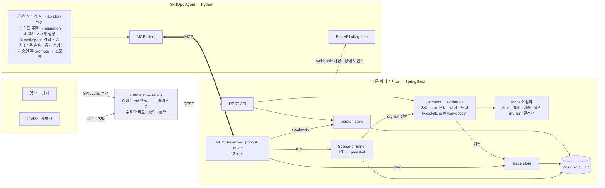
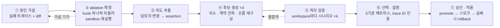

# SkillOps Agent 설계도

Capstone 4조 · 2일 빌드 · 5명 · 2026-10-20 확정
시각화 버전: https://claude.ai/artifact/EVw8gLuzz299a79Z6ghLtf (팀 공유 필요)

업무 담당자가 **SKILL.md**를 자기 업무 흐름에 맞춰 고쳤을 때 깨지는 에이전트 서비스를, 실행 증거로 진단하고 **검증된 수정안**을 제안하는 에이전트. 무대가 되는 서비스와 주인공 에이전트를 2일 안에 함께 만든다.

| 결정 | 내용 |
|---|---|
| 무대 | 주문 처리 에이전트 |
| skill | SKILL.md. 고치는 사람은 개발자가 아닌 업무 담당자 |
| harness | Spring AI로 직접 구축 |
| 원칙 | **LLM은 제안하고 harness가 판정한다** |

## 1. 무엇을 만드나

### 무대 · 주문 처리 서비스
SKILL.md 6개로 돌아가는 주문 에이전트. orchestrator skill(`order-flow`)이 정한 순서대로 단계 skill을 실행한다. 각 skill은 frontmatter에 입력·출력·의존을 선언하고, 본문은 담당자가 쓰는 자연어 절차다.

```
order-flow ⟶ order-intake → inventory-check → payment → shipping-reserve → notify
```

- 재고·결제·배송·알림은 mock 어댑터. 데모에 외부 연동은 없다.
- 모든 실행은 구조화된 트레이스로 남는다.
- SKILL.md 저장은 곧 버전이다. 되돌리기는 1클릭.

### 주인공 · SkillOps Agent
담당자의 수정으로 주문이 실패하면(또는 저장 시점에) 트레이스·diff·레지스트리를 읽고 원인을 실험으로 확정한 뒤, 깊이가 다른 수정안 2~3개를 격리된 workspace에서 실제로 돌려 통과한 것만 제안한다.

- "원래대로 되돌리기"는 해결책이 아니다. 담당자의 **의도는 보존**되어야 한다.
- 근본 수정 = 바뀐 skill 하나가 아니라 하위 skill의 **계약(입출력)** 까지 맞추는 것.
- 설명은 trace ID와 시나리오 ID를 인용해야 한다. 증거 없는 문장은 금지.

## 2. 전체 아키텍처

서비스는 내부를 MCP로 노출하고, 에이전트는 MCP만 쓴다.



| 컴포넌트 | 책임 | 프레임워크 |
|---|---|---|
| 주문 서비스 | 주문 도메인, mock 어댑터(live/dry-run), REST API | Java 21 · Spring Boot 4.1.0 · Spring Data JPA · PostgreSQL 17 |
| Harness | SKILL.md 로더·레지스트리, skill 실행기, 트레이스 기록, workspace 로딩 | Spring AI 2.0.0 ChatClient · @Tool · Anthropic starter |
| 검증 인프라 | 버전 저장소, workspace 격리, 시나리오 러너(k회), 계약 일관성 검사 | Spring Boot 서비스 내부 모듈 |
| MCP Server | 위 전부를 12개 tool로 노출, 저장·장애 webhook 발송 | Spring AI MCP Server (Streamable HTTP, `/mcp`) |
| SkillOps Agent | 진단 파이프라인 ①~⑦, 수정안 JSON, 증거 기반 설명 | Python 3.11 · Anthropic SDK 1.x · mcp 2.x · FastAPI |
| Frontend | 담당자용 편집기, 트레이스 뷰, 수정안 비교·승인·롤백 | Vue 3.5 · Vite |
| 인프라 | 한 명령으로 전체 기동 | Docker Compose |

## 3. 해결책 도출 파이프라인

유효성은 실행 결과로만 판정한다. LLM은 ①·③·④·⑥에서 가설·의도·후보·설명을 만들고, **②와 ⑤만이 sandbox 실행으로 판정**한다. 이 두 단계의 결과가 없는 수정안은 사용자에게 보이지 않는다.



③의 의도 확인은 ⑦의 승인 화면에서 한 번에 처리한다. 담당자가 의도 해석을 거부하면 수정한 의도로 ④~⑥을 다시 돌린다.

### 유효성 기준 5개

| # | 기준 | 뜻 | 판정 |
|---|---|---|---|
| 1 | 기능 복구 | 실패했던 주문이 통과한다 | **실행** · 실패 트레이스 → 재현 시나리오 → sandbox |
| 2 | 무회귀 | 전에 통과하던 주문이 여전히 통과한다 | **실행** · 골든 시나리오 6건 전체 |
| 3 | 의도 보존 | 담당자가 바꾸려던 업무 규칙이 살아 있다. 되돌리기는 불합격 | **실행** · diff에서 추출한 assertion을 기대값에 추가, 담당자가 승인 화면에서 확인 |
| 4 | 계약 일관성 | 모든 skill의 선언 입력이 상위 skill의 선언 출력으로 공급된다 | 정적 · 레지스트리(frontmatter) 검사. 여기까지 고쳐야 근본 수정 |
| 5 | 최소성 | 영향 범위 밖의 skill은 건드리지 않는다 | 정적 · 수정 footprint ⊆ 의존성 분석의 영향 집합 |

1·2·3을 모두 통과한 후보만 "유효". 유효 후보 사이의 순위는 4·5로 매긴다. 후보가 하나도 유효하지 않으면 ④로 돌아가 다시 생성하고, 두 번째도 실패하면 "유효한 수정안 없음"을 증거와 함께 보고한다. 이것도 정당한 결과다.

## 4. 5인 분업

각 흐름은 1일차 09시에 동결한 계약 5개(6절)에 맞춰 독립적으로 만든다.

### W1 · 주문 서비스 & Harness — Java · Spring Boot · Spring AI
- 주문/재고/결제/배송/알림 도메인 + mock 어댑터(live·dry-run 전환)
- SKILL.md 로더: frontmatter → 레지스트리, 본문 → system prompt
- skill 실행기(ChatClient + @Tool), 실행 트레이스 기록, 계약 일관성 검사 API
- 1일차 끝: `POST /orders`가 live skills로 끝까지 돌고 트레이스가 남는다
- 2일차 끝: workspace 로딩 + dry-run 경로 안정화, 계약 검사
- 막히지 않는 법: progressive disclosure 같은 고급 로더 기능은 만들지 않는다. 본문 전체 주입으로 끝.

### W2 · 검증 인프라 & MCP Server — Java · Spring AI MCP Server
- SKILL.md 버전 저장소(저장 = 버전), workspace(버전 + 패치 격리 디렉토리)
- 시나리오 러너: k회 실행, 구조화 기대값 비교
- MCP tool 12개, 저장·장애 webhook 발송
- 1일차 끝: 읽기 tool 6개 + `create_workspace` + `run_scenarios`
- 2일차 끝: `apply_patch` · `save_proposal` · `promote_workspace` · `rollback` + webhook
- 막히지 않는 법: W1 실행기가 늦으면 러너는 트레이스 fixture로 먼저 테스트한다.

### W3 · SkillOps Agent — Python · Anthropic SDK · mcp · FastAPI
- `/diagnose` webhook 수신, 파이프라인 ①~⑦, 후보는 structured output(JSON)
- 설명 생성: trace ID·시나리오 ID 인용 강제. 모델 `claude-opus-5-5`, adaptive thinking
- 1일차 끝: stub MCP 위에서 ①② + ⑥ → F1 수정안 1개
- 2일차 끝: ③ 의도, ④ 후보 3종, ⑤ 매트릭스, ⑦ promote
- 막히지 않는 법: 11시에 계약대로 canned 응답을 주는 stub MCP 서버부터 만든다(2시간). 실제 MCP는 1일차 18시에 교체.

### W4 · Frontend — Vue 3 · Vite
- 담당자용 SKILL.md 편집기(저장 = 버전, 변경 diff 표시), 주문 생성 + 트레이스 타임라인
- 수정안 비교: 후보 × 5기준 매트릭스, 의도 확인 체크, 승인 → 적용, 롤백
- 1일차 끝: 편집기 + 트레이스 뷰 (mock JSON) · 2일차 끝: 수정안 화면 → 실제 REST 연결
- 막히지 않는 법: 계약 문서의 REST 응답 예시 JSON을 그대로 mock으로 쓴다.

### W5 · Skills · 시나리오 · 통합/데모
- SKILL.md 6개를 업무 담당자 말투로 작성, 골든 시나리오 6개, 장애 시나리오 F1~F3(diff + 의도 + 기대 해법)
- Docker Compose, 계약 문서 관리, 통합 테스트, 데모 스크립트 · 발표 자료
- 1일차 끝: 계약 문서 확정, skills 6 + 골든 6 + F1 + compose · 2일차 끝: F2 · F3, 데모 리허설 주도
- 막히지 않는 법: 계약 변경 요청은 W5가 모아 13시·18시 두 번만 반영한다.

## 5. 2일 타임라인

| 흐름 | D1 09–11 | D1 11–18 | D1 18–20 | D2 09–13 | D2 13–16 | D2 16–18 |
|---|---|---|---|---|---|---|
| **전원** | **계약 5개 동결** | 각 레인 작업 | **통합 1차** F1 사후 진단 → 수정안 → 적용 → 재실행 통과 | 각 레인 작업 | **통합 2차** F1·F2·F3 + 저장 시 사전 분석 | **리허설** · 발표 자료 · 버퍼 |
| W1 | 계약 참여 | 도메인 + mock + 로더/레지스트리 + 실행기 + 트레이스 | 통합 | workspace·dry-run 안정화, 계약 검사 API | 통합 | 리허설 |
| W2 | 계약 참여 | 버전 저장소 + workspace + 러너 + MCP 읽기 tool 6개 | 통합 (stub → 실제 MCP 교체) | 쓰기 tool 4개 + webhook + k회 실행 | 통합 | 리허설 |
| W3 | 계약 참여 | stub MCP(2h) → ①② → ⑥ → F1 수정안 1개 | 통합 | ③ 의도, ④ 후보 3종, ⑤ 매트릭스, ⑦ promote | 통합 | 리허설 |
| W4 | 계약 참여 | 편집기 + 주문/트레이스 뷰 (mock JSON) | 통합 | 수정안 비교·의도 확인·승인·롤백 → 실제 API | 통합 | 리허설 |
| W5 | **계약 문서 작성** | skills 6 + 골든 6 + F1 + compose | 통합 진행 | F2 · F3 + 데모 스크립트 + 발표 자료 | 통합 진행 | 리허설 진행 |

**잘리는 순서.** 2일차가 밀리면 ③ 의도 추출 자동화(담당자 직접 입력으로 대체) → 저장 시 사전 분석 경로 → F3 순으로 뺀다. ②·⑤·⑦은 빼지 않는다. 이 셋이 빠지면 "검증된 수정안"이라는 주장이 사라진다.

## 6. 1일차 09시에 동결할 계약 5개

초안은 `docs/contracts/`에 있다. W5가 관리하고, 변경은 13시·18시 두 번만 반영한다.

1. **SKILL.md frontmatter** — `name, description, inputs, outputs, depends_on, owner, version`; orchestrator는 `steps`. → `contracts/skill-frontmatter.md`
2. **트레이스 레코드** — `run_id, order_id, mode(live|dry-run), workspace, steps[{skill, version, input, output, tools_called, status, error, ms}], final_status`. → `contracts/trace.schema.json`
3. **시나리오** — `id, name, order, expect{skills_called, final_status, shipments, assertions}, k`. 기대값은 구조화 결과에만. → `contracts/scenario.schema.json`
4. **수정안(proposal)** — `trigger, root_cause{skill, hunk, confirmed_by}, intent{text, confirmed}, candidates[{kind, patches, results, evidence, rank}], recommended`. `evidence`가 비면 저장 거부. → `contracts/proposal.schema.json`
5. **MCP tool 12개 + REST + webhook** → `contracts/mcp-tools-and-rest.md`

## 7. 프레임워크 ↔ 4층 커리큘럼

| 개발 단위 | 프레임워크 | 배운 과목 (2026) | 비고 |
|---|---|---|---|
| Backend 서비스 | Java 21 · Spring Boot 4.1.0 · Spring Data JPA · REST | Java, SpringBoot, Rest API 구현 · 7/27–7/31 (5일) | 가장 오래 배운 스택 |
| Harness | Spring AI 2.0.0 (ChatClient, @Tool, Advisors) | Spring AI · 8/28–9/1 (3일) · Prompt 설계 · 7/22 | SKILL.md 로더만 직접 작성 |
| MCP | Spring AI MCP Server (Java) · mcp SDK client (Python) | AI Agent Capstone (MCP) · 10/19–10/21 | 서비스-에이전트 경계가 곧 MCP 경계 |
| SkillOps Agent | Python · Anthropic SDK tool runner · FastAPI | AI Agent 설계 및 구축 · 10/15–16 · LangChain · 9/11–15 · Python · 8/3–4 | 에이전트 루프는 공식 SDK |
| Frontend | Vue 3.5 · Vite | Vue.js · 8/24–8/27 (4일) · HTML/CSS/JS · 7/15–16 | 화면 3개 |
| 인프라 | Docker Compose | 컨테이너 · 8/20–21 | K8s(9/18–21, 10/7–12)는 범위 밖 |
| 협업 | Git · 짧은 통합 주기 | Git · 7/14 · Agile/MSA · 9/2–3 | 하루 두 번 통합 |

**의도적으로 쓰지 않는 것:** RAG/Vector DB(9/30–10/6)는 skill 6개 규모에서 검색이 필요 없어 제외. ML·sLLM 과목은 이 문제와 무관. 쿠버네티스는 데모 가치 대비 비용이 커서 제외.

## 8. 데모 시나리오

| ID | 담당자가 한 일 | 깨지는 곳 | 기대하는 근본 수정 | 후보 |
|---|---|---|---|---|
| F1 | `inventory-check` 출력 필드명을 `available` → `예약가능수량`으로 바꿈 | `payment`가 `inventory.reserved`를 못 찾아 에러 | inventory-check의 outputs 선언 + payment의 inputs와 본문을 함께 갱신 | contract |
| F2 | `order-flow` steps에서 배송 예약을 결제 앞으로 옮김 | `shipping-reserve`가 `payment.id` 없이 호출 | 배송 가능 여부 확인(`shipping-check`)을 결제 앞에 분리, 예약은 결제 뒤 | flow |
| F3 | `payment`에 "선입금만 결제, 나머지는 보류" 조건 추가 | `notify`·`shipping-reserve`가 `HOLD`를 몰라 오동작 | `payment.status`에 HOLD 추가, shipping 가드, notify 보류 템플릿 — 세 skill 동시 수정 | contract |

골든 g-01~g-06: 단일 상품 정상 / 복수 상품 / 선입금 / 재고 부족 → 안내 / 결제 실패 → 재시도 안내 / 해외 배송. F3는 "되돌리기"가 가장 쉬운 유혹이라 의도 보존 기준이 작동하는지 보여주는 핵심 장면.

## 9. 리스크

| 리스크 | 대응 |
|---|---|
| harness의 skill 실행도 LLM이라 재실행이 확률적 | 기대값은 구조화 결과에만, k=2회 모두 통과, replay는 effort low |
| SKILL.md 로더 직접 구현 시간 | frontmatter 파싱 + 본문 전체 주입만 |
| 통합 지연으로 데모 미성립 | 계약 동결, W3 stub MCP, 1일차 18시 통합 고정 |
| mock 어댑터라 "실제 운영"으로 보이지 않음 | live/dry-run 전환 지점을 코드로 보여주고 실제 연동 자리를 명시 |
| LLM이 증거 없는 설명을 생성 | 설명 JSON 스키마에 `evidence[]` 필수, 비어 있으면 저장 거부 |

## 10. 확정된 가정

- **A.** SkillOps Agent는 Python + Anthropic SDK. 서비스-에이전트 경계를 언어까지 다르게 두면 MCP가 왜 필요한지 데모에서 설명이 된다.
- **B.** 담당자의 의도 확인은 승인 화면에서 한 번에.
- **C.** W1~W5는 역할. 사람 매핑은 팀이 정한다. Java에 강한 두 명이 W1·W2, Python에 익숙한 한 명이 W3.
