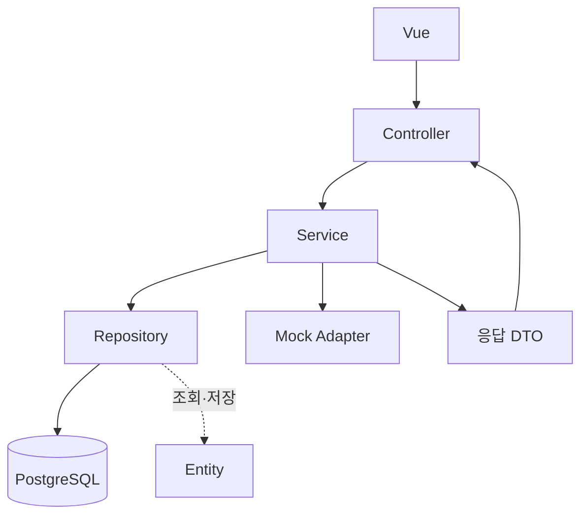

# order-agent 백엔드 구조 명세

> MVP 이후 구현: 현재 Skill·Harness·snapshot·trace 기능이 추가됐다. 최신 API·저장 방식·실패/트랜잭션·시연 후보·담당자 TODO는 [agent-evidence.md](agent-evidence.md)를 우선한다. 아래의 미구현/후속 표기는 작성 당시 단계 설명이다.

작성: 2026-10-20 / 상태: 1차 MVP 구현 반영

프로젝트명·최상위 디렉터리명은 **order-agent**다. 백엔드는 `order-agent/backend/`에 둔다. Java 기본 패키지는 하이픈 없는 `com.capstone4.orderagent`를 사용한다. 이 구조를 기준으로 애플리케이션과 테스트를 구현했다.

업무 규칙·DB 컬럼은 [design.md](design.md), HTTP 입출력·오류 코드는 [api.md](api.md)가 기준이다. 이 문서는 해당 명세를 어떤 클래스와 계층으로 구현할지 정한다.

## 1. 디렉터리

```text
order-agent/
├── docs/
├── compose.yml                         # 이후 frontend/backend/db 연결
├── backend/
│   ├── build.gradle
│   ├── settings.gradle                 # rootProject.name = 'order-agent'
│   ├── gradlew / gradlew.bat
│   ├── gradle/wrapper/
│   ├── Dockerfile
│   ├── .dockerignore
│   └── src/
│       ├── main/
│       │   ├── java/com/capstone4/orderagent/
│       │   │   ├── OrderAgentApplication.java
│       │   │   ├── controller/
│       │   │   │   ├── HealthController.java
│       │   │   │   ├── ProductController.java
│       │   │   │   └── OrderController.java
│       │   │   ├── service/
│       │   │   │   ├── ProductService.java
│       │   │   │   ├── OrderService.java
│       │   │   │   ├── OrderLifecycleService.java
│       │   │   │   └── OrderProcessingService.java
│       │   │   ├── repository/
│       │   │   │   ├── ProductRepository.java
│       │   │   │   └── OrderRepository.java
│       │   │   ├── entity/
│       │   │   │   ├── Product.java
│       │   │   │   ├── Order.java
│       │   │   │   ├── OrderItem.java
│       │   │   │   ├── OrderProcessingStep.java
│       │   │   │   └── enums/          # 주문·결제·단계 상태
│       │   │   ├── dto/
│       │   │   │   ├── order/          # 주문 요청·응답
│       │   │   │   ├── product/        # 상품 응답
│       │   │   │   └── common/         # 공통 오류 응답
│       │   │   ├── adapter/
│       │   │   │   ├── InventoryMockAdapter.java
│       │   │   │   ├── PaymentMockAdapter.java
│       │   │   │   ├── ShippingMockAdapter.java
│       │   │   │   ├── NotificationMockAdapter.java
│       │   │   │   └── model/          # Mock 입력·결과, HTTP DTO와 분리
│       │   │   ├── exception/
│       │   │   │   ├── ErrorCode.java
│       │   │   │   ├── BusinessException.java
│       │   │   │   └── GlobalExceptionHandler.java
│       │   │   └── config/
│       │   │       └── ClockConfig.java
│       │   └── resources/
│       │       ├── application.yml
│       │       ├── schema.sql
│       │       └── data.sql
│       └── test/java/com/capstone4/orderagent/
│           ├── controller/
│           ├── service/
│           ├── adapter/
│           └── integration/
└── frontend/                           # Vue, 세부 구현은 이후 진행
```

위 구조를 기준으로 구현했다. DTO·Mock 결과 일부는 작은 관련 record를 한 파일에 묶었다. Entity enum은 entity/enums에 두며 초기 데이터는 schema.sql/data.sql에 둔다.

## 2. 계층의 역할

| 계층 | 담당 | 넣지 않을 책임 |
|---|---|---|
| Controller | 요청 바인딩, @Valid, 헤더, HTTP 상태·Location 설정 | 가격 계산·재고 차감·DB 직접 조회 |
| Service | 업무 검증·절차·상태 전이·트랜잭션·DTO 조립 | HttpServletRequest·ResponseEntity 의존 |
| Repository | JPA 저장·조회·잠금 쿼리·조건부 갱신 | 결제 정책·배송 처리 |
| Entity | 테이블 매핑·관계·주문 시점 값·허용된 상태 변경 | 컨트롤러 응답·외부 도구 호출 |
| DTO | API 요청·응답 데이터 | 영속 관계·JPA 프록시 |
| Adapter | Mock 재고·결제·배송·알림 동작 | 주문 HTTP 응답·Runner 채점 |
| Exception | 오류 분류·공통 HTTP 변환 | 정상 재고 부족을 서버 예외로 바꾸는 처리 |

기본 흐름은 `Controller → Service → Repository → DB`다. Service는 필요할 때 Mock Adapter를 호출한다. Entity는 이 호출의 다음 실행 단계가 아니라 Repository가 읽고 저장하는 객체다.



## 3. Controller와 Service

### Controller

| 클래스 | 주요 endpoint | 호출할 Service |
|---|---|---|
| HealthController | GET /api/health | 단순 기동 응답 |
| ProductController | GET /api/products | ProductService |
| OrderController | POST /api/orders, GET /api/orders/{id}, GET /api/orders/by-request/{request_id} | OrderService |

OrderController는 Idempotency-Key 헤더를 검증하고 생성 결과의 신규 여부로 201/200을 결정한다. 정상 재고 부족·결제 거절도 주문 응답으로 반환한다. 오류 형식은 GlobalExceptionHandler에서 통일한다.

### Service

| 클래스 | 책임·메서드 예시 | 트랜잭션 |
|---|---|---|
| ProductService | getProducts: 활성 상품 목록과 가격·재고 DTO | 읽기 전용 |
| OrderService | createOrder / getOrder / getByRequestId: 요청 정규화·멱등 확인·다른 Service 호출·결과 조립 | 전체 createOrder에는 긴 트랜잭션 없음. 조회는 읽기 전용 |
| OrderLifecycleService | accept: CREATED와 항목 저장, claim: 처리 소유권 획득, fail: 오류 상태·단계 저장 | 각 public 메서드가 짧은 독립 트랜잭션 |
| OrderProcessingService | process: 잠금 조회→재고→결제→배송→알림→최종 상태·단계 저장 | Mock 실행 전체 하나의 트랜잭션 |

메서드명은 구현 시 일관되게 정할 수 있지만 책임과 트랜잭션 경계는 유지한다. OrderService가 처리 전체를 조율하고, 나머지 Service는 접수·처리의 트랜잭션 경계 때문에 나눈다. 네 개의 큰 아키텍처 계층 안에서 필요한 서비스만 두는 방식이다.

같은 클래스의 메서드를 this.process()로 호출하면 일반적인 Spring 프록시 기반 @Transactional이 적용되지 않을 수 있다. 별도 bean을 통해 호출해 롤백 후 오류 기록 트랜잭션을 새로 시작한다. UNIQUE 충돌 후 같은 실패 트랜잭션에서 조회를 계속하지 않는다.

## 4. Repository와 Entity

### Repository

| 클래스 | 필요한 기능 |
|---|---|
| ProductRepository | 활성 상품 조회, SKU 집합 조회, SKU 정렬 순서의 재고 잠금 조회 |
| OrderRepository | 주문 저장, request_id 조회, 주문 상세 조회, CREATED→PROCESSING 조건부 갱신, 미완료 주문 조회 |

OrderItemRepository·OrderProcessingStepRepository는 초기에는 만들지 않는다. 항목과 단계는 주문에 종속되고 독립 수정 API가 없으므로 Order를 통해 저장한다. 나중에 단계 페이징·통계가 필요하면 전용 조회 Repository를 추가할 수 있다.

### Entity

| Entity | 테이블 | 주요 데이터 |
|---|---|---|
| Product | products | SKU, 이름, 가격, 가용 재고, 활성 여부 |
| Order | orders | 주문·요청 UUID, 입력 해시, 고객·배송 입력, 금액, 상태, Mock 결과 |
| OrderItem | order_items | 주문·상품 참조, 주문 시점 SKU·이름·가격, 수량·합계 |
| OrderProcessingStep | order_processing_steps | 주문 참조, 순번, 단계·상태·코드·메시지·시각 |

- Order→OrderItem, Order→OrderProcessingStep은 1:N, 자식→Order는 N:1이다.
- OrderItem→Product는 N:1이다. 주문이 삭제된다고 Product가 삭제되는 cascade를 설정하지 않는다.
- 연관관계는 LAZY를 기본으로 두고 상세 조회에 필요한 items/steps를 명시적으로 읽는다. 두 컬렉션을 한 fetch join으로 무리하게 조회하지 않고 쿼리를 분리해 행 중복·다중 bag 문제를 피한다.
- Order 내부에 addItem, addStep, markProcessing, reject, hold, complete 같은 상태 변경 메서드를 둔다. Controller가 setter로 상태를 바꾸지 않는다.
- Entity를 API 응답으로 직렬화하지 않는다. DTO는 트랜잭션 안에서 구성하고 open-in-view=false로 조회 경계를 명확히 한다.
- 주문·단계·결제 상태는 서로 다른 enum이며 DB에는 STRING으로 저장한다. 값 순서를 뜻하는 ordinal로 저장하지 않는다.
- 1차에는 주문 삭제 API와 항목 수정 API를 만들지 않는다. orphanRemoval로 처리 증거를 지우는 동작도 필요 없다.

상태 enum은 OrderStatus, PaymentStatus, NotificationStatus, ProcessingStepType, ProcessingStepStatus 등으로 구성한다. DB 컬럼·제약 조건은 design.md의 4개 테이블 정의를 따른다.

## 5. DTO와 오류

Java record를 기본으로 제안한다. 요청 DTO는 Jakarta Validation으로 형식·범위를 검사하고, 상품 존재·중복 SKU 합산·재고 같은 업무 검증은 Service에서 한다.

| 위치 | 타입 예시 | 역할 |
|---|---|---|
| dto/order | CreateOrderRequest, OrderItemRequest, ShippingRequest | 사용자 입력만 수신, 금액·최종 상태를 받지 않음 |
| dto/order | OrderResponse, OrderItemResponse, PaymentResponse, ShipmentResponse, OrderStepResponse | api.md의 상세 응답 |
| dto/product | ProductResponse, ProductListResponse | 상품 조회 응답 |
| dto/common | ErrorResponse, FieldErrorResponse | 공통 오류 형식 |

신규 여부와 주문 응답을 함께 반환하는 내부 결과 타입은 Service에 두고, HTTP 201/200 결정은 Controller에 둔다. Adapter의 PaymentResult 같은 타입을 그대로 HTTP에 반환하지 않는다.

정상 업무 거절은 예외가 아닌 결과로 다룬다. BusinessException은 PRODUCT_NOT_FOUND·ORDER_NOT_FOUND·IDEMPOTENCY_CONFLICT 등 HTTP 오류로 변환할 상황에 사용한다. Bean Validation·JSON 파싱 오류는 별도로 처리하고, 예상하지 못한 예외는 안전한 INTERNAL_ERROR로 변환한다.

## 6. Mock Adapter

| 클래스 | 입력·결과 | 주의점 |
|---|---|---|
| InventoryMockAdapter | 잠금 확보한 상품·수량 → 전체 예약 성공/부족, 필요 시 해제 | DB 잠금과 트랜잭션 소유자는 Service |
| PaymentMockAdapter | 주문 참조·고객·금액·방식 → PAID/DECLINED·Mock 참조 | c_declined + card만 결정적 거절 |
| ShippingMockAdapter | 주문 참조·배송지·PAID·예약 결과 → Mock 참조·예정일 | 결제/예약 없는 배송 거절 |
| NotificationMockAdapter | 배송 완료 결과 → SENT | 실제 외부 메시지 발송 없음 |

ProductRepository를 통해 잠금을 확보한 후 InventoryMockAdapter가 엔티티의 재고 변경 메서드를 호출하는 형태로 시작한다. Adapter 내부에 몰래 별도 트랜잭션이나 전역 재고 Map을 두지 않는다. 이후 DRY_RUN에서는 별도 실행 상태를 사용하는 어댑터로 연결할 수 있도록 HTTP DTO에 의존하지 않는다.

ClockConfig에서 Clock을 주입해 배송일·처리 시각을 만들고 테스트는 고정 Clock을 사용한다. 테스트 기대값을 실제 Mock 실행 입력에 전달하지 않는다.

## 7. 정상·거절 호출 흐름

1. OrderController가 요청·헤더 형식을 검증한다.
2. OrderService가 입력을 정규화하고 request_id와 입력 해시를 확인한다.
3. OrderLifecycleService.accept가 새 주문·주문 항목을 저장한다. 기존 주문이면 새 처리를 만들지 않는다.
4. OrderLifecycleService.claim이 CREATED 주문만 PROCESSING으로 변경한다.
5. OrderProcessingService.process가 상품 잠금을 잡고 Mock 어댑터를 호출한다.
6. 업무 거절은 REJECTED/HOLD, 성공은 SHIPPED로 결과·단계를 저장한다.
7. 처리 예외는 전체 처리 트랜잭션을 롤백한 뒤 OrderLifecycleService.fail로 FAILED를 저장한다.
8. OrderService가 저장 결과를 DTO로 조회하고 Controller가 응답한다.

재고 부족에서는 PAYMENT/SHIPPING/NOTIFICATION을 SKIPPED로 남긴다. 결제 거절에서는 재고를 복원하고 RELEASE SUCCESS, SHIPPING/NOTIFICATION SKIPPED를 남긴다. 오류 뒤 성공 단계가 실행되거나 주문 상태만 SHIPPED가 되는 일이 없어야 한다.

## 8. 테스트 배치와 이후 연결

후속 단계에는 harness/를 추가해 flow 로드→steps 검증→단계 Skill 로드·실행→컨텍스트 전달을 맡긴다. 상세 역할·클래스·정상/중단 흐름은 [skill-flow.md](skill-flow.md)에 정의한다. Service는 접수·저장·트랜잭션을 유지하고, Harness가 Skill 실행을 관리한다.

| 위치 | 검증 |
|---|---|
| controller/ | 요청 검증·HTTP 코드·오류 JSON·DTO 형식 |
| service/ | 정상·품절·거절·멱등 흐름, 잘못된 후속 호출 방지 |
| adapter/ | 고정 실패 규칙·금액·배송일·재고 예약/해제 |
| integration/ | PostgreSQL 스키마·트랜잭션·동시 재고·UNIQUE 경합·재시작 정리 |

프로젝트 이름은 order-agent지만 1차에는 LLM·Skill 선택 기능이 없다. 고정 업무 절차를 먼저 검증한다. 이후 OrderProcessingService의 실행 경계에 Harness를 연결하고, Execution·Snapshot·Trace는 기존 SkillOps 담당 구현을 사용한다. 기본 Controller·주문 DTO·조회 API를 유지하면서 연결하는 것을 목표로 한다.

클래스·Docker 이미지·DB 테이블을 구현하고 단위·PostgreSQL 통합 테스트를 실행했다. 결과는 [verification.md](verification.md)에 기록했다.

## 9. 1차 설계 검토 결과

2026-10-20 검토 기준으로 계층·DTO·DB 4개 테이블·API·업무 분기·트랜잭션·테스트 계획이 정리돼 있어 1차 구현에 착수할 수 있다. 구현 완료나 실행 검증을 뜻하지 않는다.

- 기동 응답의 service 이름을 order-agent로 통일한다. DB order_demo·ORDER_DEMO_DB_*는 내부 데모 식별자로 유지한다.
- 처리 롤백 후 오류 기록에는 실제 실패 단계와 안전한 오류 코드를 담은 내부 오류 컨텍스트를 전달한다. 롤백된 Entity를 재사용하거나 DB에 남지 않은 성공 단계를 만들어 복구하지 않는다.
- 처리 예외의 FAILED 주문 조회, request_id UNIQUE 경합 뒤 재조회, 접수 전 오류와 접수 후 오류 구분을 구현 테스트에 포함한다.
- 알림 Mock은 SENT 상태·업무 단계를 저장한다. 현재 DB·API에 없는 알림 참조 영속화를 약속하지 않는다.
- frontend는 [frontend-design.md](frontend-design.md)에 따라 현재 API를 소비한다. 미확정 요청은 새 키로 제출하지 않고 먼저 조회한다.

Spring/JPA/SQL 매핑·데이터 보존·Docker readiness·동시 재고·멱등 요청을 실행 검증했다. 장애 주입과 복구를 포함한 실제 검증 범위는 verification.md를 따른다.
