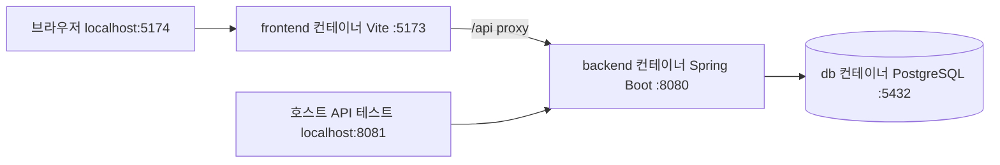
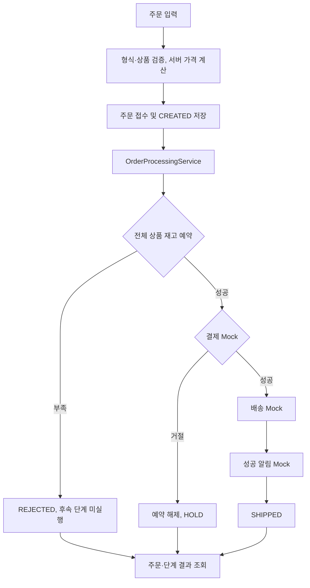
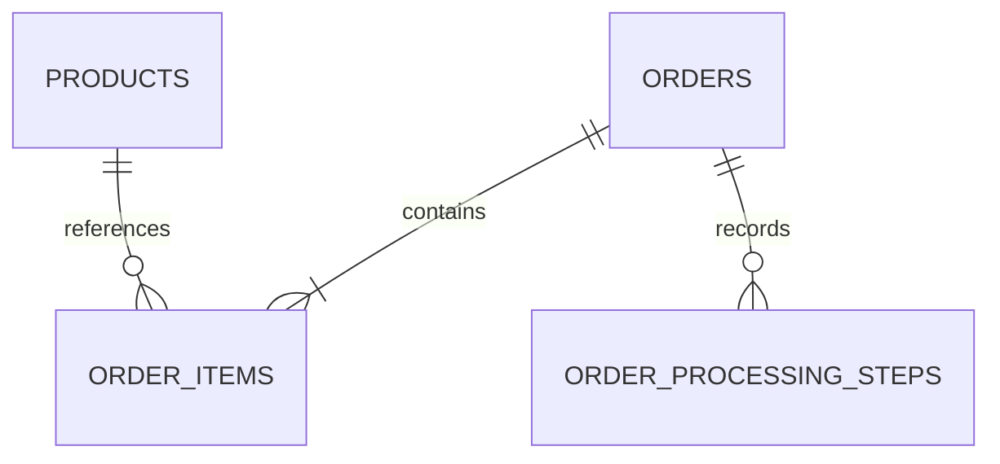

# 1차 주문 서비스 설계

> MVP 이후 구현: 현재 Skill·Harness·snapshot·trace 기능이 추가됐다. 최신 API·저장 방식·실패/트랜잭션·시연 후보·담당자 TODO는 [agent-evidence.md](agent-evidence.md)를 우선한다. 아래의 미구현/후속 표기는 작성 당시 단계 설명이다.

작성: 2026-10-20 / 상태: 1차 MVP 구현 반영, 후속 Agent 기능은 설계 단계

## 1. 목표와 경계

Vue·Spring Boot로 간단한 주문 서비스를 먼저 완성한다. 사용자가 상품과 수량을 선택하면 백엔드가 가격을 계산하고 재고·결제·배송·알림 Mock을 실행한다. 사용자는 결과와 단계별 처리 상태를 확인한다.

기존 SkillOps에서 분리한 `order-agent/` 아래에 구현한다. 사용자가 이번 작업에서 독립 디렉터리를 요청했으므로 기존 모듈 확장 방식에서 변경한다. 기존 미커밋 설계 문서와 다른 담당자 코드는 유지한다.

| 1차 포함 | 이후 SkillOps 통합 범위 |
|---|---|
| 상품 조회, 주문 생성·조회, 멱등 재요청 | Skill 선택·검증·로더·Harness |
| 결정적 재고·결제·배송·알림 Mock | 실제 모델·API 예산·토큰 관찰 |
| 주문·항목·업무 처리 단계 DB 저장 | snapshot·trace 영속 저장 |
| Vue 입력·결과·처리 단계 화면 | TargetAdapter·Runner·Judge·평가 보고서 |
| 성공·품절·결제 거절 시연 | MCP·진단 Agent·승인·PR·promote |

취소·환불·회원 인증·실제 카드정보·외부 결제/배송 연동은 제외한다. 1차에서 결제 완료 후의 배송/알림 Mock은 항상 성공한다. 해당 장애를 나중에 추가할 때 보상·재시도 규칙도 함께 설계한다.

## 2. 기술과 독립 실행

기존 저장소의 버전을 기준으로 Java 21, Spring Boot 4.1.0, Gradle wrapper 9.7.1, Vue 3.5, Vite 8, PostgreSQL 17을 사용한다. 구현 시 기존 npm lock의 정확한 버전과 맞추고 새 디렉터리의 lock을 커밋한다. 버전 호환성은 해당 단계에서 빌드로 확인한다.

백엔드는 Spring MVC·Validation·JPA·PostgreSQL 드라이버·테스트 의존성만 갖는다. Spring AI와 MCP는 1차 서비스에 필요하지 않다. 프론트는 단일 주문 화면으로 시작하므로 Pinia·Router는 필요해지기 전까지 추가하지 않는다.

독립 Docker Compose 프로젝트 `order-agent` 안에서 frontend·backend·db를 각각 컨테이너로 실행한다. 기존 SkillOps의 Compose, 네트워크, DB 볼륨은 공유하지 않는다. 하나의 컨테이너에 세 프로세스를 넣지 않고 서비스별로 빌드·재시작·로그를 확인한다.

| 서비스 | 호스트 접근 | 컨테이너 내부 연결 |
|---|---|---|
| frontend | `http://localhost:5174` | Vite 0.0.0.0:5173, `/api` → `http://backend:8080` |
| backend | `http://localhost:8081` | Spring Boot :8080, JDBC → `db:5432/order_demo` |
| db | 기본은 호스트 포트 공개 안 함 | PostgreSQL :5432, 전용 DB `order_demo` |

DB 관리 도구가 필요할 때만 개발 override로 `127.0.0.1:5433:5432`를 연다. 프론트·백엔드의 호스트 포트도 기본적으로 127.0.0.1에 바인딩한다. 같은 컴퓨터의 기존 서비스와 포트가 겹치지 않도록 한다.



**주소를 구분하는 이유:** 컨테이너 안에서 localhost는 그 컨테이너 자신이다. 프론트의 서버 측 프록시는 `backend:8080`을 호출하고, 백엔드는 `db:5432`를 사용한다. 브라우저는 Docker 내부 서비스 이름을 해석하지 않으므로 상대 경로 `/api`만 호출한다. 이 방식이면 개발 화면과 API가 브라우저에서 같은 origin이어서 별도 CORS 설정이 필요 없다.

### 이미지·시작·데이터 수명

- `order-agent/compose.yml`에 프로젝트 이름 `order-agent`와 frontend/backend/db를 정의한다. 고정 container_name·external network·기존 DB volume은 사용하지 않는다.
- backend Dockerfile은 JDK 21 + Gradle wrapper로 빌드하고 JRE 21 이미지에서 jar를 실행하는 다단계 빌드를 사용한다. 호스트의 `.gradle`, `build`, `bin`을 이미지에 복사하지 않는다.
- frontend Dockerfile은 기존 Node engine 범위를 만족하는 이미지로 npm ci 후 Vite를 `--host 0.0.0.0 --port 5173 --strictPort`로 실행한다. 처음에는 이미지에 소스를 포함하고 변경 시 재빌드한다. bind mount와 hot reload는 필요할 때 개발 override로 추가한다.
- Vite 컨테이너는 로컬 개발·시연용이다. 배포용 정적 빌드+웹 서버 구성은 별도 단계에서 추가한다.
- `.dockerignore`로 `.env`, Git 메타데이터, node_modules, 빌드 생성물을 제외한다. 비밀번호를 Dockerfile·build args에 넣지 않는다.
- db는 pg_isready healthcheck를 제공하고 backend는 DB가 healthy일 때 시작한다. backend의 실제 HTTP healthcheck도 구성하고, 실제 이미지에 있는 검사 도구로 동작을 검증한다. 기동 확인과 주문 통합 검증은 구분한다.
- DB 접속 비밀번호 등은 `order-agent/.env.example`에 변수 이름·로컬 예시만 안내하고, 실제 `.env`는 커밋하지 않는다. Compose가 읽은 값을 environment로 해당 컨테이너에 전달한다. `.env` 로딩과 Spring 설정은 별개이므로 실제 전달까지 확인한다.
- 변수 이름은 `ORDER_DEMO_DB_USER`, `ORDER_DEMO_DB_PASSWORD`를 사용하고 JDBC URL은 Compose에서 `jdbc:postgresql://db:5432/order_demo`로 전달한다. 호스트 실행용 `ORDER_DEMO_DB_URL`은 이후 선택적으로 지원한다. 기존 OpenAI 키와 루트 `.env`는 읽지 않는다.
- db의 named volume에 데이터를 보존한다. up·재빌드·일반 down으로 주문·재고를 초기화하지 않는다. `down -v`는 데모 전용 데이터를 삭제하므로 일반 종료 명령과 구분한다.
- 단일 백엔드 인스턴스의 로컬 데모로 시작한다. 컨테이너 장애를 숨기는 무제한 재시작 정책은 넣지 않는다.

저장소 루트에서 `docker compose -f order-agent/compose.yml up --build -d --wait`로 실행한다. compose.yml·Dockerfile·애플리케이션 구현과 기동·healthcheck·컨테이너 재생성 후 데이터 보존을 확인했다. 상세 실행법은 [README](../README.md)에 있다.

## 3. 구조와 책임

백엔드는 `controller/service/repository/entity`를 중심으로 구성한다. 프로젝트 디렉터리는 `order-agent`, Java 기본 패키지는 `com.capstone4.orderagent`다. Java 패키지명에는 하이픈을 사용할 수 없으므로 두 이름의 표기만 다르다.

```text
order-agent/
├── backend/
│   └── src/main/java/com/capstone4/orderagent/
│       ├── OrderAgentApplication.java
│       ├── controller/     OrderController, ProductController, HealthController
│       ├── service/        OrderService, ProductService,
│       │                   OrderProcessingService, OrderLifecycleService
│       ├── repository/     OrderRepository, ProductRepository
│       ├── entity/         Order, OrderItem, Product, OrderProcessingStep
│       ├── dto/            order/, product/, common/ 요청·응답
│       ├── adapter/        InventoryMockAdapter, PaymentMockAdapter,
│       │                   ShippingMockAdapter, NotificationMockAdapter
│       ├── exception/      업무 예외, ErrorCode, GlobalExceptionHandler
│       └── config/         Clock 등 공통 설정
└── frontend/src/
    ├── App.vue
    ├── api/orders.js
    └── components/          OrderForm.vue, OrderResult.vue, OrderSteps.vue
```

Controller는 요청·검증·HTTP 응답, Service는 주문 절차·트랜잭션, Repository는 DB 접근, Entity는 저장 데이터·유효한 상태 변경을 담당한다. API는 Entity 대신 DTO를 주고받는다. Mock은 Service가 호출하며 정상 업무 거절을 명시적인 결과로 반환한다.

`OrderService`는 주문 접수·중복 처리·실행·조회 입구다. `OrderProcessingService`가 재고→결제→배송→알림을 실행한다. `OrderLifecycleService`는 접수·처리 시작·오류 기록의 짧은 트랜잭션을 맡는다. 별도 Spring bean으로 나누는 이유는 처리 예외의 롤백 후에도 FAILED 상태를 저장하고, 같은 클래스 내부 호출로 @Transactional 적용이 빠지는 일을 피하기 위해서다.

주문 항목과 처리 단계는 Order가 함께 저장하므로 처음부터 모든 Entity별 Repository를 만들지 않는다. DTO·클래스·트랜잭션·테스트의 세부 배치는 [백엔드 구조 명세](backend-structure.md)를 따른다. 모든 Service에 interface/impl을 만들거나 범용 플러그인 구조를 추가하지 않는다.

## 4. 업무 흐름



금액은 원 단위 정수다. 서버가 SKU 가격×수량을 계산하며 클라이언트가 보낸 합계를 신뢰하지 않는다. 동일 SKU를 여러 줄로 보냈으면 합산 후 재고를 확인한다. 수량은 항목당 1~99, 입력 항목은 1~20줄, 합산 후 SKU당 수량도 99 이하여야 한다.

부분 예약은 하지 않는다. 여러 상품 중 하나라도 부족하면 전체 거절한다. 모든 주문은 별개의 업무 상태를 가지며 Mock 결과는 DB에 저장한다. 실제 외부 부수 효과는 없다.

### 최종 상태

| 상태 | 의미 | 도구·재고 처리 |
|---|---|---|
| CREATED | 접수 완료 | 아직 처리 전 |
| PROCESSING | 처리 중 | 클라이언트 재조회 시 관찰 가능 |
| SHIPPED | 결제·배송 예약·알림 완료 | 재고 차감 유지 |
| REJECTED | 재고 부족 | 재고 미차감, 결제·배송·알림 SKIPPED |
| HOLD | 결제 거절로 보류 | 예약 재고 복원, 배송·알림 SKIPPED |
| FAILED | 예상하지 못한 내부 오류 | 실패 단계 기록, 정상 업무 거절과 구분 |

주문 HOLD와 결제 DECLINED는 다른 개념이다. 결제 상태는 NOT_ATTEMPTED / PAID / DECLINED로 둔다. 결과 메시지는 상태와 `result_code`를 기준으로 표시한다.

### Mock 시연 데이터

| SKU | 이름 | 단가 | 초기 재고 |
|---|---|---:|---:|
| CAMP-LANTERN-LED | LED 캠핑 랜턴 | 30000 | 10 |
| CAMP-CHAIR-FOLD | 접이식 캠핑 의자 | 45000 | 5 |
| CAMP-MUG-STEEL | 스테인리스 캠핑 머그컵 | 12000 | 0 |

결제 방식은 card·prepaid만 지원한다. 일반 card/prepaid는 성공하고, 데모 고객 `c_declined`의 card 결제는 항상 거절한다. 이는 결정적 Mock 규칙이지 실제 결제 정책이 아니다. 단순한 시연을 위해 1차에서는 임의 실패 설정을 받는 개발 API를 만들지 않는다.

국가는 KR·US·JP만 지원한다. 배송일은 처리 시작 시 고정한 기준일에서 KR +2일, US/JP +7일이며 express면 각각 1일을 줄인다. 테스트에서는 Clock을 고정한다. 성공 알림은 외부 발송 없이 SENT 상태와 업무 처리 단계를 저장한다. 알림 참조를 별도 DB 컬럼에 저장하는 기능은 1차에서 제외한다.

LIVE 재고는 성공 주문마다 감소한다. 앱 재시작으로 기존 재고·주문을 초기화하지 않는다. seed는 최초 생성 시에만 삽입한다. 반복 테스트는 격리 DB/트랜잭션을 사용하고, 수동 데모 초기화는 데모 전용 볼륨 삭제 방법과 데이터 소실 설명을 구현 README에 명시한다.

## 5. DB 설계

이번에는 4개 업무 테이블로 시작한다. snapshot·trace·평가 테이블은 아직 만들지 않는다. 주문 화면의 처리 단계 기록은 아래 `order_processing_steps`에 저장하며, 모델 선택·Skill 로드·원본 tool 요청·토큰을 기록하는 기술 trace와 구분한다.



### products

| 컬럼 | 타입·제약 | 의미 |
|---|---|---|
| id | bigint PK | 내부 상품 ID |
| sku | varchar(64), UNIQUE, NOT NULL | 외부 상품 식별자 |
| name | varchar(120), NOT NULL | 상품명 |
| unit_price | bigint, NOT NULL, CHECK >= 0 | 원 단위 가격 |
| stock_quantity | integer, NOT NULL, CHECK >= 0 | 현재 주문 가능한 수량 |
| active | boolean, NOT NULL | 주문 가능 여부 |

### orders

| 컬럼 | 타입·제약 | 의미 |
|---|---|---|
| id | UUID PK | 주문 ID |
| request_id | UUID, UNIQUE, NOT NULL | Idempotency-Key |
| request_hash | char(64), NOT NULL | 정규화한 업무 입력 해시 |
| customer | varchar(64), NOT NULL | 데모 고객 식별자 |
| payment_method | varchar(16), NOT NULL | card / prepaid |
| shipping_country | varchar(2), NOT NULL | KR / US / JP |
| shipping_express | boolean, NOT NULL | 빠른 배송 여부 |
| total_amount | bigint, NOT NULL, CHECK >= 0 | 서버 계산 주문 금액 |
| status | varchar(20), NOT NULL | 주문 상태 |
| result_code | varchar(64), nullable | OUT_OF_STOCK / PAYMENT_DECLINED / INTERNAL_ERROR 등 |
| payment_status | varchar(20), NOT NULL | 결제 관찰 상태 |
| payment_reference | varchar(80), nullable | Mock 결제 참조 |
| shipment_reference | varchar(80), nullable | Mock 배송 참조 |
| estimated_delivery_date | date, nullable | 배송 예정일 |
| notification_status | varchar(20), NOT NULL | NOT_ATTEMPTED / SENT |
| created_at / updated_at | timestamptz, NOT NULL | 서버 시각 |
| version | bigint, NOT NULL | 동시 상태 변경 감지용 JPA Version |

### order_items

| 컬럼 | 타입·제약 | 의미 |
|---|---|---|
| id | bigint PK | 항목 ID |
| order_id | UUID FK → orders, NOT NULL | 주문 참조 |
| product_id | bigint FK → products, NOT NULL | 상품 참조 |
| sku / product_name | varchar, NOT NULL | 주문 시점 상품 정보 보존 |
| unit_price | bigint, NOT NULL, CHECK >= 0 | 주문 시점 가격 |
| quantity | integer, NOT NULL, CHECK 1~99 | 주문 수량 |
| line_total | bigint, NOT NULL, CHECK >= 0 | 서버 계산 항목 금액 |

`UNIQUE(order_id, product_id)`로 정규화 후 중복 항목을 방지한다. 나중에 상품 가격·이름이 바뀌어도 과거 주문은 저장한 값을 보여준다. 상품은 물리 삭제하지 않고 active=false로 전환한다.

### order_processing_steps

| 컬럼 | 타입·제약 | 의미 |
|---|---|---|
| id | bigint PK | 단계 기록 ID |
| order_id | UUID FK → orders, NOT NULL | 주문 참조 |
| sequence | integer, NOT NULL | 표시 순서 |
| step | varchar(32), NOT NULL | INTAKE / INVENTORY / PAYMENT / RELEASE / SHIPPING / NOTIFICATION / RECOVERY |
| status | varchar(16), NOT NULL | SUCCESS / REJECTED / FAILED / SKIPPED |
| result_code | varchar(64), nullable | 구조화된 결과 코드 |
| message | varchar(500), NOT NULL | 사용자에게 안전한 요약 |
| started_at / completed_at | timestamptz, NOT NULL | 단계 시각, SKIPPED는 동일 시각 |

`UNIQUE(order_id, sequence)`, orders.created_at·orders.status·자식 FK 인덱스를 둔다. 고정된 예제 데이터 외의 민감 입력·인증정보는 단계 메시지에 저장하지 않는다.

DB 초기 스키마는 구현 시 `schema.sql`과 JPA `ddl-auto=validate`로 일치시킨다. 생성·제약 조건 SQL과 seed를 분리한다. 이미 저장한 데이터를 다시 seed로 덮어쓰지 않는다. 스키마 변경 이력이 필요해지는 시점에 기존 팀의 마이그레이션 도구와 맞춘다.

## 6. 트랜잭션·중복 요청·내부 오류

1. 입력 검증·정규화 후 Idempotency-Key를 조회한다. 같은 입력이면 기존 주문을 반환하고 처리를 반복하지 않는다. 다른 입력이면 409다.
2. 새 주문 CREATED와 항목을 짧은 트랜잭션으로 저장한다. request_id UNIQUE 경합은 트랜잭션 밖에서 기존 주문을 재조회해 처리한다.
3. 처리 소유권을 `CREATED → PROCESSING` 조건부 갱신으로 확보하고 커밋한다. 이미 PROCESSING이면 다른 요청은 재처리하지 않고 조회만 한다.
4. OrderProcessingService는 별도 Spring bean의 트랜잭션으로 실행한다. 상품 행을 SKU 정렬 순서로 잠그고 전체 재고를 검사한다. 차감·Mock 결과·단계·최종 상태를 한 트랜잭션에서 저장한다.
5. 결제 거절은 예외를 던지지 않는 업무 결과다. 차감한 재고를 복원하고 HOLD와 RELEASE 성공 기록을 함께 커밋한다.
6. 예상하지 못한 예외는 처리 트랜잭션을 롤백한다. 별도 오류 기록 트랜잭션으로 FAILED·오류 단계·후속 SKIPPED를 저장한다. 존재하지 않는 성공 기록을 만들지 않는다.

1차 Mock은 외부 호출이 없어 처리 트랜잭션을 짧게 유지할 수 있다. 이후 실제 모델·외부 API를 연결할 때는 이 트랜잭션 안에서 네트워크를 기다리지 않도록 예약·실행·결과 확정으로 분리해야 한다. 외부 부수 효과가 없다는 현재 전제 덕분에 전체 롤백을 사용할 수 있는 것이다.

접수 후 프로세스가 중단되면 CREATED/PROCESSING이 남을 수 있다. 1차는 단일 백엔드 인스턴스를 전제로, 재시작 시 남아 있는 미완료 주문을 FAILED/PROCESS_INTERRUPTED로 정리한다. 처리 트랜잭션의 재고 변경은 DB 롤백 여부와 함께 확인한다. 자동 업무 재실행은 하지 않는다. 다중 인스턴스 운영은 범위 밖이다.

첫 요청은 제한된 시간 안에 동기 처리한다. 동일 키의 동시 재요청은 PROCESSING을 반환할 수 있으며 프론트가 재조회한다. DB lock timeout은 제한하고 충돌·잠금 오류를 일반 재고 부족으로 바꾸지 않는다.

## 7. 프론트 화면과 상태

컴포넌트·상태 전이·복구 동작의 상세 설계는 [frontend-design.md](frontend-design.md)를 따른다.

한 화면에서 왼쪽/상단은 주문 입력, 오른쪽/하단은 최근 결과를 보여준다. 모바일에서는 세로로 배치한다.

- 상품 목록·가격·현재 재고, 수량 입력·항목 추가/제거.
- 데모 고객 선택, card/prepaid, 배송 국가·express.
- 서버 계산 전 합계는 “예상 금액”으로 표시하고 최종 금액은 응답 사용.
- 처리 중 버튼 비활성화, 진행 안내, 입력 보존.
- 주문 ID·최종 상태·결제/배송 결과·오류 요약·단계 타임라인.
- SKIPPED를 성공으로 표시하지 않고, 업무 거절과 서버 오류를 다른 메시지로 안내.

초기 상태는 idle → submitting → result/error다. 네트워크 실패는 주문 실패로 단정하지 않는다. 프론트가 생성한 UUID 키를 입력과 함께 유지하고, 해당 키로 주문을 조회한 후 같은 키로 재전송한다. 최종 결과 확인 후 사용자가 내용을 바꾸거나 새 주문을 시작하면 새 키를 만든다. 결과가 미확정이면 복구 조회 중이 아니어도 입력 변경·새 제출을 막아 같은 주문이 새 키로 중복 접수되지 않게 한다.

PROCESSING 응답은 최대 10초 동안 1초 간격으로 조회한다. 이후 자동 조회를 멈추고 수동 새로고침을 제공한다. 화면을 떠나면 polling을 취소한다. 개인정보가 없는 데모에서도 1차는 키·본문을 메모리에만 보관하며 페이지 새로고침을 넘는 자동 복구는 보장하지 않는다.

## 8. 이후 SkillOps와의 연결

후속 주문 Agent는 order-flow의 steps를 읽고 Harness가 단계별 Skill을 실제 로드·실행하는 방식으로 연결한다. 파일이 다른 파일을 직접 호출하거나 단계마다 별도 Agent를 만드는 구조가 아니다. 단계 입력·결과 전달·중단·보상·코드 경계는 [skill-flow.md](skill-flow.md)를 따른다. 이 설계 추가로 1차 MVP 구현 범위가 자동으로 확장되는 것은 아니다.

1차 주문 처리에는 아직 execution_id·snapshot_id·trace_id가 없다. 주문 ID를 실행 ID처럼 사용하지 않는다.

이후 `OrderProcessingService`의 처리 경계에 기존 Harness를 연결하고 Order와 Execution을 1:N으로 연관시킨다. 실행 재시도 시 주문을 복제하지 않고 새 Execution을 만든다. Snapshot·Trace·Evaluation은 SkillOps/C 저장소와 연결한다. 지금 미리 빈 테이블이나 참조 무결성이 없는 가짜 ID를 넣지 않는다.

Mock 어댑터는 request-scoped/static 전역 상태에 의존하지 않고 명시적인 주문·입력으로 호출한다. 이후 DRY_RUN 구현을 추가할 수 있도록 업무 입력/결과 타입을 HTTP DTO와 분리한다. 현재의 업무 단계 기록은 UI용 결과이며, 나중의 trace에서 이를 참조할 수 있어도 기술 trace 전체를 대체하지는 않는다.

독립 디렉터리는 학습·시연용 중간 산출물이다. 검증 뒤 통합 시 어떤 서비스가 주문 원장을 소유할지 하나로 정하고, 도메인 코드를 복사한 두 서비스가 각각 상태를 갱신하는 구조는 피한다.

## 9. 구현 순서와 검증

| 순서 | 작업 | 완료 조건 |
|---|---|---|
| 1 | 백엔드·프론트 scaffold, Dockerfile·Compose·전용 DB | 세 컨테이너 기동, 내부 DNS·healthcheck·기존 앱과 포트/DB 분리 확인 |
| 2 | 테이블·seed·상품 API | 앱 재기동 시 데이터 보존, 상품 조회 |
| 3 | 주문·Mock·멱등·단계 저장 | 정상·품절·결제 거절 결과와 재고 일치 |
| 4 | Vue 입력·조회·결과 연결 | 실제 백엔드 응답으로 화면·오류·타임라인 표시 |
| 5 | 오류·동시성·복구 | 중복 키 1회 처리, 재고 음수 방지, 예외 롤백 |
| 6 | 테스트·실행법 문서 | Java 검사·프론트 lint/build·실제 브라우저 확인 |

필수 테스트:

- LED 캠핑 랜턴 2개 정상 주문: 총 60000, SHIPPED, 재고 10→8, Mock 참조/단계 저장.
- 품절 주문: REJECTED, 결제·배송·알림 미실행, 재고 변화 없음.
- c_declined + card: HOLD, 결제 DECLINED, 재고 복원, 배송·알림 미실행.
- 여러 SKU 중 하나 부족: 전체 미차감.
- 중복 SKU 합산: 수량 제한·재고 검사 우회 불가.
- 같은 키·같은 본문: 같은 주문, 중복 차감/배송 없음.
- 같은 키·다른 본문: 409.
- 동시에 마지막 재고 주문: 합계 판매량이 초기 재고를 넘지 않음.
- 내부 예외: 재고 롤백, FAILED와 안전한 오류 기록.
- 잘못된 입력·없는 SKU·404·네트워크 오류 UI.
- 미완료 주문의 재시작 정리, seed 재삽입 방지.
- Compose 전체 기동·정상 종료, 컨테이너 재생성 후 DB 보존, 프록시/DNS 연결, DB 호스트 포트 미공개 확인.

동시성·SQL·FK는 실제 PostgreSQL 통합 테스트로 확인한다. 단위 테스트는 Mock 결과와 업무 분기, 프론트는 lint/build와 브라우저 연동을 확인한다. 실행한 테스트와 남은 범위는 [verification.md](verification.md)에 기록했다.

## 10. 구현 배치 보완

- JSON 요청의 항목·배송은 CreateOrderRequest 안의 record, 응답의 항목·배송·결제·단계는 OrderResponse 안의 record로 묶었다. DTO 역할과 API 형식은 유지한다.
- `adapter/model`에 단일 용도 파일을 늘리기보다 PaymentMockAdapter.Result·ShippingMockAdapter.Result를 사용한다.
- 재시작 복구는 중단 위치를 추측하지 않는 RECOVERY 단계로 기록한다. 롤백된 완료 단계는 성공으로 복원하지 않는다.
- 프론트는 composable 주입 API를 Node 기본 test runner로 검증하고, Playwright로 실제 Docker 연동을 검증한다. 프론트와 기존 SkillOps 사이의 코드 의존성은 없다.
- 테스트용 db-test는 profile=test, 호스트 5434, tmpfs 데이터다. 데모 order_data와 공유하지 않는다.
