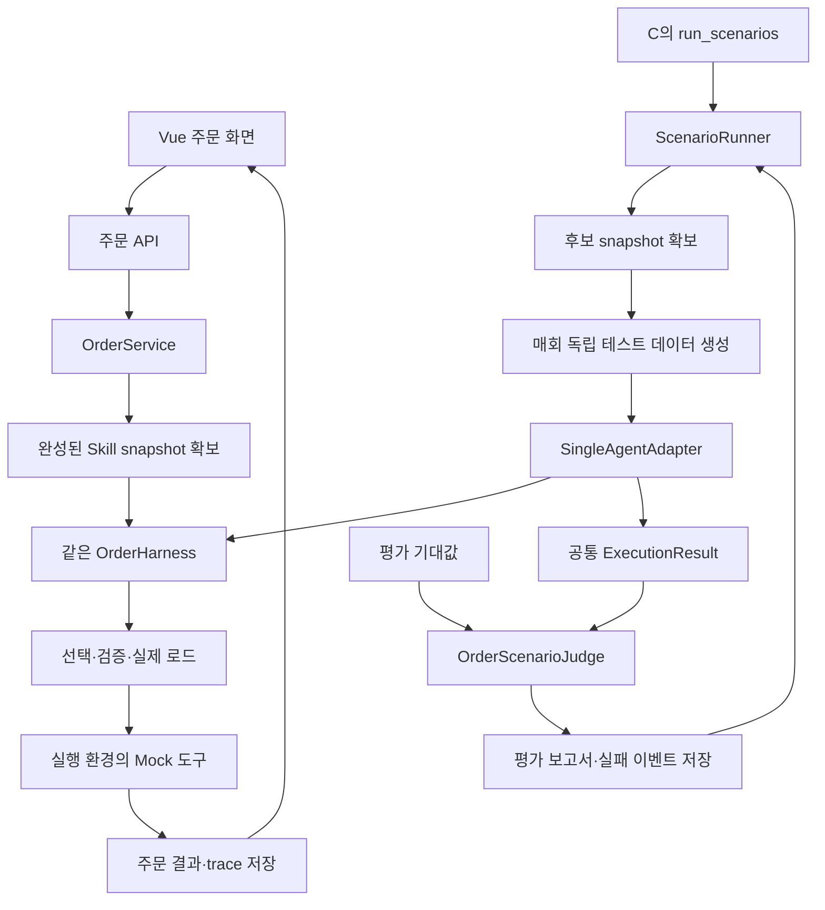

# 주문 서비스와 실행·평가 환경 설계안

작성: 2026-10-20 · 상태: 구현 전 제안

이 문서는 실제 저장소 조사 결과를 바탕으로 한 설계다. 기능 구현이나 기존 계약의 동결을 뜻하지 않는다. 기존 v0 계약을 유지할 부분과 확장이 필요한 부분을 구분한다. 최신 사용자 요청에 따라 이번 작업은 설계 문서까지만 작성한다.

## 1. 조사 결과

### 작업 지침과 변경 상태

- 저장소와 상위 경로에서 적용되는 `AGENTS.md`를 찾지 못했다.
- 조사 시작 시 `git status --short`에는 미추적 `service/bin/`만 있었다. 생성물이므로 조사 대상과 변경 대상에서 제외했다.
- `node_modules`, `build`, `.venv`, `bin`, `dist`, `.git` 내부는 코드 조사에서 제외했다. `.env`와 토큰 값은 읽거나 출력하지 않았다.
- `docs/skillops-design.md`는 최신 분업 기준을 `docs/roles/`로 명시한다. 계약 문서는 모두 v0 초안이며 실제 동결됐다는 변경 기록은 없다.
- 이번 설계를 위해 잠시 시작한 빌드·설정 변경은 원상 복구했다. 애플리케이션 기능 코드는 변경하지 않는다.

### 실제 디렉터리와 구현 수준

| 위치 | 현재 확인한 내용 | 재사용·변경 방향 |
|---|---|---|
| `service/` | Spring Boot 단일 모듈, Gradle wrapper | 주문·하네스·평가 모두 이 모듈 내부에 구현 |
| `service/.../api/HealthController.java` | `GET /api/health` | 유지, 주문 컨트롤러 별도 추가 |
| `service/.../mcp/PingTools.java` | MCP `ping` 구현 | 유지, MCP 서버 중복 생성 안 함 |
| `domain`, `adapter`, `harness`, `registry`, `trace`, `workspace`, `scenario`, `webhook` | 패키지 책임을 적은 `package-info.java`만 있음 | 기존 패키지에 필요한 클래스 추가 |
| `skillops-agent/` | FastAPI `/diagnose` 접수, MCP 클라이언트, LLM 팩토리 | 진단 Agent 담당 범위로 유지 |
| `frontend/` | Vue 진입점·빈 Router·예제 App·예제 Pinia store | Vue와 `/api` 프록시 재사용, 주문 화면 추가 |
| `skills/` | 6개 Skill frontmatter, 대부분 본문 TODO | 기존 이름과 경로 유지, 본문 작성 |
| `scenarios/` | `golden/g-01.json`, `failures/F1.md` | 기존 시나리오 스키마를 확장하며 fixture 추가 |
| `docs/contracts/` | Skill·trace·scenario·proposal·MCP/REST 초안 | 기존 필드 보존, 추가 필드는 별도 합의 후 반영 |
| `docker-compose.yml` | PostgreSQL 17만 기동 | 기존 DB 재사용, 별도 Python 실행 서버 추가 안 함 |
| 기존 테스트 | Java 헬스 체크, Python API 테스트 3개 | 기존 테스트 유지, 주문·평가 테스트 추가 |

`service/.../`는 `service/src/main/java/com/capstone4/skillops/`를 뜻한다. 주문·평가 구현이나 Python Runner는 현재 없다. Skill 편집·승인 화면도 아직 없다. 없다는 이유로 이번 범위에서 진단·MCP·승인 기능을 대신 만들지는 않는다.

### 버전: 선언과 잠금 파일을 구분

| 기술 | 실제 설정 또는 잠금 버전 |
|---|---|
| Java | Gradle toolchain 21 |
| Spring Boot | `build.gradle`: 4.1.0 |
| Spring AI | BOM 2.0.0, 현재 starter는 Anthropic |
| Gradle | wrapper 9.7.1 |
| PostgreSQL | Compose 이미지 `postgres:17` |
| Python | `pyproject.toml`: >=3.11,<3.12, uv 사용 |
| Python 잠금 | Anthropic 1.15.0, MCP 2.3.0, FastAPI 0.150.0, Pydantic 2.14.1 |
| Vue / Vite | `package-lock.json`: Vue 3.5.44 / Vite 8.3.4 |
| Pinia / Router | `package-lock.json`: Pinia 4.1.0 / Vue Router 5.4.0 |
| Node | `package.json`: ^22.18.0 또는 >=24.12.0 |

새 기술 버전을 임의로 올리지 않는다. Java는 기존 Spring AI BOM 안에서 호환성을 확인하고, 프론트는 `npm ci`, Python은 기존 `uv.lock`을 사용한다. 현재 체크아웃의 파일은 앞선 대화와 달리 Anthropic 상태다. OpenAI 전환은 기존 사용자 의도를 따르되 구현 단계에서 서비스 담당 설정과 맞추며, 모델명은 환경 변수로 받는다.

### 읽은 기준 문서

- `docs/skillops-design.md`, `docs/roles/A-springai-boot-vue.md`, `B-agent-shell.md`, `C1-mcp-read-and-stores.md`, `C2-mcp-workspace-runner.md`, `D-business-service.md`
- `docs/contracts/skill-frontmatter.md`, `trace.schema.json`, `scenario.schema.json`, `proposal.schema.json`, `mcp-tools-and-rest.md`
- 루트·frontend·skillops-agent README, skills·scenarios README, 기존 Skill 6개, g-01, F1
- Gradle·uv·npm 설정 및 잠금 파일, Vue 진입점·라우터·프록시, Compose

## 2. 핵심 선택과 이유

| 선택 | 이유 |
|---|---|
| 기존 Spring Boot 안에 Harness·Runner 구현 | Python Runner가 없고 주문 도메인이 Java다. 같은 메서드 호출을 재사용하면 HTTP 서버와 DTO 중복이 줄어든다. |
| `Harness / TargetAdapter / Judge / Runner` 분리 | 실행기를 바꿔도 반복·저장 코드를 다시 만들 필요가 없고, 채점기가 정답을 실행기로 흘려보내는 실수를 막을 수 있다. |
| PostgreSQL에 주문·trace·평가 기록, 파일에 불변 snapshot | 이미 JPA·Postgres가 있다. 조회·연관관계는 DB에, 원래 파일과 관련 자원은 파일 저장소에 보존하는 것이 자연스럽다. |
| LIVE와 DRY_RUN에서 같은 하네스, 다른 실행별 상태 | 평가가 실제 주문의 재고·결제를 바꾸지 않으면서 로더·검증·도구 호출 코드까지 검증할 수 있다. |
| 고정 응답 모드를 기본 개발 모드로 제공 | API 키와 비용 없이 재현 가능한 테스트가 가능하다. 실제 모델 검증 여부는 보고서에 따로 표시한다. |
| 기존 Vue에 주문 페이지 추가 | 새 프론트나 Sites 호스팅이 필요 없다. A의 편집·승인 화면과 Router에서 나중에 결합한다. |
| snapshot 발행과 실행을 분리 | 실행 중 편집이 섞이면 결과를 재현할 수 없다. 완성된 파일 세트를 발행한 뒤 그 ID로만 실행한다. |

처음에는 `SingleAgentAdapter`와 `OrderScenarioJudge`만 만든다. 런타임 플러그인 검색, 멀티에이전트 메시지 시스템, 별도 평가 서버는 추가하지 않는다.

## 3. 역할 경계와 구현 위치

다음 클래스명은 제안이며 새 최상위 디렉터리를 의미하지 않는다.

| 기존 패키지 | 추가할 책임·주요 타입 | 다른 담당자와 접점 |
|---|---|---|
| `domain/` | `OrderService`, 주문·상품·항목·상태, 주문 입력 검증 | A 주문 컨트롤러 → 서비스 |
| `adapter/` | 재고·결제·배송·알림 Mock, 실행별 `MockSession` | Harness에서 호출, dry-run 데이터 분리 |
| `harness/` | `OrderHarness`, `ExecutionRequest`, `ExecutionResult`, `SkillSource`, 모델 포트 | A의 실행기 구현이 생기면 해당 구현 사용 |
| `registry/` | Skill 파싱·이름 해석·입출력 계약 검사 | A Registry 재사용, 새로운 Registry 이중 구축 금지 |
| `workspace/` | `SnapshotService` 계약, immutable manifest와 파일 발행 | C-1 버전 저장소, C-2 workspace 연결 |
| `trace/` | 실행·선택·로드·도구 호출 관찰 기록, 조회 계약 | C-1 TraceStore 구현 사용 |
| `scenario/` | `TargetAdapter`, `SingleAgentAdapter`, `Judge`, `OrderScenarioJudge`, `ScenarioRunner` | C-2 `run_scenarios`가 호출 |
| `api/` | 상품·주문·trace REST | 기존 API 패턴과 Swagger 사용 |
| `webhook/` | `FailureEventSink` 연결 계약 | C-2 비동기 전송 구현을 연결 |
| `frontend/src/views/` | `OrderView.vue` | 기존 Router에 `/orders` 추가 |
| `frontend/src/api/` | 주문 API 모듈 | 기존 Vite `/api` 프록시 사용 |

문서상 A는 Harness·Registry·화면, C는 Runner·저장소를 담당한다. 사용자 요청은 이 경계까지 연결하는 설계와 구현 범위를 포함한다. 실제 코딩 전에 해당 경로의 최신 변경을 다시 확인하고 이미 추가된 구현을 우선 연결한다. C의 MCP 함수, B의 진단 로직, 승인·PR·promote를 대신 구현하지 않는다. 구현이 없으면 인터페이스와 테스트용 대역을 먼저 제공한다.

## 4. 두 실행 경로



일반 주문은 `OrderService → Harness`로 실행한다. Runner를 통과하지 않는다. 평가만 `Runner → TargetAdapter → Harness`로 실행한다.

Harness는 업무를 수행하는 실행기다. Runner는 몇 번, 어떤 파일 상태로, 얼마 동안 실행할지 관리한다. Judge는 실행이 끝난 관찰 결과와 정답을 비교한다.

### Java 내부 호출 계약 초안

```java
interface TargetAdapter {
    ExecutionResult execute(ExecutionRequest request, ExecutionControl control);
}

interface Judge {
    Judgment grade(Expectation expectation, ExecutionResult actual);
}

interface SkillSource {
    SkillManifest manifest();
    LoadedSkill load(String skillId);
}
```

- `SingleAgentAdapter`는 Harness를 한 번 호출하고 공통 결과로 변환한다. 채점 규칙이나 반복 루프를 갖지 않는다.
- `ExecutionRequest`: `execution_id`, `order_id`, `agent_id`, `snapshot_id`, 주문 입력, 실행 모드, 시나리오 입력 fixture 참조, 선택적 `evaluation_id`·`diagnosis_run_id`.
- `ExecutionControl`: 공유 deadline, API 호출·토큰 한도, API 재시도 정책. 기대값은 포함하지 않는다.
- `ExecutionResult`: 실행 완료 여부, 실제 선택·로드·도구 호출, 최종 상태·컨텍스트, 오류, trace 참조, 관측 비용.
- `Expectation`: 기대 Skill 선택·로드, 필수·금지 도구와 필요한 인자, 최종 상태, 배송 수, assertion. Runner/Judge만 접근한다.
- Snapshot ID에서 `SkillSource`를 만드는 책임은 서버에 있다. 클라이언트가 임의 파일 경로나 임의 객체를 주입할 수 없다.

## 5. 주문과 Mock의 최소 업무 규칙

### 주문 입력·상태

기존 g-01의 입력 구조를 유지하되, 독립 데모의 상품은 캠핑용품으로 바꾼다. 기존 저장소의 g-01 파일을 수정했다는 뜻은 아니다.

```json
{
  "customer": "c_1001",
  "items": [{"sku": "CAMP-LANTERN-LED", "qty": 2}],
  "payment_method": "card",
  "shipping": {"country": "KR", "express": false}
}
```

수량은 양의 정수이고 상품은 등록된 SKU여야 한다. 중복 SKU는 검증 후 합산해 재고 검사를 우회하지 못하게 한다. 금액은 클라이언트가 보내지 않고 상품 가격으로 계산한다. 금액은 원 단위 정수로 저장한다.

내부 진행 상태는 `CREATED → PROCESSING → 최종 상태`다. 기존 `final_status` 필드에는 `SHIPPED / REJECTED / HOLD / FAILED`만 쓴다. 주문 상태와 결제 상태는 다른 타입으로 둔다.

| 결과 | 주문 최종 상태 | 후속 처리 |
|---|---|---|
| 재고 예약·결제·배송·알림 성공 | SHIPPED | 배송 1건, 성공 알림 1건 |
| 재고 부족 | REJECTED | 예약 없이 중단. 결제·배송·성공 알림 호출 금지 |
| Mock 결제 거절 | HOLD | 결제 상태 DECLINED, 예약 해제 후 중단. 배송·성공 알림 호출 금지 |
| Skill/로더/도구 계약 오류 | FAILED | 이후 업무 단계 중단, 실패 trace·이벤트 저장 |
| 결제 완료 후 배송·알림 오류 | FAILED | 결제·배송 결과를 보존하고 운영 확인 대상으로 기록. 자동 환불 금지 |

`HOLD`는 정상적인 결제 미완료를 표현한다. 문서의 “결제 실패”와 시스템 `FAILED`를 섞지 않는다. 기존 v0 문서는 결제 실패 주문의 최종 상태를 확정하지 않았으므로 이 표를 제안 규칙으로 명시한다. 재고 부족·결제 거절은 정상 Mock 응답이므로 API 인증 오류처럼 취급하지 않는다.

오류 시 이미 발생한 효과를 지우지 않는다. 미결제 예약 해제도 실제 `inventory.release` 도구 이벤트로 남긴다. 배송이 발생하지 않았으면 최종 상태만 SHIPPED로 바꿀 수 없다. 재고 부족·결제 거절 안내는 최소 버전에서는 결과 화면으로 제공한다. 후속 알림 요구가 생기면 성공 알림과 구분한 별도 계약으로 추가한다.

취소·환불은 이번 최소 범위에서 제외한다. 기존 계약에 상태·API·부분 취소 정책이 없기 때문이다. 재고 예약 해제는 환불과 다른 내부 보상 처리로 포함한다.

### Mock와 테스트 데이터

독립 데모 상품 제안: LED 캠핑 랜턴 30,000원/재고 10, 접이식 캠핑 의자 45,000원/재고 5, 스테인리스 캠핑 머그컵 12,000원/재고 0. 랜턴 2개 주문은 60,000원이다. 기존 저장소의 과일 g-01은 아직 변경하지 않았으며, 추후 통합 시 fixture와 Mock 데이터를 함께 맞춘다.

- 재고: 모든 상품의 수량을 함께 확인하고 전체 예약 또는 전체 거절. LIVE에서는 동시 예약을 트랜잭션·행 잠금 또는 조건부 갱신으로 보호한다.
- 결제: card·prepaid는 정상 fixture에서 PAID, cod는 초기 정상 fixture에서 HOLD로 제안한다. 결제 거절은 개발 fixture의 Mock 설정으로 재현한다. 실제 카드정보는 받지 않는다.
- 배송: 결제 PAID와 예약 보유를 서버에서 확인한다. 국내 2일, 해외 +5일의 고정 ETA 계산을 사용한다.
- 알림: 실제 메시지를 보내지 않고 전달 대상을 기록한다. 성공 알림은 배송 완료 조건을 검사한다.
- 도구는 주문 ID·항목·금액·국가 등 인자를 검증한다. 모델이 보낸 금액이나 주문 ID를 그대로 신뢰하지 않는다.
- LIVE도 외부 연동 없는 Mock지만 주문 간 상태는 공유한다. DRY_RUN은 `execution_id`별 새 재고·결제·배송·알림 상태를 갖는다.
- repeats의 다음 실행과 다른 평가 실행은 앞 실행의 재고를 물려받지 않는다. LIVE 데이터를 테스트 초기화 대상으로 사용하지 않는다.
- LIVE 재전송은 `Idempotency-Key`로 같은 주문 결과를 조회한다. 같은 키와 다른 본문은 409로 거절한다. 평가 반복은 새 키·새 실행을 사용한다.

기존 문서의 금액 조건 결제 실패는 구체적인 임계값이 없다. 초기에는 입력 fixture와 Mock 실패 설정을 분리해 사용한다. 금액 규칙으로 확정하면 해당 규칙과 g-05를 함께 바꾼다.

## 6. Harness와 모델 경계

1. 실행 전에 발행된 snapshot의 manifest를 확보한다.
2. 그 snapshot에서 제공할 Skill 후보 목록을 만들고 실제 제공 목록을 기록한다.
3. 모델 또는 고정 응답 제공자가 엔트리 Skill 이름을 반환한다. 정상 주문은 `order-flow`, 정상 미선택은 명시적인 `none` 응답이다.
4. 원래 응답 문자열을 보존하고 이름을 해석한다. 알 수 없는 이름을 미선택으로 바꾸지 않는다.
5. manifest에 존재하고 경로·frontmatter가 유효한 Skill만 실제 로드한다.
6. 로드한 `order-flow.steps`와 단계별 `inputs/outputs/depends_on`을 검증한다.
7. 단계 Skill 본문과 해당 단계의 입력 컨텍스트를 모델에 제공한다. 업무 도구 호출을 허용된 범위에서 수행하고 실제 호출 지점에서 기록한다.
8. 업무 실패·실행 오류의 중단 규칙을 적용하고 결과를 저장한다.

`order-flow.steps`가 실행 순서를 정하는 기존 설계를 유지한다. 모델이 별도 계획을 만들어 steps를 무시하는 두 번째 오케스트레이터는 만들지 않는다. 엔트리 선택은 모델이 하지만 단계 파일은 실제 로더가 읽어야 한다. 모델의 “사용했다”는 문장은 로드 증거가 아니다.

경로에 `/`, `..`가 들어가거나 이름 형식이 맞지 않으면 로드를 거절한다. frontmatter의 name과 디렉터리 이름도 일치해야 한다. YAML 형식·중복 키·필수 필드·버전 타입을 검증한다. tools의 실제 출력과 선언 출력을 구분하고, 필수 결과가 없으면 임의로 생성하지 않는다.

고정 응답과 실제 모델은 `DecisionProvider` 같은 작은 포트로 교체한다. 도구 dispatch·입력 검증·로더·trace는 공통으로 둔다. 고정 응답은 “정답지”에서 응답을 가져오지 않고 입력·고정 정책·로드된 frontmatter를 사용한다.

**고정 응답 검증의 한계:** 본문의 자연어 의미를 해석하지 않는다. 따라서 frontmatter와 흐름 오류 F1·F2, 업무 실패, 예산·저장 로직은 검증할 수 있지만 F3 같은 자연어 정책 변경의 유효성까지 보증하지 않는다. 보고서에 `model_mode`, `evidence_scope`를 남기고 고정 모드 통과를 실제 모델 검증 완료로 표시하지 않는다.

실제 모델은 기존 Spring AI를 사용한다. 자동 tool 실행 루프가 예산·관찰을 우회하지 않도록 모든 모델 호출과 tool callback 경계에서 계수·시간 검사를 한다. SDK 내부 재시도는 끄거나 명시적으로 계수 가능한 방식으로 제한한다. 모델 입력에는 scenario.expect, 필요한 도구의 정답 목록, Judge 결과를 전달하지 않는다. 일반적인 업무 도구 명세와 Skill 절차는 제공해도 된다.

## 7. snapshot: 파일 상태를 고정하는 단위

snapshot은 단일 SKILL.md 복사본이 아니라 실행에 제공할 후보 세트 전체다. 후보 메타데이터, Skill 본문, 관련 문서·자원, 파일별 해시를 함께 보존한다.

제안 파일 배치:

```text
.data/snapshots/<snapshot_id>/
  manifest.json
  skills/<skill_id>/SKILL.md
  skills/<skill_id>/<관련 파일>
```

manifest에는 `snapshot_id`, 전체 해시, 생성 시각, 출처(live version set / ws_id), 버전 맵, 후보 설명, 모든 파일의 상대 경로·SHA-256을 포함한다. 파일 집합은 경로 순 정렬 후 경로·길이·원본 바이트를 기준으로 해시한다. 실행 시 모델 후보 목록과 로더 모두 이 manifest만 사용한다.

### 완성된 상태만 발행

- C-1의 버전 저장소에서 확정된 버전 집합을 읽는다. 한 파일씩 최신 live를 읽으며 조합하지 않는다.
- C-2 workspace는 `EDITING → SEALED` 단계로 고정한다. SEALED 뒤 변경은 새 workspace revision을 만든다.
- 발행자는 임시 디렉터리에 전체 파일·manifest를 기록하고 해시를 검증한다.
- 같은 파일시스템에서 최종 디렉터리로 원자적 rename한 뒤 READY로 표시한다. 기존 ID에는 덮어쓰지 않는다.
- DB에 manifest·READY 참조를 저장한 뒤 실행을 시작한다. READY DB 기록 전에 프로세스가 죽어 생긴 고아 디렉터리는 정리할 수 있지만 실행에서는 조회하지 않는다.
- 실행은 READY snapshot만 허용하고, 파일을 읽을 때 manifest 해시와 대조한다. 관련 자원도 snapshot 밖 경로를 참조할 수 없다.
- 심볼릭 링크·경로 탈출을 거절한다. 저장 경로를 클라이언트 입력으로 받지 않는다.

파일을 두 번 읽어 같은지 비교하는 것만으로 여러 파일의 편집 일관성을 보장하지는 못한다. 버전 저장소가 아직 없으면 서비스 소유의 발행 잠금과 전체 후보를 한 번에 제출하는 publish 인터페이스를 사용한다. 편집 중인 임의 디렉터리를 바로 실행하는 우회 경로는 제공하지 않는다. 외부에서 파일을 바꾸는 개발 fixture도 완성 후 발행해야 한다.

snapshot 파일 저장소는 C의 버전 저장소를 대체하지 않는다. 버전 저장소는 편집 이력, snapshot은 특정 실행에 제공한 전체 상태의 증거다.

## 8. trace·결과 저장

기존 trace v0 필드는 유지하고 확장 필드를 더하는 방향으로 C-1과 맞춘다. `skill_versions`는 실제 사용 버전이며 후보 전체는 snapshot manifest에서 찾는다.

| 정보 | 기록 위치·의미 |
|---|---|
| `diagnosis_run_id` | 진단 파이프라인에서 넘어온 참조. 대상 실행 ID와 구분 |
| `evaluation_id` | Runner 한 번의 평가 요청. 일반 주문은 null |
| `execution_id` | 대상 실행 한 번. repeat마다 새 ID |
| `run_id` | 기존 MCP·webhook·proposal과 호환되도록 대상 trace ID로 유지 |
| `order_id` | 실행 대상 주문. 평가에서도 독립 테스트 주문 ID |
| `snapshot_id`, `snapshot_hash` | 실제 사용한 후보 상태 |
| `agent_id`, `model_mode`, `model` | 대상·실행 방식·설정된 모델 |
| `offered_skills` | 실제 모델에 제공한 ID·이름·설명 |
| `raw_selection`, `resolved_skill_id` | 원래 모델 응답과 해석 결과를 별도 보관 |
| `load_events` | 실제 파일·해시·버전·성공/거절 이유 |
| `steps`, `tool_events` | 입력·출력·도구명·인자·요청/결과·오류·시각 |
| `final_status`, `final_context` | 주문 상태와 Judge가 비교할 관찰값 |
| `elapsed_ms`, `api_calls`, `retry_calls` | 실제 시도 기준 계수 |
| `input_tokens`, `output_tokens` | 제공자가 알려준 사용량. 미관측은 null, 0으로 꾸미지 않음 |
| `completion`, `error_category` | 완료·제한 중단·오류 구분 |

현재 계약의 `run_id`를 무작정 진단 ID로 재해석하지 않는다. 대상 `run_id`는 `execution_id`와 1:1 대응시키고, 진단 참조는 새 필드에 보관한다. 기존 `get_trace(run_id)`와 failure webhook `{type, run_id}`는 그대로 작동해야 한다.

DB 엔티티 제안은 Order/OrderItem, Execution, TraceEvent, Evaluation, EvaluationAttempt다. 상세 입출력은 JSON 컬럼에 둘 수 있지만 ID·시각·상태·관계는 일반 컬럼으로 조회한다. snapshot 파일과 manifest 참조도 DB에서 관리한다.

시작·단계·도구 이벤트를 짧은 트랜잭션으로 저장한다. DB 트랜잭션을 모델 API 응답까지 열어두지 않는다. 비정상 종료된 RUNNING 실행은 재시작 시 INTERRUPTED로 판별할 수 있어야 한다. 기록 저장 실패가 발생하면 주문 처리가 끝났더라도 성공 응답을 확정하지 않고 조정이 필요한 상태로 남긴다.

실행 실패 이벤트와 평가 불합격 이벤트는 구분해 저장한다. 주문의 정상 재고 부족은 SkillOps 장애 이벤트를 만들지 않는다. dry-run의 실패가 다시 무제한 자동 진단을 깨우지 않도록 기본적으로 내부 기록만 남긴다. 외부 전송은 C-2 `FailureEventSink`가 맡고, 재시도·중복 제거용 이벤트 ID를 보존한다.

## 9. Judge와 Runner

### Judge가 검사할 것

단일 주문 시나리오 Judge는 다음을 비교한다.

- 엔트리 Skill 선택과 실제 로드 성공 여부.
- 필요한 단계 Skill이 실제로 로드·실행되었는지.
- 필수 도구·인자가 실제 tool event에 존재하는지, 금지 도구 호출은 없는지.
- final_status, shipments 수, payment·notify 등 구조화 컨텍스트 assertion.
- 완료되지 않은 실행은 통과하지 않았는지.

도구 호출 횟수나 순서는 업무상 필요한 것만 강제한다. 예: 배송 전 결제 PAID·재고 예약은 필요하지만, 독립적인 조회 두 개의 순서는 고정하지 않는다. SKU 항목 배열은 순서와 무관하게 정규화해 비교하고, 주문 ID는 해당 execution의 ID와 일치하는지 검사한다.

기존 `expect.skills_called`는 순서 비교로 설명돼 있다. v0 필드는 호환 모드에서 유지하되, v1에는 `selected_skill`, `required_skills`, `required_tools`, `forbidden_tools`, 필요한 선후 조건을 명시적으로 추가하는 안을 제안한다. 현재 계약에는 도구 인자 검증 필드가 없으므로 이를 확장하지 않고 “모두 검사한다”고 약속할 수 없다.

문자열 assertion은 `==`, `!=`, `in`만 지원하는 작은 파서로 처리한다. Java/SpEL/Python eval을 실행하지 않는다. 문법 오류·지원하지 않는 연산자는 평가기 오류이며 정답 실패로 위장하거나 무시하지 않는다.

`Judgment`는 `PASS / FAIL / ERROR / NOT_EXECUTED`와 체크별 기대·실제·실패 사유를 반환한다. Runner는 Judge 내부 비교 규칙을 갖지 않는다.

### Runner의 한 평가

1. 요청·시나리오·expectation 문법을 검증한다.
2. 후보를 READY snapshot으로 고정한다. baseline과 수정 후보 비교 시 각자의 snapshot ID를 보존한다.
3. 시나리오와 Mock fixture 버전·해시, Judge 버전, repeats, 예산, 모델 설정을 평가 기록에 고정한다.
4. 시나리오별로 repeats 슬롯을 생성한다.
5. 실행 가능하면 새 execution_id와 새 MockSession을 만든다.
6. `actual = targetAdapter.execute(request, control)`을 호출한다.
7. `judgment = judge.grade(expectation, actual)`을 호출한다.
8. trace·judgment·실패 이벤트를 저장한다. 오류·중단도 한 슬롯으로 보존한다.
9. 모든 슬롯을 집계한다. 계획한 실행이 빠졌거나 ERROR가 있으면 전체 PASS가 될 수 없다.

기존 `k`는 외부 MCP 계약에 남기고 내부에서는 `repeats`로 변환한다. `k=3`이면 첫 실행이 성공해도 독립적으로 세 번 실행한다. 각 실행은 공유 deadline·API 호출 한도 안에서만 수행한다.

### 반복과 API 재시도

- repeats: 서로 다른 평가 표본이다. 정답이 나올 때까지 다시 시도하는 장치가 아니다.
- retry: 같은 모델 요청의 timeout·429·일시적 5xx에 한정한다. 기본 1회 추가 시도 등 작은 상한을 설정한다.
- 인증 오류, 형식 오류, 알 수 없는 Skill, 잘못된 선택, 정상 결제 거절은 API 재시도하지 않는다.
- API 시도 직전에 공유 예산을 차감한다. 실패·재시도도 `api_calls`에 포함한다.
- 전체 deadline과 호출별 timeout을 함께 적용한다. 늦게 도착한 모델 응답은 후속 업무 도구를 실행할 권한이 없다.
- 단순 Future 취소만으로 원격 API가 취소됐다고 가정하지 않는다. timeout 뒤에도 과금 여부가 불명확하면 관측 한계를 기록한다.
- 토큰 사용량은 응답 후 알 수 있다. 관측 토큰 상한·출력 토큰 제한을 사용하되 통화 단위 과금의 절대 상한을 보장한다고 주장하지 않는다.
- 한도가 소진되면 남은 슬롯을 NOT_EXECUTED로 남긴다. 평가 완료율과 실제 수행 횟수를 함께 표시한다.

## 10. 오류 분류

| 분류 | 의미 | 처리·평가 |
|---|---|---|
| NO_SELECTION | 명시적 정상 미선택 | 주문은 REJECTED, 선택 없음이 기대값이면 평가 PASS 가능 |
| SELECTION_MISMATCH | 유효한 다른 Skill을 선택 | Harness는 관찰 결과 보존, Judge가 FAIL 판정 |
| UNKNOWN_SKILL | 존재하지 않는 이름 반환 | 원래 문자열 보존, 로드 거절, 실행 FAILED |
| INVALID_SKILL_NAME / FORMAT | 경로·이름·YAML 형식 문제 | 로드 거절, 실행 FAILED |
| CONTRACT_VIOLATION | 단계 입력·의존·출력 불충족 | 도구 실행 전 차단, 실행 FAILED |
| BUSINESS_REJECTION | 재고 부족·결제 거절 | REJECTED/HOLD. 기대한 실패면 평가 PASS 가능 |
| API_TIMEOUT / AUTH / RATE_LIMIT | 모델·네트워크 문제 | 재시도 정책 적용 후 실행 오류, 평가 PASS 불가 |
| TOOL_ERROR | Mock 자체 예외·인자 위반 | 업무 거절과 구분, 실행 FAILED |
| JUDGE_ERROR | assertion·평가기 문제 | 평가 ERROR. 대상 주문 상태를 바꾸지 않음 |
| BUDGET_EXHAUSTED / DEADLINE_EXCEEDED | 실행 전 또는 실행 중 제한 | 미실행 슬롯 보존, 전체 평가 INCOMPLETE |
| STORAGE_ERROR / INTERRUPTED | 저장·프로세스 중단 | 완료로 위장하지 않고 복구 대상 기록 |

주문 HTTP 입력 오류는 400, 상품·주문 등 조회 대상 없음은 404, 멱등 키 충돌은 409로 처리한다. 정상 업무 거절은 실행 결과 응답으로 전달한다. 모델 오류는 안전한 오류 요약과 실행 참조를 반환하고 API 키·원본 인증 헤더·민감 응답은 노출하지 않는다.

## 11. REST와 화면

### 주문 API

| 경로 | 동작 |
|---|---|
| `GET /api/products` | 상품·가격·조회 시점의 Mock 재고. 예약 성공을 보장하지는 않음 |
| `POST /api/orders` | 기존 주문 형식 수신, snapshot 확보 후 일반 Harness 실행 |
| `GET /api/orders/{id}` | 주문 입력·결과·실행 ID 조회 |
| `GET /api/orders/{id}/trace` | 기존 계약 유지, 해당 실행 trace 조회 |

POST 응답은 기존 `{order_id, run_id, final_status}`를 유지하고 `execution_id`, `selected_skill`, `error_summary`, `trace_url`을 추가한다. 초기에는 제한된 시간 안에 동기 실행한다. 접수 시점에 order_id·execution_id를 확보하고 멱등 키로 재조회할 수 있게 한다. 긴 작업 큐는 초기 범위에서 제외한다.

### Vue 최소 화면

기존 App을 공통 레이아웃과 RouterView로 두고 `/orders`에 주문 화면을 붙인다. 편집·승인·수정안 화면을 새로 만들지 않는다.

- 상품·수량, 고객, 결제 방식, 국가 입력.
- 실행 버튼·처리 중 표시·중복 클릭 방지.
- 주문 상태·선택 Skill·execution_id·run_id·오류 요약.
- 단계별 선택/로드/도구 요청/결과 표시. 실패 단계와 중단된 후속 단계를 구분.
- 네트워크 실패 시 입력을 보존하고 멱등 키로 주문 상태를 다시 조회.
- 화면 크기에 따른 가독성, label·키보드 조작·오류 알림 영역 제공.

정상·결함 fixture 선택은 별도 “개발·시연” 패널로 구분한다. 일반 주문 payload에 임의 snapshot 경로나 기대값을 넣지 않는다. 개발 API가 필요하면 `demo-enabled`일 때만 활성화하고 서버의 allowlist에 있는 fixture 이름만 받는다. 운영 빌드에서는 UI와 서버 양쪽에서 막는다.

## 12. C가 호출할 내부 인터페이스

MCP 구현 자체는 C 담당자가 기존 `mcp/`에 추가한다. 이 설계의 내부 서비스는 Spring bean으로 직접 호출되므로 별도 내부 HTTP 서버가 필요 없다.

| 내부 계약 | 입력 | 출력 |
|---|---|---|
| `SnapshotService.seal` | 확정 버전 집합 또는 C의 완성된 workspace revision 참조 | `snapshot_id`, 전체 해시, manifest 참조 |
| `ScenarioRunner.evaluate` | snapshot 참조, scenario ID/정의, k, 한도, 진단 참조 | 평가 보고서·execution/run 참조·실패 목록 |
| `TraceStore.get` | 기존 `run_id` | v0 필드 + 확장 관찰 정보 |
| `EvaluationStore.get` | `evaluation_id` | 요청·완료율·판정·실행 참조 |
| `FailureEventSink.append` | 실행/평가 실패 이벤트 | event ID. 전송 실패가 원래 주문 결과를 덮지 않음 |

기존 MCP `run_scenarios(ws_id, scenario_ids, k)`는 내부에서 workspace를 seal하고 Runner를 호출한다. 기존 반환 배열 `{scenario_id, passed, runs, failures}`는 유지한다. 확장 보고서는 evaluation 참조로 조회하는 방향으로 합의한다. `passed`는 PASS일 때만 true이며 ERROR·INCOMPLETE·NOT_EXECUTED는 false다.

현재 MCP 표에는 임의 재현 시나리오 입력이 없지만 B/C 문서에는 동적 재현 시나리오가 필요하다고 되어 있다. v1 계약에 `scenarios?` 또는 별도 시나리오 등록 참조를 추가해야 한다. 설계만으로 현재 API가 이를 지원한다고 가정하지 않는다.

보고서 입력 예시(내부 DTO이며 기존 MCP 인자를 바로 바꾸는 예시는 아님):

```json
{
  "snapshot_id": "s_example",
  "scenario_ids": ["g-01", "g-04", "g-05"],
  "repeats": 3,
  "diagnosis_run_id": null,
  "limits": {"max_api_calls": 30, "timeout_ms": 60000}
}
```

파일 참조는 `snapshot_id + 상대 경로 + 해시`로 교환한다. C의 workspace ID와 실행 snapshot ID는 다른 값이다. DB를 다른 프로세스에서 직접 수정하거나 로컬 절대 경로에 의존하지 않는다. B의 proposal evidence에는 실제 run_id와 evaluation 보고서 참조가 연결돼야 한다.

## 13. 문서 차이와 합의 사항

| 차이 | 설계안의 처리 |
|---|---|
| 전체 문서의 W1~W5와 최신 A/B/C-1/C-2/D 분업 | 문서가 직접 지시한 `docs/roles/` 우선 |
| 앞선 대화 OpenAI 전환과 현재 Anthropic 체크아웃 | 현재 파일이 Anthropic임을 보고. 구현 시 기존 사용자 의도인 OpenAI 적용, 설정·lock 함께 검증 |
| 기존 시나리오의 Skill 순서 비교와 요청의 불필요한 순서 강제 금지 | v0 유지, v1의 필수 집합·업무 선후 조건으로 완화 제안 |
| trace.run_id와 진단 run_id 혼동 | 기존 run_id 의미 유지, 진단 참조 별도 필드 |
| 결제 실패 안내·F3 보류 알림과 최소 실행의 후속 단계 중단 | 최소 버전은 화면 안내·배송/성공 알림 금지. F3 보류 안내는 별도 명시 계약 후 추가 |
| 파일 상태 고정과 아직 없는 C 버전 저장소 | 먼저 발행/조회 인터페이스 합의, 완성된 후보를 원자적으로 발행. 편집 중 폴더 복사로 대체하지 않음 |
| 로컬 파일 저장과 기존 JPA/Postgres 방향 | 주문·trace·평가는 기존 DB 사용, snapshot 파일만 파일 저장 |

설계 진행을 멈춰야 할 핵심 충돌은 현재 없다. 위 항목은 제안·호환성 조건으로 남기고, 실제 공용 DTO·스키마 변경을 구현할 때 A/C와 맞춘다. 기존 계약 파일을 이번 문서 작업에서 임의로 덮어쓰지 않는다.

## 14. 구현 순서와 단계별 완료 조건

| 단계 | 추가·수정 위치 | 확인할 결과 |
|---|---|---|
| 1. 계약·경계 확정 | 이 문서, A/C 내부 DTO 합의 | 두 실행 경로·snapshot 발행 계약·실패 상태가 명확함 |
| 2. 최소 주문·Mock·화면 | `domain`, `adapter`, `api`, Vue `/orders` | 고정 결과로 입력→결과 표시, 재고/결제/배송 중단 규칙 테스트 |
| 3. 공통 Harness·실행 어댑터 | `harness`, `registry`, `scenario` | 실제 파일 로드, 일반/평가가 같은 Harness 호출, 없는 이름 보존·로드 거절 |
| 4. Judge·Runner | `scenario` | 독립 반복, 정상 실패 채점, 오선택 재시도 없음, 미실행 PASS 금지 |
| 5. snapshot·저장 연결 | `workspace`, `trace`, JPA, C 저장소 | 불변 파일 실제 사용, 재시작 조회, 변조 감지, 부분 발행 거절 |
| 6. 실제 모델 | 기존 Spring AI 설정·의존성, 모델 포트 | 호출 계수·재시도·timeout·토큰 관찰. 키 없으면 미검증 표시 |
| 7. fixture·전후 비교 | 기존 `skills`, `scenarios` | baseline/결함/수정 snapshot 비교, 같은 시나리오·설정 사용 |
| 8. C 연동·사용법 | 계약 확장, README, 호출 예시 | MCP wrapper가 내부 서비스 호출, evidence 참조 조회 가능 |

3단계에서도 임시 불변 SkillSource와 저장 대역으로 경계를 테스트한다. 5단계의 원자적 snapshot·영속 저장 연결 전에는 평가 결과를 정식 검증 증거로 취급하지 않는다. 단계별 실행기를 따로 만들어 버리는 방식은 피한다.

### 필수 검증 목록

- 주문: 정상, 여러 상품, 재고 부족, Mock 결제 거절, 결제 후 도구 오류, 멱등 재전송·동시 재고 예약.
- Skill: 정상 미선택, 유효한 오선택, 존재하지 않는 이름 원문 보존, 경로 탈출, YAML 오류, 입출력 누락.
- snapshot: 원본 수정 이후 기존 snapshot 실행 불변, 관련 파일 보존, 다른 후보의 메타데이터 누락 없음, 미완성 후보 거절, 해시 변조 거절.
- Runner: k=3 성공도 3번 실행, 매회 초기 재고, 실패한 선택 재시도 없음, 일시 API 오류만 재시도, 모든 호출 계수, deadline 뒤 tool 금지, 남은 슬롯 NOT_EXECUTED.
- Judge: 필요한 도구 인자 누락·잘못된 금액·배송 금지 위반 감지, 독립 조회 순서 변경 허용, 잘못된 assertion은 ERROR.
- 저장: trace와 report 재조회, 중단된 실행 식별, FAILED 뒤 이벤트 저장, dry-run이 자동 진단 재귀를 만들지 않음.
- UI: 처리 중·성공·업무 거절·실행 오류·네트워크 오류, 실행 ID와 단계 실제 데이터 표시, 개발 fixture 차단.
- 실제 모델: 테스트 키의 인증 오류와 실제 응답 검증을 구분. 키 없이 고정 모드만 통과한 결과는 실제 모델 검증 미완료.

Java는 기존 JUnit·Spring 테스트를 사용한다. 도메인·Runner는 대역을 주입한 단위 테스트로 빠르게 검증하고, 저장·동시 예약은 Compose PostgreSQL을 사용하는 별도 통합 테스트로 검증한다. H2로 Postgres JSON·잠금 동작을 검증했다고 주장하지 않는다. 프론트는 `npm ci`, lint, build와 브라우저에서 실제 `/api` 연결을 확인한다.

### 성공·실패 시연 계획

| fixture | 기대 | 핵심 증거 |
|---|---|---|
| g-01 | SHIPPED | 실제 Skill 로드, 예약·결제·배송·알림 |
| g-04 | REJECTED | 재고 거절, 결제·배송 없음 |
| g-05 | HOLD | 결제 거절, 예약 해제, 배송 없음 |
| F1 snapshot | FAILED | inventory.reserved 공급 누락, payment 전 차단 |
| F1 수정 snapshot | SHIPPED | 변경 의도 필드와 reserved 공급 함께 유지 |
| F2 snapshot | FAILED | 결제 전 배송에 필요한 입력·업무 가드 위반 |
| F3 본문 정책 | 실제 모델 평가 대상으로 분리 | 고정 응답만으로 의도 보존 통과 처리 금지 |

수정 전후는 live를 덮어쓰며 비교하지 않는다. baseline·결함·수정본을 각각 발행하고 동일 fixture·Judge 버전·반복·한도로 실행한다. 이 단계의 PASS는 주문 시나리오 기준이며 수정안의 의도·최소성·전체 승인 가능성을 모두 보장하는 판정은 아니다.

## 15. 실행 환경과 문서화 계획

현재 제공되는 명령은 기존 뼈대 실행 명령이다. 아래 설정의 추가·변경과 주문 API는 아직 구현하지 않았다.

```bash
# 현재 인프라·서비스
cp .env.example .env
docker compose up -d --wait
cd service
./gradlew bootRun

# 별도 터미널: 현재 Vue
cd frontend
npm ci
npm run dev
```

구현 후 브라우저 진입점은 `http://localhost:5173/orders`, API는 기존 프록시를 통해 8080에 연결한다. Swagger에서 주문 API를 확인하도록 한다.

환경 변수 계획:

| 이름 | 용도 |
|---|---|
| 기존 `POSTGRES_HOST/PORT/DB/USER/PASSWORD` | 기존 DB 설정 |
| `OPENAI_API_KEY` | OpenAI 실제 모델 모드, 값은 문서·로그에 노출 안 함 |
| 기존 `SKILLOPS_MODEL` | 사용할 모델명. Python과 서비스에 공용으로 쓸지 구현 시 확인 |
| `SKILLOPS_MODEL_MODE` | 추가 제안: fixed / openai |
| `SKILLOPS_ROOT` | 추가 제안: skills·scenarios 루트 |
| `SKILLOPS_DATA` | 추가 제안: snapshot 저장 위치 |
| `SKILLOPS_DEMO_ENABLED` | 추가 제안: 개발 fixture API 허용 |

Spring Boot는 루트 `.env`를 자동으로 읽지 않으므로 IDE envFile 또는 검토한 로컬 실행 스크립트 등으로 환경 변수를 전달한다. `.env`를 셸 코드로 무조건 실행하는 방식을 안내하지 않는다. 기본 개발 검증은 fixed 모드로 하고 실제 모델 검증은 별도로 보고한다.

Runner는 기본적으로 C의 MCP `run_scenarios` 또는 통합 테스트에서 호출한다. 시연 REST가 필요하면 개발 전용 endpoint로만 추가하며 아직 존재하는 API처럼 README에 적지 않는다.

## 16. 이번 작업의 산출물과 한계

이번 산출물은 이 설계 문서 하나다. 주문 API·UI·Runner·DB 모델은 아직 구현하지 않았고 테스트·API 호출·브라우저 동작 검증도 실행하지 않았다. 문서에 기재한 동작과 클래스는 구현 목표다.

실제 구현 시작 시 git 상태와 타 담당자 변경을 다시 조사하고, 위 단계 순서로 진행한다. 기존 C 저장소·A 하네스가 추가됐다면 연결부만 구현한다. 실제 모델 호출은 별도 검증이 끝나기 전까지 미완료로 표시한다.
