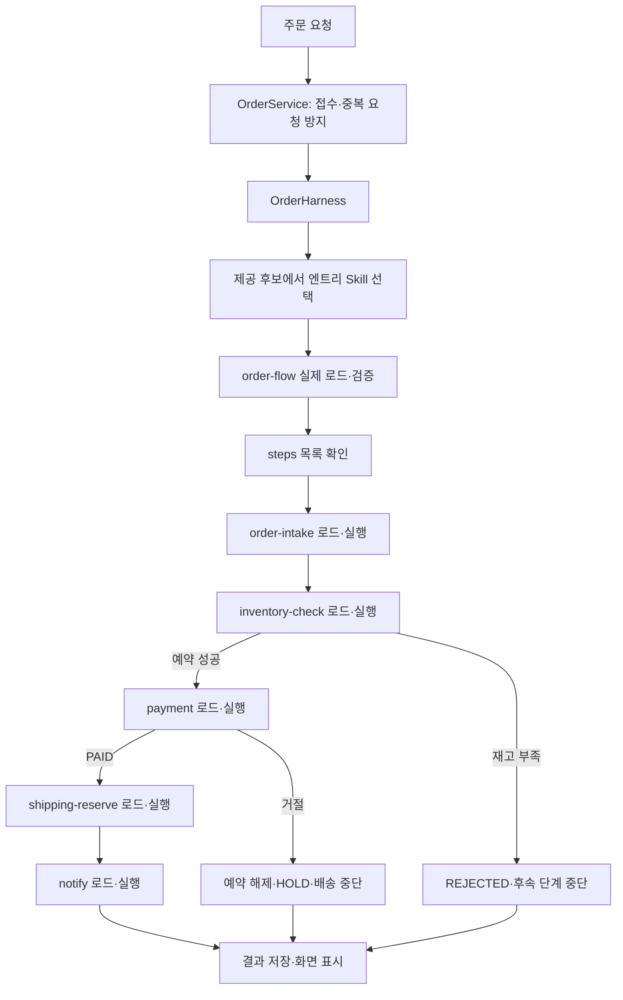

# 주문 Agent의 Skill 실행 흐름

> MVP 이후 구현: 현재 Skill·Harness·snapshot·trace 기능이 추가됐다. 최신 API·저장 방식·실패/트랜잭션·시연 후보·담당자 TODO는 [agent-evidence.md](agent-evidence.md)를 우선한다. 아래의 미구현/후속 표기는 작성 당시 단계 설명이다.

작성: 2026-10-20 / 상태: 후속 Agent 연결 설계, 미구현

## 1. 적용 단계

1차는 고정 절차의 주문 서비스 MVP다. 이 문서는 다음 단계에서 주문 Agent를 붙일 때 사용할 설계다. 1차에 이미 LLM·Harness가 구현됐다는 뜻은 아니다.

주문 API·Service·Repository·Entity 구조는 유지한다. `OrderProcessingService`의 실행 경계에 Harness를 연결하고 같은 업무 Mock 어댑터를 사용한다. SkillOps 진단 Agent·MCP·승인·PR은 다른 담당자 범위이며 이 문서에서 구현하지 않는다.

## 2. 핵심: flow가 순서를 선언하고 Harness가 실행



- `order-flow`는 실행 순서를 적은 지침이다. 파일 자체가 Java 함수를 실행하거나 다른 파일을 호출하지 않는다.
- Harness가 steps를 순회하며 각 단계 Skill 파일을 실제로 읽고 입력·출력을 연결한다.
- 같은 주문 Agent가 단계를 수행한다. 단계마다 별도 Agent·서버를 만들지 않는다.
- 모델이 매번 다음 Skill을 자유롭게 골라 steps를 무시하는 구조는 아니다. 엔트리 선택 뒤에는 flow가 선언한 단계 목록을 따른다.
- `order-flow`는 주로 순서를 선언하고, 업무 도구 요청은 단계 Skill 실행에서 수행한다. 중첩 flow·재귀 Skill 호출은 초기 Agent 범위에서 제외한다.

## 3. Skill 파일과 책임

후속 단계의 제안 위치는 `order-agent/skills/<skill_id>/SKILL.md`다. 기존 저장소 루트 `skills/`를 독립 앱이 몰래 공유하지 않는다. 구현 전에 A/C의 실제 로더·snapshot 소스와 연결 방식을 맞추고, 같은 Skill의 두 live 원본을 운영하지 않는다.

```text
order-agent/skills/
├── order-flow/SKILL.md
├── order-intake/SKILL.md
├── inventory-check/SKILL.md
├── payment/SKILL.md
├── shipping-reserve/SKILL.md
└── notify/SKILL.md
```

| Skill | 역할 | 주요 입력 | 주요 출력·결과 |
|---|---|---|---|
| order-flow | 단계와 순서 선언 | 주문 요청 | steps |
| order-intake | 접수 주문 검수·서버 계산값 확인 | 고객·상품·수량·결제·배송 입력 | order.id, order.total |
| inventory-check | 전체 상품 재고 확인·예약 | order.id, order.items | inventory.available, inventory.reserved |
| payment | 예약된 주문 결제 | order.id, order.total, order.payment_method, inventory.reserved | payment.id, payment.status |
| shipping-reserve | PAID 주문 배송 예약 | 주문·배송지·결제 결과 | shipping.id, shipping.eta |
| notify | 배송 예약된 주문 성공 알림 | 주문·고객·결제·배송 결과 | notify.sent, notify.channel |

이 표는 기존 Skill 이름·컨텍스트 키를 기준으로 한 역할 요약이다. inputs/outputs/depends_on 전체는 실제 적용할 버전의 manifest·계약에 고정한다. 기존 frontmatter에 없는 필드를 코드에서 조용히 추가하지 않는다.

### order-flow 예시

```yaml
---
name: order-flow
description: 캠핑용품 주문을 접수부터 배송 예약·알림까지 처리한다.
steps: [order-intake, inventory-check, payment, shipping-reserve, notify]
owner: 운영팀
version: 1
---
# 주문 처리 순서
단계는 위 순서대로 진행한다.
재고가 부족하면 결제와 배송을 진행하지 않는다.
결제가 거절되면 예약 재고를 해제하고 배송과 성공 알림을 중단한다.
```

### payment 예시

```yaml
---
name: payment
description: 재고가 예약된 주문의 결제를 처리한다.
inputs: [order.id, order.total, order.payment_method, inventory.reserved]
outputs: [payment.id, payment.status]
depends_on: [inventory-check]
owner: 재무팀
version: 1
---
# 결제 절차
1. 재고 예약이 완료됐는지 확인한다.
2. 주문번호·서버 계산 금액·결제 방식으로 결제 도구를 요청한다.
3. 승인되면 결제 참조와 PAID 상태를 기록한다.
4. 거절되면 거절 결과를 반환하고 정상 배송 절차를 중단한다.
```

예시 파일을 아직 생성하지 않았다. 거절 시 payment.id는 없을 수 있다. 업무 종료 분기에서는 승인 분기의 필수 출력이 없다는 이유만으로 정상 거절을 Skill 오류로 바꾸지 않는다. 성공·거절 분기를 명시적으로 구분해 검증한다.

## 4. 한 단계가 실제로 실행되는 방법

랜턴 2개 주문의 `inventory-check` 단계 예시:

1. Harness가 고정된 Skill 소스에서 inventory-check를 로드한다.
2. 이름·frontmatter·선언 입력·의존 단계 결과를 검증한다.
3. Skill 본문, 허용 업무 도구 명세, 해당 단계가 읽을 주문 컨텍스트를 모델에 전달한다.
4. 모델이 재고 예약 도구 호출을 요청한다.
5. Harness가 허용된 도구인지·주문 ID·상품·수량·실행 한도를 확인한다.
6. 재고 도구가 서버 재고를 확인하고 예약 성공/부족을 반환한다.
7. 실제 로드·호출·결과를 관찰 지점에서 기록한다.
8. 예약 성공 결과를 컨텍스트에 저장하고 payment 단계로 전달한다. 부족하면 주문을 REJECTED로 종료한다.

모델이 “예약 완료”라고 말한 것만으로 inventory.reserved=true로 바꾸지 않는다. 도구의 실제 결과를 사용한다. 모델의 JSON 출력·요약은 도구에서 확인된 값과 대조하며 결제·재고·최종 상태를 임의로 덮어쓸 수 없다.

order-intake는 OrderService가 이미 수행한 접수·가격 계산을 검수/조회하는 방식으로 연결한다. Skill을 실행한다고 새 주문을 만들거나 금액을 다시 모델이 계산하지 않는다.

## 5. 컨텍스트와 중단 규칙

컨텍스트는 이 실행에서 확인된 업무 결과 묶음이다. 예를 들어 서버가 확정한 order.total=60000, 실제 도구가 반환한 inventory.reserved=true가 다음 단계의 입력이 된다. 다음 모델 호출에는 해당 단계에 필요한 값만 제공한다.

- inputs가 없거나 depends_on이 충족되지 않으면 도구를 실행하기 전에 오류로 중단한다.
- flow의 steps가 존재하지 않는 Skill을 가리키거나 중복·순환·형식 문제가 있으면 거절한다. 초기 버전은 각 단계 1회 실행만 허용한다.
- 전체 flow의 정적 입력 공급 관계를 먼저 검사하고, 실행 시 실제 입력·출력을 다시 검사한다. 정적 오류라면 업무 부수 효과 발생 전에 차단한다.
- 재고 부족은 REJECTED다. payment/shipping/notify는 실행하지 않는다.
- 결제 거절은 HOLD다. 서버가 예약 해제를 확정하고 shipping/notify는 실행하지 않는다.
- 예약 해제는 업무 보상을 보장하기 위한 서버/Harness 정책이다. 모델이 해제를 요청하지 않았다고 예약을 방치하지 않으며, 실제 해제 실행을 별도로 기록한다.
- 결제 PAID·재고 예약 없이 배송하는 요청은 도구가 다시 검사해 거절한다. Skill 문서만으로 안전 조건을 해제할 수 없다.
- 시스템·모델·파일·도구 오류는 FAILED로 기록하고 후속 정상 업무 단계를 실행하지 않는다. 이미 발생한 결과를 숨기거나 자동 환불하지 않는다.
- 정상 미선택과 존재하지 않는 Skill 요청은 구분한다. 알 수 없는 이름의 원래 문자열을 보존하고 실제 로드는 거절한다.
- 단계 Skill frontmatter의 실행 규칙(rules)이 매치되면 도구를 부르지 않고 주문을 HOLD 또는 REJECTED로 끝낸다. 자세한 규칙은 9절을 따른다.

정해진 중단 분기는 누락된 단계를 모두 실행해야 한다는 의미가 아니다. 건너뛴 단계는 SKIPPED로 표시한다. 엔트리가 유효한 다른 Skill로 해석되면 선택 결과를 기록하고, 주문용 엔트리 정책에 맞지 않으면 업무 도구 실행 전에 차단한다.

## 6. 코드 경계

기존 controller/service/repository/entity는 유지하고 후속 단계에 harness 패키지를 추가한다.

```text
com.capstone4.orderagent/
├── service/
│   └── OrderProcessingService      # 고정 절차 또는 Harness 호출 조율
├── harness/
│   ├── OrderHarness                # flow 단계·종료·실행 한도 관리
│   ├── SkillLoader                 # 실제 파일 읽기·파싱·검증
│   ├── SkillSource                 # 고정된 후보·파일 상태 조회 계약
│   ├── SkillExecutor               # 한 단계 모델·도구 실행
│   ├── DecisionProvider            # 고정 응답/실제 모델 교체 경계
│   └── ExecutionContext            # 실행별 확인된 업무 결과
└── adapter/                        # 기존 업무 Mock 재사용
```

이는 책임을 보여주는 제안 클래스다. A 담당 Harness가 제공되면 그 구현을 연결하고 같은 로더·실행기를 중복 생성하지 않는다. 1차 고정 처리와 후속 Harness가 운영 중 각자 다른 업무 규칙을 유지하지 않도록 동일한 도구 검증·업무 상태 전이 코드를 사용한다.

현재 1차의 “Mock 전체를 한 DB 트랜잭션으로 처리” 방식을 실제 모델 모드까지 확장하지 않는다. 모델 응답을 기다리며 DB 잠금을 유지하지 않도록 업무 예약·호출·결과 확정을 짧은 트랜잭션으로 분리하고 각 도구의 멱등성을 보장해야 한다. 이는 Harness 연결 단계의 필수 작업이다.

## 7. 관찰·snapshot·평가 연결

Agent 실행부터는 실행별 execution_id, 후보 목록, 모델의 원래 선택 이름, 해석된 skill_id, 실제 로드, 도구 요청·결과·중단 이유를 기록한다. 상세 저장 계약은 장기 설계 및 C 저장소와 연결한다. 1차 order_processing_steps만으로 이 기술 trace가 구현됐다고 표시하지 않는다.

실행 전에 제공 후보와 관련 파일을 snapshot으로 고정하고, 선택과 단계 로드 모두 같은 고정 소스를 사용한다. 단계마다 수정 중인 live 파일을 다시 읽는 방식을 허용하지 않는다. snapshot 발행·저장 기능을 이번 문서 작업에서 구현하거나 C의 버전 저장소와 중복 구축하지 않는다.

일반 주문은 OrderService→Harness로 실행한다. Runner는 일반 주문 경로에 들어가지 않는다. 이후 Runner는 SingleAgentAdapter로 **같은 Harness**를 호출하고 Judge가 별도로 채점한다. expectation·정답 Skill·필수 도구 정답 목록을 모델 입력에 전달하지 않는다.

고정 응답으로 Skill 선택·로드·입출력·오류 분기를 검증한 뒤 실제 모델을 연결한다. 고정 응답은 자연어 본문의 정책 해석을 검증하지 못하므로 그 결과를 실제 모델 검증 완료로 표시하지 않는다.

## 8. 화면·API 적용 단계와 검증

1차 OrderResponse와 프론트는 현재 명세를 유지한다. Agent 연결 시 execution_id·선택 Skill·실제 단계별 Skill 정보를 별도 버전/확장 DTO로 맞추고 표시한다. 아직 없는 ID나 선택 결과를 화면에 가짜로 넣지 않는다. 단계 진행 표시는 1차처럼 응답+제한 polling이며 SSE는 별도 추가 범위다.

후속 검증 항목:

- order-flow.steps 순서대로 실제 단계 파일이 로드되는가.
- 첫 단계의 검수는 접수된 주문을 조회하며 주문·결제를 중복 생성하지 않는가.
- 각 단계의 도구 결과가 다음 단계 입력으로 전달되는가.
- 재고 부족·결제 거절 이후 배송·성공 알림이 호출되지 않는가.
- 선언만 있고 실제 도구 출력이 없을 때 성공으로 기록하지 않는가.
- 없는 Skill·누락 입력·잘못된 flow·timeout에서 안전하게 중단하는가.
- 결제 거절 시 모델 응답과 무관하게 재고가 해제되는가.
- 동일 snapshot을 일반 실행과 Runner에서 읽고 같은 Harness를 사용하는가.

현재는 설계만 반영했으며 Skill 파일·Harness·모델 연결·검증 코드는 아직 없다.

## 9. 실행 규칙(rules) (2026-10-26 구현)

본문에만 적은 정책("선입금 주문만 결제한다")은 fixed 모드에서 지켜지지 않고 openai 모드에서도 판정할 수 없다. 업무 담당자의 정책을 실행에 반영하려면 단계 Skill frontmatter에 선언형 실행 규칙 `rules`를 둔다. Harness가 모드와 무관하게 결정적으로 평가한다. 공용 계약은 `docs/plans/2026-10-26-behavior-edit-root-fix.md` 2.1·2.2절이다.

```yaml
---
name: payment
description: 예약된 주문 금액을 결제한다
inputs: [order.id, order.total, order.payment_method, inventory.reserved]
outputs: [payment.id, payment.status]
depends_on: [inventory-check]
rules:
  - when: "order.payment_method != 'prepaid'"
    then: hold            # hold | reject
    reason: PREPAID_ONLY  # [A-Z][A-Z0-9_]{0,39}
owner: 재무팀
version: 2
---
```

| 항목 | 규칙 |
|---|---|
| 위치 | 단계 Skill만. flow Skill(steps가 있는 Skill)에 규칙이 있으면 로드 때 `INVALID_SKILL_FORMAT` |
| 형식 | 생략·null·빈 목록은 규칙 없음. 목록 0~10개, 항목은 `when`·`then`·`reason` 세 키만 가진 Map. 어긋나면 로드 때 `INVALID_SKILL_FORMAT` |
| when | 조건 문법 v2 한 줄. 연산자 `==`, `!=`, `in`, `>`, `>=`, `<`, `<=`(앞뒤 공백 필수), 값 `'글자'`·`true`·`false`·`null`·숫자, `in` 뒤에만 `[..]` 목록. 크기 비교의 오른쪽은 숫자만, 실제 값이 숫자가 아니면 거짓. `true`/`false`는 1/0과 다르다 |
| 조건 키 | 값 이름은 그 Skill의 선언 input과 같거나 `input + '.'`으로 시작해야 한다(`order.shipping.country`는 `order.shipping` 선언으로 충분). 아니면 flow 정적 검사에서 `CONTRACT_VIOLATION`(details.reason `RULE_KEY_NOT_INPUT`, `rule_keys`)이며 업무 도구는 하나도 실행하지 않는다. 예약 키(`order.final_status`, `order.shipments`)도 선언하지 않으면 거부한다 |
| 값 찾기 | 평가 문맥은 그 단계의 선언 입력 Map이다. 이름이 그대로 있으면 그 값, 없으면 점으로 나눈 앞부분 가운데 문맥에 있는 가장 긴 것의 Map을 따라 내려간다. 끊기면 null이다 |
| 평가 시점 | 실행 중 입력 검증 직후, 결정 요청·도구 호출 전. 위에서부터 처음 참인 규칙 하나만 적용한다 |
| 결과 | hold는 HOLD, reject는 REJECTED. 주문 result_code는 reason이다. 결제 상태는 바꾸지 않는다. 결제 전이면 예약 재고를 해제하고(실패 보상과 같은 정책), 결제 뒤 단계의 규칙이면 승인된 결제와 예약이 그대로 남는다. 그 단계는 SKIPPED(결과 코드 reason), 업무 순서에서 뒤의 단계는 SKIPPED(UPSTREAM_REJECTED)이고 실행은 COMPLETED다 |

- 정책을 결제 전에 걸어야 결제가 남지 않는다. 예를 들어 해외 배송 금지는 shipping-reserve가 아니라 `order.shipping`을 입력으로 가진 order-intake에 건다.
- 조건에 쓰려는 값이 그 단계 입력에 없으면 inputs에 더한다. 앞 단계가 공급하지 않는 키를 더하면 기존 입력 공급 검사(missing_inputs)에 걸린다.
- 모델 결정 질문 JSON에는 rules를 싣지 않는다. 규칙은 Harness가 이미 평가했기 때문이다.
- trace 모양과 주문 단계 기록은 [agent-evidence.md](agent-evidence.md)의 "실행 규칙과 RULE_MATCHED" 절을 따른다.
